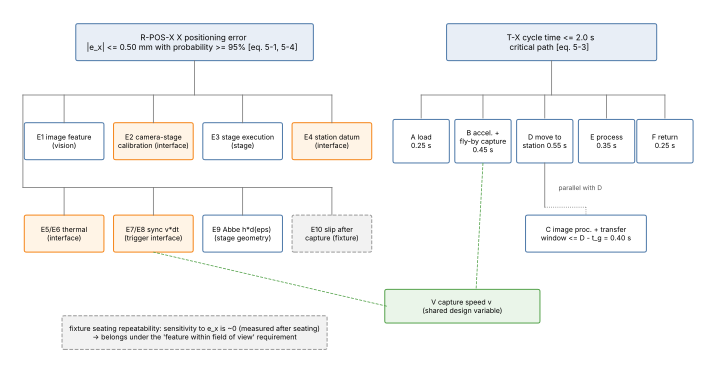
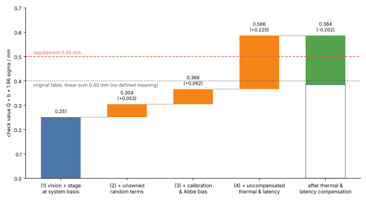

# 第5章 指标分解：从总体目标到部件责任

**所属主题：预算、分配与取舍｜版本：V0.1 研究正文初稿｜日期：2026-11-17**

## 5.1 各部件都达标，系统为什么不达标

视觉检测定位台的第一轮样机有一条总体要求（沿用[误差预算案例](../../examples/error-budget.md)，写法遵循第一章第1.10节）：

> **R-POS-X：** 在稳定工况 C-N（环境温度20±5 °C，工件经过相机时速度不超过0.20 m/s）下，工件被检特征点到达工位目标点时，X向定位误差绝对值不超过0.50 mm 的概率至少为95%。

工作方式如下：工件装在夹具上随平台沿X向运动；相机固定在机架上，平台带工件经过相机时触发拍照（飞拍），图像给出特征点相对相机的位置，加上拍照时刻锁存的光栅尺读数，得到特征点在平台坐标中的位置；随后平台把特征点送到工位目标点下方完成作业。

项目组按部件清单把0.50 mm分了下去：

| 部件 | 分到的指标 | 部件验收条件 | 验收结果 |
| --- | --- | --- | --- |
| 视觉（相机、镜头、算法） | “精度±0.15 mm” | 静止标定板，视场中心，20 °C，重复30次，按3σ计 | 3σ=0.12 mm，通过 |
| 运动平台 | “定位精度±0.15 mm” | 空载，20 °C，单向趋近，激光干涉仪在光栅尺测量线高度测量，按最大偏离计 | 0.11 mm，通过 |
| 夹具 | “重复定位±0.10 mm” | 同一工件重复装夹30次，按最大偏离计 | 0.07 mm，通过 |
| 余量 | 0.10 mm | — | — |
| 合计 | 0.15+0.15+0.10+0.10=0.50 mm | — | — |

三个部件都通过了各自的验收，而且分配表用的是线性相加，看起来偏保守。系统试验却不理想（教学数据）：在25 °C、0.20 m/s下连续定位50件，X向误差均值约+0.27 mm，样本标准差约0.16 mm，其中4件绝对值超过0.50 mm。50件中有8%超限，这组数据不能支持“至少95%”的要求；第5.5节的回算还会说明，按当时的设计，校核值本身已经超过要求。

部件验收和系统试验都没有做错。问题出在分解本身：

1. **树没有覆盖输出。** 系统误差中有几项不属于任何部件：相机与平台之间的标定残差、拍照时刻与光栅尺锁存时刻之差、机架与平台在不同温度下的相对漂移、工位目标点的建立误差。没有人对它们负责，也没有人测过它们。
2. **部件指标的口径和工况与系统不一致。** 视觉在静止、视场中心、20 °C下验收，系统需要的是0.20 m/s、全视场、20±5 °C下的值；平台按单向、空载验收，系统运行是双向、带载。
3. **组合关系没有定义。** “3σ”“最大偏离”和一个未说明含义的余量被直接相加，所得的0.50 mm既不是误差上界，也不是某个概率分位值。
4. **预算分给了不进入输出的项。** 飞拍是在装夹之后测量特征点，夹具的重复定位误差已被视觉测出，对X向定位误差几乎没有贡献；它分走了0.10 mm，真正的贡献项却没有分到。

本章回答四个问题：**总体要求怎样沿着输出的形成关系分解为部件和接口的责任；每一级用什么组合关系回算；怎样检查分解已经闭合；以及怎样把分解结果记入一本随项目更新的“误差与资源预算”活账。**

各章分工如下。要求的写法（对象、条件、阈值、判定方法）沿用第一章，本章不再展开。误差的口径区分在第6章，传播与相关在第7章，分配值怎样调整和优化在第8章，余量与预留量的管理在第9章。本章只使用这些概念的最小版本，足以搭起指标树和活账即可。本章所有数值均为明确假设下的教学计算，不代表具体产品。

## 5.2 基本术语

| 术语 | 本章采用的含义 | 使用时需要说明 |
| --- | --- | --- |
| 指标 metric | 用于表征要求是否满足的量，例如X向定位误差、单件节拍、平均功耗 | 对象、条件、口径与单位，见第一章第1.5节 |
| 指标树 metric tree | 由上级指标出发，沿输出的形成关系逐级展开的节点结构，每个父节点带一个组合关系 | 每个节点的定义、组合关系与持有方 |
| 功能分配 functional allocation | 确定哪一部分系统执行哪个功能 | 回答“由谁做” |
| 性能分配 performance allocation | 确定每个环节允许多大的误差、时间、资源或损失 | 回答“允许多少”，必须连同口径与工况 |
| 组合关系 roll-up relation | 由子节点的量计算父节点的量的关系 $y_P=g_P(y_1,\dots,y_n;c)$ | 关系的类型、依据及适用条件 |
| 贡献项 contributor | 在输出关系中对父节点有影响的一项输入或误差来源 | 原始量、单位及其灵敏度 |
| 派生要求 derived requirement | 由上级要求经分析导出、向部件或接口提出的要求 | 来源的上级条目与推导依据 |
| 持有方 owner | 对某个节点的数值和证据负责的角色 | 一个节点只有一个持有方；接口项同样需要 |
| 分配值 allocated value | 分给某个节点的允许量，是对持有方的约束 | 口径与工况须与组合关系一致 |
| 当前估计 current estimate | 依据现有分析、资料或试验，对该节点实际量的最好估计 | 依据类型：分析、资料、试验、暂定 |
| 余量 margin | 要求与当前估计之差，在本章按第5.7.3节计算 | 计算式、工况与持有方；主讲见第9章 |
| 预留量 reserve | 系统层保留、尚未分配给任何节点的量 | 由系统层持有；主讲见第9章 |

“分解”和“分配”是两个相关但不同的动作。**分解**决定树的结构：父节点由哪些子节点组成、用什么关系组合；**分配**给各节点填入允许值。本章重点是分解，并给出一组可回算的初始分配；如何依据灵敏度、能力、成本和可校准性调整分配，是第8章的内容。功能分配与性能分配的区分，以及由上级要求导出派生要求的做法，参照NASA系统工程手册的逻辑分解与技术要求定义过程。[R1][R2]

“回算”指由子节点的分配值或当前估计，按组合关系求出父节点的值，再与父节点的要求比较。能回算，是指标树成立的最低条件。

## 5.3 指标树按输出的形成关系展开

### 5.3.1 物料清单不是指标树

第5.1节的分解实际上是一棵物料清单树：系统由视觉、平台、夹具组成，于是指标也分给这三个部件。物料清单回答“系统由什么组成”；指标树回答“这个输出由什么决定”。两者之间是多对多的关系：

- 一个部件可以影响多个指标。平台既影响X向定位误差，也影响单件节拍和功耗。
- 一个指标可以包含不属于任何部件的贡献项。拍照与锁存的时间差发生在相机和平台的接口上；相机与平台之间的坐标关系由标定建立，归属同样不在某一个部件内部。
- 一个部件的某项性能对某个指标可能没有影响。夹具的重复定位误差在飞拍方案下被视觉测出，不进入X向定位误差。

按部件清单分指标，容易同时犯两种错误：漏掉接口上的贡献项，又把预算分给灵敏度接近零的项。因此，**指标树应当由输出的形成关系展开，而不是由组织结构或物料清单展开。**部件清单在树建成之后用来确定持有方。这与架构定义中“功能—物理”映射的思路一致：同一功能可由多个物理要素共同实现，同一要素也可承担多项功能。[R4]

### 5.3.2 先写输出关系，再画树

对误差类指标，输出关系就是误差方程。对定位台的飞拍方案，把X向定位误差 $e_x$ 定义为作业时特征点的实际X坐标减去工位目标点X坐标，二者表达在平台基准坐标系中（基准与坐标约定见第二章）。在小误差、单方向的条件下，可以写成各项之和：

$$
e_x\approx e_{\mathrm{img}}+e_{\mathrm{cal}}+e_{\mathrm{sync}}+e_{\mathrm{exe}}+e_{\mathrm{abbe}}+e_{\mathrm{th}}+e_{\mathrm{ref}}+e_{\mathrm{slip}}.
\tag{5-1}
$$

| 项 | 含义 | 原始量与折算关系 | 发生位置 |
| --- | --- | --- | --- |
| $e_{\mathrm{img}}$ | 图像特征定位误差，已折算到物方X向 | 像素误差乘以物方像素尺寸 | 视觉内部 |
| $e_{\mathrm{cal}}$ | 相机坐标到平台坐标的标定残差 | 标定模型的残余误差 | 视觉与平台之间 |
| $e_{\mathrm{sync}}$ | 曝光中点与光栅尺锁存时刻之差引起的位置误差 | $v\,\Delta t$，$v$为拍照时速度 | 触发与锁存接口 |
| $e_{\mathrm{exe}}$ | 平台把指令位移执行到位的误差 | 带载、双向的重复性与位移误差 | 平台内部 |
| $e_{\mathrm{abbe}}$ | 特征点高于光栅尺测量线，导轨俯仰引起的误差 | $h\,(\varepsilon_t-\varepsilon_c)$，$h$为高度差，$\varepsilon$为俯仰角 | 平台与工件几何 |
| $e_{\mathrm{th}}$ | 自标定以来，机架上的相机相对平台基准的热漂移 | $k_T\,\Delta T$，$k_T$为X向漂移系数 | 机架与平台之间 |
| $e_{\mathrm{ref}}$ | 工位目标点在平台坐标中的建立误差 | 基准对齐（含回零）的重复性 | 工位与平台之间 |
| $e_{\mathrm{slip}}$ | 拍照之后工件在夹具中的滑移 | 取决于加速度载荷与夹持力 | 夹具与工件之间 |

阿贝项中的 $\varepsilon_c$、$\varepsilon_t$ 分别是拍照位和工位处的导轨俯仰角。光栅尺读数在两个位置都含有 $h\varepsilon$ 的偏离，进入误差的是两者之差，这是阿贝原则的直接应用。[R8]

式（5-1）里没有夹具的装夹误差。装夹偏离多少，视觉就测出多少，平台再据此补偿；只有拍照之后的滑移 $e_{\mathrm{slip}}$ 才会进入。这正是第5.1节分解的第四个问题。夹具的重复定位能力并非无关，它决定特征点能否落在视场之内，应该挂到“视场覆盖”这条要求下面，而不是X向定位误差下面。

式（5-1）是一阶、可加的模型。各项是否可以直接相加、相关项怎样处理、非线性何时显著，属于第7章的内容。本章只用它回答一个结构性问题：**哪些项必须在树上有节点。**

第三列保留了各项的原始量，例如时间差、俯仰角、温度变化，以及把它们折算到 $e_x$ 的系数 $v$、$h$、$k_T$。这些系数就是灵敏度（定义见[系统灵敏度辨析](../concepts/sensitivity.md)，系统讲授在第7章）。原始量和灵敏度分开记录，速度或安装高度改变时，只需更新系数，不必重新推导每一项。

### 5.3.3 关系图：两个分支与一个共享变量

**图5-1** 视觉检测定位台的两项总体要求及其展开。左侧X向定位误差按式（5-1）展开，右侧单件节拍按第5.4.2节的关键路径展开。蓝框为部件内部的贡献项，橙框为接口上的贡献项，灰色虚线框为灵敏度接近零或尚未定量的项；拍照速度 $v$ 同时进入同步误差和运动时间，以绿色虚线标出。

图5-1有两点值得注意。

第一，接口项（标定、同步、热漂移、工位基准）在树上与部件项并列，各有持有方。第5.1节的分解中，它们没有节点，因此也没有人负责。

第二，严格说这不是一棵树。拍照速度 $v$ 越高，运动段越短，节拍越好；同时同步误差 $v\,\Delta t$ 和运动模糊越大，定位误差越差。同一个设计变量通过不同路径进入两个总体指标，图的结构是有向无环图而不是树。分解时应把这类共享变量单独列出，任何对它的修改都要在所有相关分支上回算。本章沿用“指标树”的叫法，但需要记住这一点。

## 5.4 组合关系与闭合条件

### 5.4.1 组合关系随指标类型改变

父节点与子节点之间的组合关系写为：

$$
y_P=g_P(y_1,y_2,\dots,y_n;\,c),
\tag{5-2}
$$

$c$ 是父节点要求适用的工况。$g_P$ 来自物理关系或运行逻辑，不由表格格式决定。常见类型如下：

| 类型 | 组合关系 | 典型指标 | 常见错误 |
| --- | --- | --- | --- |
| 可加型 | $y=\sum y_i$ | 质量、串行时间、平均功耗、能量 | 把并行或重叠的环节也相加 |
| 乘积型 | $y=\prod y_i$ | 串联效率、串联环节的通过概率、链路增益 | 各环节“都不低于90%”，就认为整体不低于90% |
| 瓶颈型 | $y=\min y_i$ | 流水线吞吐率、通道容量 | 提升非瓶颈环节后，期待整体改善 |
| 并发峰值型 | $y=\max_{m}\sum_{i\in m}y_i$ | 峰值功率、峰值电流、总线峰值负载 | 只按各自额定值或平均值相加，不按工作模式组合 |
| 关键路径型 | 有向图上的最长路径 | 节拍、端到端时延 | 不区分串行与并行，全部相加 |
| 误差型 | 依赖灵敏度、口径与相关性 | 定位误差、测量误差 | 把不同口径的数直接相加 |
| 动态型 | 由整个回路或动态系统决定 | 带宽、调节时间、超调、稳定裕度 | 按环节逐项分摊，见第5.8节 |

乘积型的一个算例：驱动器效率0.95、减速器0.90、带传动0.92，每一项都“不低于90%”，串联效率却只有 $0.95\times0.90\times0.92\approx0.787$。通过概率同理，第一章式（1-12）已经说明，单次满足概率0.99、独立重复100次全部满足的概率约为0.366。对乘积型指标取对数，相对变化近似相加：$\delta y/y\approx\sum\delta y_i/y_i$。分配时按相对量处理更方便。

峰值类的资源账本（峰值、平均、占空比与模式组合）在第9章主讲，这里只要求组合关系的类型正确。

### 5.4.2 节拍按关键路径组合

定位台的单件节拍要求为：

> **R-TIM-X：** 在C-N工况下，从上一件卸料完成到本件卸料完成的时间不超过2.0 s。

一个工作循环包含六个环节（教学假设）：

| 环节 | 内容 | 时间 / s |
| --- | --- | --- |
| A | 上料、装夹并确认就绪 | 0.25 |
| B | 加速，以0.20 m/s经过相机并完成拍照 | 0.45 |
| C | 图像处理0.25 s与结果传输0.02 s，自拍照时刻起计 | 0.27 |
| D | 从拍照位移动到工位目标点并停稳 | 0.55 |
| E | 工位作业 | 0.35 |
| F | 返回与卸料 | 0.25 |

平台不必等待图像结果才开始运动：拍照完成后立即按名义目标出发，图像结果到达后再修正终点。修正必须在D结束前至少 $t_g=0.15$ s到达，否则平台需要等待。于是C与D并行，节拍由关键路径决定：[R7]

$$
T=A+B+\max\left(D,\ C+t_g\right)+E+F.
\tag{5-3}
$$

代入数值，$\max(0.55,\ 0.42)=0.55$ s，$T=0.25+0.45+0.55+0.35+0.25=1.85$ s，距2.0 s还有0.15 s。若把六个环节简单相加，得到2.12 s，会误判为不满足要求。

式（5-3）还给C导出了一条不同类型的派生要求：只要 $C\le D-t_g=0.40$ s，C对节拍没有影响；超过0.40 s后，每多1 ms，节拍增加1 ms。C的分配值因此是一个**时间窗**，而不是节拍中的一个加数。当前估计0.27 s，距窗口上限还有0.13 s。这0.13 s只属于C，不能挪给其他环节使用，因为它不在关键路径上。

### 5.4.3 误差型：先统一口径，再谈相加

误差型的组合依赖三件事：每一项的统计口径（有界偏差、标准差还是分位值），每一项到输出的灵敏度，以及各项之间是否相关。这三件事分别是第6章和第7章的主题。本章只用[误差预算案例](../../examples/error-budget.md)已经采用的最小规则来回算：有界的残余偏差按上界线性相加，记为 $b$；随机项在独立、近似正态、已折算到 $e_x$ 的假设下按方差相加，合成标准差记为 $\sigma$[R6]；然后用

$$
Q=b+1.96\,\sigma
\tag{5-4}
$$

作为与“绝对值不超过0.50 mm的概率至少为95%”对照的保守校核值。这个规则在什么条件下成立、何时偏乐观或偏保守，见[误差统计口径](../concepts/error-statistics.md)及第6章、第7章。本章使用它，只是为了让指标树能够回算。

对照式（5-4）可以看出第5.1节分配表的问题。视觉的“3σ”、平台和夹具的“最大偏离”各有含义，余量的含义没有说明；把它们相加得到的“0.50 mm”，在式（5-4）中找不到对应的量。**不同口径的数不能直接相加。**相加之前，先把每一项换算成组合关系需要的口径。

### 5.4.4 分解闭合的四个条件

设父节点P的要求为 $g_P$ 在工况集合 $\mathcal C_P$ 上满足某个阈值。它的分解称为**闭合**，当且仅当以下四个条件同时成立：

1. **覆盖。** 输出关系中的每一项都有对应节点。决定省略的项，写明理由和量级上界。
2. **口径与工况一致。** 每个子节点的指标定义（对象、方向、基准）、统计口径和工况集合，与 $g_P$ 所需一致；子节点的工况集合应覆盖 $\mathcal C_P$ 中与它有关的部分。
3. **可回算。** 用子节点的分配值按 $g_P$ 计算出的父节点值满足要求；与要求之间的差额作为预留量明确记录。
4. **单一持有。** 每个叶节点和每个接口项有且只有一个持有方；共享来源只在一处计入，其他节点引用它。

第5.1节的分解四条全部不满足：漏项违反第1条，验收口径和工况违反第2条，口径混加使第3条无法检查，接口项无人负责违反第4条。部件验收全部通过，并不能弥补这些缺陷。

一个实用的检查方法是双向追踪：自上而下，从父节点的输出关系出发，确认每一项都落到某个节点；自下而上，从每个叶节点出发，确认它的数值能够沿组合关系一路回算到总体要求。前一个方向发现漏项，后一个方向发现口径不一致和无效分配。

## 5.5 贯穿算例：定位台的误差回算与差额分解

### 5.5.1 当前依据

| 项目 | 数值或定义 | 依据及属性 |
| --- | --- | --- |
| 总体要求 | R-POS-X：C-N下 $\lvert e_x\rvert\le0.50$ mm 的概率不低于95% | 第5.1节 |
| 拍照速度 | $v\le0.20$ m/s，按0.20 m/s校核 | 要求给定的工况上限 |
| 视觉随机误差 | 静止、视场中心 $\sigma=0.04$ mm；0.20 m/s、全视场估计 $\sigma=0.08$ mm | 前者为部件验收；后者计入运动模糊与视场边缘畸变残差，为分析估计 |
| 平台执行重复性 | 单向空载最大偏离0.11 mm；带载双向估计 $\sigma=0.10$ mm | 前者为部件验收；后者为供应商带载双向数据的折算 |
| 工位目标点建立 | 重复性 $\sigma=0.06$ mm | 分析估计 |
| 温度短时随机变化 | 补偿模型不能跟踪的短时变化，$\sigma=0.05$ mm | 暂定 |
| 同步抖动 | $\sigma_t=0.20$ ms，$\sigma=v\,\sigma_t=0.04$ mm | 触发链路分析 |
| 相机—平台标定残差 | 绝对值上界0.05 mm | 标定报告，暂定 |
| 阿贝项 | $h=120$ mm，全行程俯仰±50 μrad，$\lvert\varepsilon_t-\varepsilon_c\rvert\le100$ μrad，上界 $120\times100\times10^{-6}=0.012$ mm | 导轨资料与工件几何 |
| 热漂移 | 标定在20 °C进行，$k_T=0.024$ mm/K，$\lvert\Delta T\rvert\le5$ K 时上界0.12 mm | 一次升温试验，教学假设 |
| 固定时延 | 曝光中点滞后于锁存0.5 ms，未补偿时偏差 $0.20\ \mathrm{mm/ms}\times0.5\ \mathrm{ms}=0.10$ mm | 触发链路分析；只在+X方向拍照，符号固定 |
| 拍照后滑移 | 尚未评估，暂按0处理 | 待验证项 |

表中“原始量×灵敏度”的写法，如 $0.20\ \mathrm{mm/ms}\times0.5\ \mathrm{ms}$，就是第5.3.2节建议的记录方式。

### 5.5.2 按系统口径重写部件指标

第一步是把部件验收的结果换成式（5-4）需要的口径和C-N的工况：

| 部件 | 验收口径与工况 | 系统需要的口径与工况 | 换算后 |
| --- | --- | --- | --- |
| 视觉 | 3σ，静止，视场中心，20 °C | σ，0.20 m/s，全视场，20±5 °C | σ由0.04 mm变为0.08 mm |
| 平台 | 最大偏离，单向，空载，20 °C | σ，双向，带载，20±5 °C；单向与双向定位重复性的区分见[R9] | σ=0.10 mm |
| 夹具 | 最大偏离 | 对 $e_x$ 的灵敏度接近0 | 移出本分支，挂到视场覆盖要求下 |

视觉的验收数字（3σ=0.12 mm）低于分配的0.15 mm；但换到系统口径后，它的标准差翻了一倍。部件验收“通过”，只说明部件在验收条件下满足了验收口径，不说明它在系统工况下提供了系统需要的量。**派生要求必须连同口径和工况一起下达，部件验收也必须按这个口径和工况进行。**

### 5.5.3 回算与差额分解

按式（5-4），从只含视觉和平台两项开始，逐步把式（5-1）中的项补齐：

| 步骤 | $b$ / mm | $\sigma$ / mm | 校核值 $Q$ / mm | 增量 / mm | 差额性质 |
| --- | --- | --- | --- | --- | --- |
| 原分配表的线性和（仅作对照） | — | — | 0.40 | — | 口径混加，无确定含义 |
| ① 视觉、平台按系统口径，夹具移出 | 0 | 0.128 | 0.251 | — | 口径与工况修正 |
| ② 补上无持有方的随机项：工位基准0.06、温度短时随机变化0.05、同步抖动0.04 | 0 | 0.155 | 0.304 | +0.053 | 漏项（接口随机项） |
| ③ 补上标定残差0.05、阿贝项0.012 | 0.062 | 0.155 | 0.366 | +0.062 | 漏项（有界偏差） |
| ④ 补上未补偿的热漂移0.12、固定时延0.10 | 0.282 | 0.155 | 0.586 | +0.220 | 漏项（可补偿的系统性偏差） |

其中第①步 $\sigma=\sqrt{0.08^2+0.10^2}\approx0.128$ mm；第②步 $\sigma=\sqrt{0.06^2+0.08^2+0.10^2+0.05^2+0.04^2}\approx0.155$ mm。

**图5-2** 按式（5-4）及上表数值计算。蓝色为按系统口径重估的两项部件贡献，橙色为原分解遗漏的项，绿色为补偿热漂移与固定时延后的减少量，空心框为补偿后的校核值0.384 mm（见第5.5.5节）；虚线为0.50 mm要求，点线为原分配表的线性和0.40 mm。

两个结论值得写下来。

- 口径修正本身（第①步）没有使系统超限，0.251 mm远低于0.50 mm。**超出的部分全部来自树外的项**：第②—④步合计+0.335 mm，其中最大的两项——热漂移和固定时延——都发生在接口上。
- 漏项中贡献最大的两项恰恰最容易处理：热漂移可以用温度补偿，固定时延可以测量后扣除。它们之所以造成不达标，是因为没有出现在树上，所以没有人去补偿。

### 5.5.4 与系统试验对照

把第④步的模型与第5.1节的系统试验对照。在25 °C、0.20 m/s下，热漂移约为 $+0.024\times5=+0.12$ mm，固定时延为+0.10 mm，两项符号都固定；标定残差和阿贝项在各自上界内取某个未知值。因此模型预测的误差均值在 $0.22\pm0.062$ mm 范围内，即0.158—0.282 mm；标准差约0.155 mm。

试验得到均值+0.27 mm，落在预测范围内；标准差0.16 mm，与预测的0.155 mm接近。按均值0.27 mm、标准差0.16 mm的正态近似，单件超出±0.50 mm的概率约7.5%，50件中期望约3.8件超限，与观测到的4件一致。

原分配表的结论是“误差不超过0.40 mm”，既解释不了+0.27 mm的均值，也解释不了超限件。补齐后的树能够同时解释均值、离散程度和超限比例。这是“算一次、测一次、对照一次”的完整过程：**计算给出预测，试验给出观测，对照检查预测是否解释了观测。**对照一致，不等于模型已被确认（模型确认在第18章主讲），但它说明补齐后的树抓住了主要贡献项。

50件试验的统计强度、均值与标准差的区间估计，在第6章和第24章讨论。本节只用它们检查模型与现象是否相容。

### 5.5.5 修改设计后的回算

依据差额分解，项目组做了两项修改：

- **温度补偿：** 在机架上增设温度测点，按 $k_T$ 补偿相机位置。补偿模型的残差系数不超过0.003 mm/K，残余热漂移上界为 $0.003\times5=0.015$ mm。
- **时延补偿：** 测量曝光中点与锁存时刻之差，在软件中扣除。时延测量的不确定范围为±0.015 ms，残余偏差上界为 $0.20\times0.015=0.003$ mm。

残余偏差合计 $b=0.05+0.012+0.015+0.003=0.080$ mm，随机项不变，

$$
Q=0.080+1.96\times0.155\approx0.384\ \mathrm{mm}<0.50\ \mathrm{mm}.
$$

这正是[误差预算案例](../../examples/error-budget.md)采用的候选方案。案例中把各项随机误差视为独立；若视觉与平台的误差因共享温度而相关，校核值会增大，第7章将以此为例比较独立、相关和有界三种处理。

### 5.5.6 一个设计变量同时进入两个分支

若为了缩短节拍，把拍照速度提高到0.30 m/s：同步抖动折算为 $0.30\ \mathrm{mm/ms}\times0.20\ \mathrm{ms}=0.06$ mm，合成标准差变为 $\sqrt{0.0241-0.04^2+0.06^2}\approx0.162$ mm；固定时延补偿的残余偏差随速度增大到 $0.30\times0.015=0.0045$ mm，$b$ 变为0.0815 mm。两项合计，校核值由0.384 mm增至约0.398 mm。这还没有计入运动模糊使视觉随机误差增大的部分，该部分须由视觉持有方重新评估。

节拍一侧，B段能缩短多少，取决于加减速能力与拍照位的位置，需要用第一章式（1-20）一类的运动关系重算。**共享变量的修改必须在所有相关分支上同时回算，**否则一个分支的改进会悄悄消耗另一个分支的余量。

### 5.5.7 这组计算支持什么决策

| 结论 | 依据 | 能支持的动作 |
| --- | --- | --- |
| 原分解不闭合，部件验收通过不代表系统达标 | 第5.4.4节四个条件；第5.5.3节差额分解 | 废止原分配表；按图5-1重建指标树 |
| 超限主要来自接口上的系统性偏差 | 差额分解第④步，+0.220 mm | 优先实施温度补偿与时延补偿 |
| 补齐后的模型与系统试验相容 | 第5.5.4节对照 | 以补齐后的树为预算基础，进入第6—8章 |
| 补偿后的候选方案校核值约0.384 mm | 式（5-4），独立假设 | 作为候选分配；相关性、口径和分配的合理性待第6—8章检查 |
| 拍照速度不能单独为节拍调整 | 第5.5.6节 | 把 $v$ 列为共享设计变量，修改时两个分支同时回算 |
| 拍照后滑移、视觉随机误差的实际值尚无证据 | 第5.5.1节 | 列入待验证项 |

## 5.6 本章的最小产物：指标分解与回算表

### 5.6.1 表中记录什么

指标分解与回算表把指标树写成可审查、可回算的形式。每一行是一个节点，至少包含：

- **编号与父节点：** 节点在树中的位置；共享变量注明它进入的所有父节点。
- **指标定义：** 对象、方向、基准、单位；接口项写明是哪两个部件之间的哪种关系。
- **工况与口径：** 适用的工况集合，统计口径（有界偏差、标准差、分位值、最大值）或资源口径（峰值、平均、占空比）。
- **组合关系：** 本节点作为父节点时，用什么关系组合子节点；作为子节点时，它进入父节点的灵敏度。
- **持有方：** 唯一的责任角色。
- **分配值与依据：** 分配值及其来源（继承、推导、经验、暂定）。

表的末尾给出每个父节点的回算结果，以及与要求的差额。

### 5.6.2 定位台的填写示例

| 编号 | 父节点 | 指标定义 | 工况与口径 | 组合关系或灵敏度 | 持有方 | 分配值 |
| --- | --- | --- | --- | --- | --- | --- |
| R-POS-X | — | 特征点到达工位时的X向定位误差 | C-N；$\lvert e_x\rvert\le0.50$ mm 的概率≥95% | 式（5-1）、（5-4） | 系统 | 0.50 mm（要求） |
| E1 | R-POS-X | 图像特征定位随机误差，物方X向 | 0.20 m/s，全视场，20±5 °C；σ | 1 | 视觉 | 0.08 mm |
| E2 | R-POS-X | 相机—平台标定残差 | C-N全行程；有界偏差 | 1 | 系统集成 | 0.05 mm |
| E3 | R-POS-X | 平台执行重复性 | 带载，双向，拍照位至工位；σ | 1 | 平台 | 0.10 mm |
| E4 | R-POS-X | 工位目标点建立重复性 | 每次回零后；σ | 1 | 系统集成 | 0.06 mm |
| E5 | R-POS-X | 温度短时随机变化（慢变漂移另列E6） | 20±5 °C；σ | 1 | 系统集成 | 0.05 mm |
| E6 | R-POS-X | 温度补偿后的残余热漂移 | $\lvert\Delta T\rvert\le5$ K；有界偏差 | $\lvert\Delta T\rvert\times$残差系数 | 系统集成 | 0.015 mm |
| E7 | R-POS-X | 同步抖动 | $v=0.20$ m/s；σ | $v$=0.20 mm/ms | 系统集成（触发链路） | 0.04 mm（0.20 ms） |
| E8 | R-POS-X | 时延补偿残差 | $v=0.20$ m/s；有界偏差 | $v$=0.20 mm/ms | 系统集成（触发链路） | 0.003 mm（0.015 ms） |
| E9 | R-POS-X | 阿贝项 | 全行程；有界偏差 | $h$=120 mm | 平台 | 0.012 mm（100 μrad） |
| E10 | R-POS-X | 拍照后工件滑移 | 加速度不超过平台上限；有界偏差 | 1 | 夹具 | 0（待验证） |
| T-X | — | 单件节拍 | C-N；最大值 | 式（5-3） | 系统 | 2.0 s（要求） |
| T1—T6 | T-X | A—F各段时间，其中C为时间窗 | C-N；最大值 | 关键路径 | 各段持有方 | 依次为0.25、0.45、≤0.40、0.55、0.35、0.25 s |
| V | E7、E8、T-X | 拍照速度（共享设计变量） | C-N | 进入同步误差与B段时间 | 系统 | 0.20 m/s |

回算：误差分支 $b=0.080$ mm、$\sigma=0.155$ mm、$Q=0.384$ mm，与要求差0.116 mm；节拍分支 $T=1.85$ s，与要求差0.15 s。夹具重复定位不在本表中，而是挂在视场覆盖要求下。

配套[误差与资源预算模板](../../templates/error-and-resource-budget.md)提供空白工作件，其第一部分即为本表。

## 5.7 建立“误差与资源预算”活账

### 5.7.1 活账与一次性预算表的区别

第5.6节的表记录的是树的结构和分配值，适合在评审时一次性审查。但预算的数值会随项目推进而变化：部件选型后有了资料，样机做出来后有了实测，第6—8章还会修正口径、加入相关性、调整分配。若每次变化都另起一张表，旧表中的假设就会悄悄留在其他文件里。

系统工程中常把关键指标作为技术性能度量（technical performance measure，TPM），随项目阶段跟踪其当前估计与余量。[R3][R5] 本书把这一做法落实为一本**误差与资源预算活账**，以主线案例为对象：在本章建立，此后在第6—9、11、12、15、18、22章逐章更新，在第24章以实测值回代后收口。它与第一章建立的“需求—验证矩阵”和“配置与证据索引”、第二章建立的“接口与状态表”一起，构成贯穿全书的四本活账。

### 5.7.2 活账的字段

每一行对应指标树的一个节点。核心字段八项：

| 字段 | 记录内容 | 本章的填写要求 |
| --- | --- | --- |
| 来源 | 贡献项是什么，发生在哪个部件或接口，原始量是什么 | 与式（5-1）这类输出关系逐项对应 |
| 口径 | 有界偏差、标准差、分位值或最大值；资源的峰值、平均或时间窗；适用工况 | 与父节点的组合关系所需一致 |
| 灵敏度 | 原始量到父节点的折算系数，连同单位与工作点 | 本章用几何或运动学关系给出；系统方法见第7章 |
| 相关性 | 是否与其他行共享温度、基准、时间源、电源或原始数据 | 本章只标记共享来源；量化见第7章 |
| 分配值 | 分给本行的允许量 | 第5.6节的值；调整见第8章 |
| 当前估计 | 当前最好的估计值，及依据类型（分析、资料、试验、暂定） | 依据类型必填 |
| 实测值 | 在规定工况与口径下的实测结果，及证据入口 | 尚无实测时写“待测”和计划章节 |
| 余量与预留量 | 本行的余量；父节点行另记预留量 | 按第5.7.3节计算，写明持有方 |

此外还需要几项管理字段：编号、持有方、状态（候选、经论证、已基线化，见第一章第1.9.3节）、未闭合原因及计划解决的章节。

### 5.7.3 余量与预留量的最小约定

余量与预留量在第9章主讲。为使活账从一开始就把两者分开记录，本章先采用以下约定。对父节点，记要求为 $Q_{\mathrm{req}}$，按组合关系由各子节点**分配值**回算得到 $Q_{\mathrm{alloc}}$，由各子节点**当前估计**回算得到 $Q_{\mathrm{est}}$，则：

$$
R=Q_{\mathrm{req}}-Q_{\mathrm{alloc}},
\qquad
M=Q_{\mathrm{req}}-Q_{\mathrm{est}}.
\tag{5-5}
$$

$R$ 为预留量，由系统层持有，尚未分给任何子节点；$M$ 为余量，表示按当前估计还剩多少空间。对叶节点，余量为分配值减去当前估计。

使用时注意三点：

- **两者含义不同。** 预留量是管理上的决定，只有经过记录的决定才能释放；余量是估计的结果，随证据变化。
- **误差型节点的余量不能逐行相加。** 随机项按方差组合，叶节点各自的余量（例如标准差之差）加起来并不等于父节点的余量。父节点的余量必须用组合关系重新回算。
- **同一份余量只能被一方使用。** 若两个子节点都认为“上面还有余量”，并各自据此放宽，父节点的余量就被重复消耗了。

[误差预算案例](../../examples/error-budget.md)把0.50 mm与0.384 mm之差称为“性能余量”，是因为案例把候选分配当作当前估计来校核。活账建立后，分配值和当前估计分开记录，这0.116 mm是预留量；余量由当前估计另行回算。

### 5.7.4 定位台活账初版

误差分支（单位 mm，随机项为标准差，偏差项为绝对值上界）：

| 编号 | 来源 | 口径 | 灵敏度 | 相关性 | 分配值 | 当前估计（依据） | 实测值 | 余量 |
| --- | --- | --- | --- | --- | --- | --- | --- | --- |
| E1 | 图像特征定位，视觉内部 | σ，0.20 m/s，全视场 | 1 | 与E3、E5共享温度 | 0.08 | 0.08（分析） | 待测，第15章 | 0 |
| E2 | 相机—平台标定，接口 | 有界偏差 | 1 | 与E4共享标定时的平台基准 | 0.05 | 0.05（标定报告，暂定） | 待测，第15章 | 0 |
| E3 | 平台执行，平台内部 | σ，带载双向 | 1 | 与E1、E5共享温度 | 0.10 | 0.09（供应商资料） | 待测，第15章 | 0.01 |
| E4 | 工位目标点建立，接口 | σ | 1 | 与E2共享平台基准 | 0.06 | 0.05（分析） | 待测 | 0.01 |
| E5 | 温度短时随机变化，接口 | σ，20±5 °C | 1 | 与E1、E3共享温度 | 0.05 | 0.05（暂定） | 待测，第18章 | 0 |
| E6 | 残余热漂移，接口 | 有界偏差，原始量 $\lvert\Delta T\rvert\le5$ K | 补偿残差系数≤0.003 mm/K | 与E5同源 | 0.015 | 0.015（分析） | 待测，第18章 | 0 |
| E7 | 同步抖动，触发链路 | σ，原始量0.20 ms | 0.20 mm/ms | 与E8同一链路 | 0.04 | 0.04（链路分析） | 待测，第11章 | 0 |
| E8 | 时延补偿残差，触发链路 | 有界偏差，原始量0.015 ms | 0.20 mm/ms | 与E7同一链路 | 0.003 | 0.003（分析） | 待测，第11章 | 0 |
| E9 | 阿贝项，平台与工件几何 | 有界偏差，原始量100 μrad | 120 mm | — | 0.012 | 0.012（导轨资料） | 待测 | 0 |
| E10 | 拍照后滑移，夹具 | 有界偏差 | 1 | 与平台加速度有关 | 0 | 未评估 | 待测，第12章 | 未知 |
| 合计 | — | $b$；$\sigma$；$Q$ | — | 按独立假设合成 | 0.080；0.155；0.384 | 0.080；0.145；0.365 | — | $R=0.116$；$M=0.135$ |

合计行按式（5-4）计算：当前估计的 $\sigma=\sqrt{0.08^2+0.05^2+0.09^2+0.05^2+0.04^2}\approx0.145$ mm，$Q_{\mathrm{est}}=0.080+1.96\times0.145\approx0.365$ mm。预留量 $R=0.50-0.384=0.116$ mm，余量 $M=0.50-0.365=0.135$ mm，均由系统层持有。E10尚未评估，所以 $M$ 是“在E10为零的前提下”的余量，这一前提必须随数值一起写出。

节拍分支（单位 s）：

| 编号 | 来源 | 口径 | 灵敏度 | 相关性 | 分配值 | 当前估计（依据） | 实测值 | 余量 |
| --- | --- | --- | --- | --- | --- | --- | --- | --- |
| T1（A） | 上料与就绪 | 最大值 | 1（关键路径上） | — | 0.25 | 0.25（节拍分析） | 待测 | 0 |
| T2（B） | 加速与飞拍 | 最大值 | 1 | 受V影响 | 0.45 | 0.45（运动分析） | 待测 | 0 |
| T3（C） | 图像处理与传输 | 时间窗，最大值 | 0（≤0.40 s时）；1（超出部分） | 与视觉算法版本有关 | ≤0.40 | 0.27（台架计时） | 待测，第11章 | 0.13（仅限C） |
| T4（D） | 移动到工位并停稳 | 最大值 | 1 | 受平台带载能力影响 | 0.55 | 0.55（运动分析） | 待测 | 0 |
| T5（E） | 工位作业 | 最大值 | 1 | — | 0.35 | 0.35（工艺资料） | 待测 | 0 |
| T6（F） | 返回与卸料 | 最大值 | 1 | — | 0.25 | 0.25（节拍分析） | 待测 | 0 |
| 合计 | — | 关键路径，式（5-3） | — | — | 1.85 | 1.85 | — | $R=0.15$；$M=0.15$ |

节拍分支的预留量与余量目前相等，因为各段的分配值就是按当时的估计给出的；随着实测数据进入，两者会分开。

### 5.7.5 闭合检查

每章更新活账之后，做一次闭合检查。本章建立活账时的检查结果如下：

| 检查项 | 结果 | 说明 |
| --- | --- | --- |
| 每项新增输入都有来源 | 是 | 每行的当前估计都标了依据类型；E1、E2、E5为暂定或分析，状态为“候选” |
| 每项输出都有去向 | 是 | E1—E10回算到R-POS-X，T1—T6回算到T-X；共享变量V同时指向两者 |
| 关键假设能够校核 | 部分 | 独立假设、正态近似可在第6、7章校核；E10无法在本章校核 |
| 超出约束时有可解释的处理 | 是 | 原分解超限的原因已分解到项，并以补偿措施处理 |

未闭合项必须写明原因和计划解决的章节：

| 未闭合项 | 原因 | 计划 |
| --- | --- | --- |
| 各项口径是否换算正确，有限样本下的区间 | 本章只用了最小规则 | 第6章 |
| E1、E3、E5之间的相关性；E2与E4的共享基准 | 本章只标记了共享来源 | 第7章 |
| 分配值是否合理，先改哪一项 | 当前分配是候选方案 | 第8章 |
| 预留量的持有与释放规则；节拍和功耗等资源 | 本章只作最小约定 | 第9章 |
| E7、E8及T3的实际时间特性 | 尚无时间链路实测 | 第11章 |
| E10拍照后滑移 | 加速度载荷与夹持力尚未分析 | 第12章 |
| 温度补偿模型（$k_T$ 及残差系数）的参数辨识与模型确认 | 只有一次升温试验 | 第18章 |
| E1—E3的实测值 | 测量链与参考设备未定义 | 第15章 |
| 全部行的实测回代 | 需要系统试验与统计判定 | 第24章 |

### 5.7.6 同步更新需求—验证矩阵

分解产生的派生要求，需要同时进入第一章建立的需求—验证矩阵，否则它们只有分配值而没有验证计划。本章新增的条目如下：

| 编号 | 要求 | 条件 | 阈值 | 验证方法 | 证据类型 | 样本量估计 | 状态 |
| --- | --- | --- | --- | --- | --- | --- | --- |
| R-POS-X | 系统X向定位误差 | C-N | $\lvert e_x\rvert\le0.50$ mm 的概率≥95% | 试验 | 系统试验数据与统计判定 | 按第一章式（1-13），以95%置信度证明通过概率不低于95%，零失效验证每个工况约需59次 | 候选 |
| R-VIS-001 | 视觉特征定位随机误差 | 0.20 m/s，全视场，20±5 °C | σ≤0.08 mm | 试验 | 部件试验，按系统口径 | 第6章按区间宽度确定 | 候选 |
| R-STG-001 | 平台执行重复性 | 带载，双向，拍照位至工位 | σ≤0.10 mm | 试验 | 部件试验，按系统口径 | 第6章确定 | 候选 |
| R-INT-001 | 相机—平台标定残差 | C-N全行程 | ≤0.05 mm | 分析与试验 | 标定报告及独立复核 | 待定 | 候选 |
| R-INT-002 | 拍照与锁存的同步 | $v=0.20$ m/s | 抖动σ≤0.20 ms；补偿后固定时延残差≤0.015 ms | 试验 | 时间链路测量 | 第11章确定 | 候选 |
| R-INT-003 | 温度补偿 | $\lvert\Delta T\rvert\le5$ K | 残差系数≤0.003 mm/K | 试验 | 升温试验 | 待定 | 候选 |
| R-TIM-002 | 图像处理与传输时间 | C-N | 自拍照时刻起≤0.40 s | 试验 | 计时日志 | 待定 | 候选 |

R-VIS-001与R-STG-001的条件栏写的是系统口径，而不是部件资料上的条件。第5.1节的教训正是：部件按自己的条件验收通过，系统并不因此达标。

## 5.8 失效边界：什么时候不能按树分解

指标树把总体要求拆成可以分别负责、分别验证的部分。这一做法依赖若干前提；前提不成立时，树的回算结果会误导决策。

| 情形 | 表现 | 处理 | 主讲章 |
| --- | --- | --- | --- |
| 动态与闭环指标 | 带宽、调节时间、超调、稳定裕度由整个回路决定，不能按环节加减 | 不分配这些量本身，改为分配能够组合的派生量，例如回路中各环节的时延，再用回路模型回算 | 第11、12章 |
| 强耦合与共享变量 | 一个设计变量进入多个分支，或一个部件的状态改变另一个部件的参数 | 共享变量单列；修改时所有相关分支同时回算；耦合强时建立联合模型 | 第12章 |
| 非线性与大偏差 | 式（5-1）这类一阶可加关系在偏离较大时不再成立 | 检查线性化余项，必要时改用蒙特卡洛或区间方法 | 第7章 |
| 相关与共因 | 共享温度、基准、时间源或原始数据，使各项不独立 | 在活账中标记共享来源，量化相关性；共因失效另行分析 | 第7、21章 |
| 模式组合与过渡过程 | 稳态下各项都满足，启动、切换或并发时出现峰值 | 按工作模式分别建树，或对每个模式组合回算 | 第9、13章 |
| 统计单位不一致 | 部件按单次动作给概率，系统要求按完整任务给概率 | 先统一统计单位，再组合；见第一章式（1-12） | 第一章、第6章 |
| 分配不唯一 | 多组分配值都能回算满足要求 | 回算只证明可行，不证明合理；依据灵敏度、能力、成本和可验证性选择 | 第8章 |

其中第一类最容易被忽视。例如把“闭环带宽不低于20 Hz”分成“驱动器带宽不低于40 Hz、传感器带宽不低于40 Hz”，即使两个部件都达标，闭环带宽也可能因时延和结构模态而达不到要求。动态指标应在回路层面验证；可以向部件分配的，是进入回路模型的参数，例如时延、相位滞后或模态频率的下限，并且每次都用回路模型回算。

## 5.9 常见混淆与过关标准

### 5.9.1 常见混淆

| 常见做法或说法 | 应改为怎样检查 |
| --- | --- |
| 按部件清单把总体指标分下去 | 先写输出关系，按输出关系展开；部件清单用来确定持有方 |
| 每个部件都通过验收，系统就应该达标 | 检查树是否覆盖输出、口径和工况是否一致、组合关系是否正确、接口项是否有持有方 |
| 部件资料的数字可以直接作为分配值 | 换算到组合关系需要的口径与工况后再比较 |
| “±0.15 mm”加“±0.15 mm”加“±0.10 mm”，合计不超过0.50 mm | 先统一口径；偏差与随机项分别处理；不同口径的数不能相加 |
| 线性相加总是保守的 | 只有在各项是同一口径的上界、且没有漏项时才成立；漏项时线性相加同样会低估 |
| 接口上的误差由两边各负责一半 | 接口项单独成为节点，指定唯一持有方 |
| 所有环节的时间相加就是节拍 | 区分串行与并行，按关键路径组合；不在关键路径上的环节分配时间窗 |
| 每个环节效率都不低于90%，整体也不低于90% | 乘积型指标按乘积回算，或按相对量分配 |
| 余量写一个总数就可以 | 分开记录预留量与余量，写明计算式、工况和持有方 |
| 分配表做完就可以归档 | 分配表进入活账，随资料、实测和后续分析逐章更新 |
| 闭环带宽可以分给各环节 | 动态指标在回路层面回算；向部件分配时延、相位滞后等派生量 |

### 5.9.2 过关标准与过关任务

本章的过关标准是：工程师能够从一项总体要求出发，写出输出关系并据此建立指标树；为每个父节点给出正确类型的组合关系，并用分配值回算到总体要求；能够指出原分解不闭合的具体位置（漏项、口径或工况不一致、组合关系错误、持有方缺失）；并能把结果建成一本记录来源、口径、灵敏度、相关性、分配值、当前估计、实测值、余量与预留量的活账，写明未闭合项及其计划解决的章节。

**过关任务：** 以手头一个实际项目的一项总体要求为对象，完成：① 写出输出关系，列出全部贡献项及其原始量和灵敏度；② 建立指标分解与回算表，标出每个接口项的持有方；③ 选一个已通过验收的部件，对照它的验收口径和工况与系统需要的口径和工况，判断验收结果能否直接用于回算；④ 建立活账初版，完成闭合检查，写出未闭合项清单。

### 5.9.3 迁移练习：电机驱动输送单元

一条带式输送线把托盘送到机器人拾取位。电机经减速器驱动输送带；托盘经过拾取位前的光电传感器时，控制器触发减速停止。

> **R-STOP：** 在额定负载、输送速度0.50 m/s下，托盘停止位置相对拾取基准沿输送方向的误差绝对值不超过2 mm。

现方案为“检测后按设定减速度开环停止”，托盘从减速开始到停止的距离为 $s=v^2/(2a)$。各部件均已通过各自验收：

| 部件 | 指标与验收结果 |
| --- | --- |
| 光电传感器 | 静态重复检测位置±0.5 mm，通过 |
| 驱动器与电机 | 减速度设定值2.5 m/s²，实际减速度偏离不超过±10%，通过 |
| 速度控制 | 额定负载下稳态速度偏离不超过±2%，通过 |
| 控制器 | 传感器信号到减速开始的响应时间1.0—3.0 ms，通过 |
| 输送带 | 额定张力下伸长率不超过0.5%，通过 |

**练习：**

1. 写出停止位置误差的输出关系，列出全部贡献项，指出哪些项属于接口，哪些项没有出现在部件验收表中。
2. 计算减速度在±10%范围内变化时停止距离的变化，并与 $\partial s/\partial a$ 的一阶估计比较。只看这一项，系统能否满足R-STOP？
3. 计算速度偏离±2%和响应时间在1.0—3.0 ms内变化，各自引起的停止位置变化。
4. 指出现方案下哪些项可能相关（提示：负载、母线电压）。
5. 若改为“传感器触发时锁存电机编码器读数，按距离闭环停止”，指标树的结构怎样变化？哪些项从树上消失，哪些项新出现？
6. 为新方案建立活账初版的前五行，并写出至少两项未闭合项及其计划解决的章节。

**参考要点：** 名义停止距离 $s=0.5^2/(2\times2.5)=50$ mm。减速度为2.25 m/s²时 $s\approx55.6$ mm，为2.75 m/s²时 $s\approx45.5$ mm，即+5.6 mm与−4.5 mm，两侧不对称；一阶估计 $\partial s/\partial a=-v^2/(2a^2)=-20$ mm/(m/s²)，给出±5.0 mm。仅此一项已超过±2 mm，而驱动器“通过了验收”。速度偏离±2%即±0.01 m/s，经 $\partial s/\partial v=v/a=0.2$ s 折算约±2 mm；响应时间的变化范围2.0 ms，按 $v$ 折算为1.0 mm。开环方案的主要贡献项都与减速过程有关，改为编码器闭环按距离停止后，减速度和速度偏离对停止位置的直接影响基本消失，取而代之的是编码器到输送带的传动误差（打滑、伸长率与张力变化）、锁存时刻的同步误差和闭环定位的跟踪误差；方案改变，树的结构也随之改变。输送单元的峰值电流、饱和与降额在第12章展开。

## 参考文献与定义来源

通用术语和方法参照下列资料作中文释义；指标树的闭合条件、组合关系分类、活账字段及数值算例为本项目的工作约定或独立教学推导。来源信息整理日期：2026-11-17。

- **[R1]** NASA. *NASA Systems Engineering Handbook*, Section 4.3 Logical Decomposition. 用于功能与性能分解、由上级要求导出下级要求的方法。 [官方正文](https://www.nasa.gov/reference/4-3-logical-decomposition/)
- **[R2]** NASA. *NASA Systems Engineering Handbook*, Section 4.2 Technical Requirements Definition. 用于派生要求、分配与可追溯关系。 [官方正文](https://www.nasa.gov/reference/4-2-technical-requirements-definition/)
- **[R3]** NASA. *NASA Systems Engineering Handbook*, Section 6.7 Technical Assessment. 用于技术性能度量（TPM）与余量随项目进展的跟踪。 [官方正文](https://www.nasa.gov/reference/6-7-technical-assessment/)
- **[R4]** ISO/IEC/IEEE 15288:2023, *Systems and software engineering — System life cycle processes*, 架构定义与系统分析过程。 [ISO](https://www.iso.org/standard/81702.html)
- **[R5]** INCOSE. *Systems Engineering Handbook*, 5th ed. Wiley, 2023. 用于要求分配、技术性能度量与预算管理的一般做法。
- **[R6]** JCGM 100:2008（GUM）第5节. 用于灵敏度系数与合成标准不确定度的组合关系；本章只使用其最简形式，系统讨论见第7章。 [ISO 官方在线正文](https://www.iso.org/sites/JCGM/GUM/JCGM100/C045315e-html/C045315e_FILES/MAIN_C045315e/05_e.html)
- **[R7]** Kelley, J. E.; Walker, M. R. Critical-path planning and scheduling. *Proceedings of the Eastern Joint IRE-AIEE-ACM Computer Conference*, 1959: 160–173. 用于关键路径的组合关系。
- **[R8]** Bryan, J. B. The Abbé principle revisited: an updated interpretation. *Precision Engineering*, 1(3): 129–132, 1979. 用于阿贝误差的含义。
- **[R9]** ISO 230-2:2014, *Test code for machine tools — Part 2: Determination of accuracy and repeatability of positioning of numerically controlled axes*. 用于区分单向与双向定位重复性；本章算例只借用这一区分，不引用其具体评定程序。

前置定义见[第一章](../problem-and-model/ch01-from-request-to-engineering-problem.md)、[第二章](../problem-and-model/ch02-units-datums-and-coordinates.md)、[第三章](../problem-and-model/ch03-orders-dimensions-and-limits.md)和[第四章](../problem-and-model/ch04-models-assumptions-and-validity.md)；误差口径见[误差统计口径](../concepts/error-statistics.md)。
