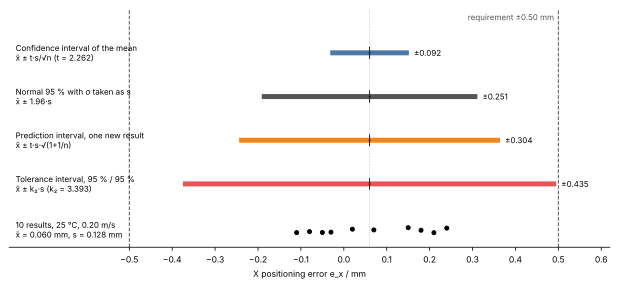
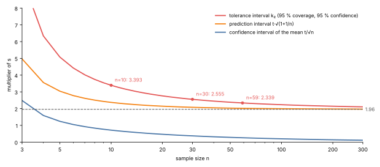

# 第6章 误差、偏差与不确定度：先把问题说对

**所属主题：预算、分配与取舍｜版本：V0.1 研究正文初稿｜日期：2026-11-18**

## 6.1 同一组数据，三个“±”

第5章按差额分解给定位台加了温度补偿和时延补偿，回算的校核值降到0.384 mm。改造完成后，项目组在25 °C、拍照速度0.20 m/s下连续定位10件，记录X向定位误差 $e_x$（单位mm，教学数据）：

| 序号 | 1 | 2 | 3 | 4 | 5 | 6 | 7 | 8 | 9 | 10 |
| --- | --- | --- | --- | --- | --- | --- | --- | --- | --- | --- |
| $e_x$ / mm | +0.21 | −0.08 | +0.15 | +0.02 | −0.11 | +0.18 | +0.07 | −0.03 | +0.24 | −0.05 |

样本均值 $\bar x=0.060$ mm，样本标准差 $s=0.128$ mm（分母 $n-1$）。三份报告由同一组数据写出了三个结论：

| 报告 | 写法 | 计算 | 作者的判断 |
| --- | --- | --- | --- |
| 试验记录 | “定位误差 0.060±0.092 mm（95%置信）” | $\bar x\pm t_{0.975,9}\,s/\sqrt{10}$ | 最大不到0.16 mm，远优于0.50 mm |
| 视觉组周报 | “定位误差 0.060±0.251 mm（95%）” | $\bar x\pm1.96\,s$ | 有约0.19 mm余量 |
| 质量部意见 | “95%/95%统计容忍区间 0.060±0.435 mm” | $\bar x\pm k_2 s$，$k_2=3.393$ | 上限0.495 mm，贴着要求，不能放行 |

三个“±”都标着95%，宽度却相差将近5倍。计算都没有算错，它们回答的是三个不同的问题：第一个说明**误差的总体均值**大概在哪里，第二个在“标准差恰好等于0.128 mm”的假设下估计**95%的单次结果**落在哪里，第三个要求**以95%的置信度保证至少95%的单次结果**落在区间内。R-POS-X问的是第三类问题；第一份报告把均值的区间当成了单次结果的范围，结论因此偏乐观得多。

类似的混淆在项目文件里随处可见：标定报告写“残差±0.05 mm”，平台资料写“重复定位精度0.36 mm”，干涉仪证书写“$U=0.6$ μm，$k=2$”，第5章的时延补偿写“±0.015 ms”。同样一个“±”，有的是样本中见到的最大值，有的是分布的倍数，有的是对某个固定值的认识程度，有的是要求。**数字的含义没说清，就没有资格进入预算。**

本章回答四个问题：**一个带“±”的量值至少要交代哪几件事；误差中哪部分是系统的、哪部分是随机的，以及这种区分取决于什么；不确定度怎样评定，A类与B类评定是什么关系；置信区间、覆盖区间与统计容忍区间各回答什么问题，样本有限时覆盖因子怎样修正。**

各章分工如下。本章是全书“误差、偏差与不确定度口径”和“统计区间”的主讲章。误差怎样经灵敏度与相关性传播到系统输出，在第7章；分配值怎样调整，在第8章；测量链与溯源、测量能力的评估，在第15章；样本量的完整推导、试验设计和符合性判定规则，在第24章。本章所有数值均为明确假设下的教学计算，不代表具体产品。

## 6.2 基本术语

计量术语以VIM第3版（JCGM 200:2012）为准，中文对照JJF 1001—2011；统计术语参照ISO 3534-1。[R1][R2][R3]

| 术语 | 本章采用的含义 | 使用时需要说明 |
| --- | --- | --- |
| 误差 error | 测得值（或输出）减去参考值，有符号，见第一章式（1-5） | 对象、方向、时刻与参考 |
| 系统误差 systematic error | 在重复测量或重复动作中保持不变、或按可预见方式变化的误差分量（VIM 2.17） | 相对于哪一种重复而言，见第6.4节 |
| 随机误差 random error | 在重复中以不可预见方式变化的误差分量（VIM 2.19） | 同上 |
| 偏差 bias | 系统误差的估计值（VIM 2.18），JJF 1001译作“测量偏移”，本库称“偏差”，见[术语约定](../terminology.md) | 估计方法及其不确定度 |
| 修正 correction | 为补偿估计的系统效应而加到未修正结果上的量（VIM 2.53），通常等于偏差的负值 | 修正值本身的不确定度 |
| 测量不确定度 uncertainty | 依据所用信息，表征赋予被测量的量值分散性的非负参数（VIM 2.26） | 是关于“知道得多准”，不是误差本身 |
| 标准不确定度 standard uncertainty | 以标准差表示的不确定度，记为 $u$ | 评定途径与自由度 |
| A类评定 Type A evaluation | 对规定条件下测得的量值作统计分析，得到不确定度分量（VIM 2.28） | 样本量、独立性与计算方法 |
| B类评定 Type B evaluation | 用A类以外的方法评定不确定度分量，如证书、资料、界限与经验（VIM 2.29） | 信息来源、假定分布与可靠程度 |
| 合成标准不确定度 combined standard uncertainty | 由各分量按测量模型合成的标准不确定度，记为 $u_c$ | 灵敏度与相关性，见第7章 |
| 扩展不确定度 expanded uncertainty | $U=k\,u_c$，$k$ 为覆盖因子 | $k$ 的取值依据及对应的覆盖概率 |
| 覆盖区间 coverage interval | 依据可获得的信息，以规定概率包含被测量的量值的区间（VIM 2.36）；JJF 1001译作“包含区间”，覆盖因子、覆盖概率相应译作“包含因子”“包含概率” | 被测量是一个量，不是一批结果 |
| 置信区间 confidence interval | 由样本构造、在重复抽样意义下以规定概率覆盖总体**参数**（如均值、标准差）的区间 | 被覆盖的是哪个参数 |
| 统计容忍区间 statistical tolerance interval | 以规定置信度包含总体中至少规定比例的区间（ISO 3534-1、ISO 16269-6） | 比例 $p$ 与置信度 $\gamma$ 两个数 |
| 公差 tolerance | 设计规定的允许变动范围，属于要求 | 与统计容忍区间、不确定度不同 |

关于用词，有三点说明。

- **统计容忍区间。**本书采用GB/T 3359与ISO 16269-6的中文译名“统计容忍区间”，不写作“统计容差区间”，以免与设计“公差”混淆：前者是数据的统计性质，后者是要求。[R4]
- **覆盖与包含。**全书沿用“覆盖区间”“覆盖因子”“覆盖概率”的说法，与第1、5章一致；查阅JJF 1059.1等中文规范时，对应“包含区间”“包含因子”“包含概率”。
- **偏差的两种语境。**测量语境中的“偏差”指bias；尺寸与公差语境中，GB/T 1800.1用“偏差”指某一尺寸减其公称尺寸所得的代数差，如上极限偏差、下极限偏差。[R5] 第6—8章两种用法都会出现，本书的写作规则是：**测量语境单写“偏差”时指bias；尺寸语境一律写全称，如“尺寸偏差”“上极限偏差”，不单写“偏差”。**测量语境是否改用“偏移”，仍是框架的待决事项，本章的写法不预设结论。

## 6.3 一个“±”要交代的五件事

### 6.3.1 五种身份

工程文件中带“±”或“不超过”的量值，常见的身份有五种：

| 身份 | 描述的是什么 | 典型写法 | 不能当作 |
| --- | --- | --- | --- |
| 一次误差 | 某一次结果相对参考值的差 | “这一件偏+0.21 mm” | 总体表现 |
| 误差分布的特征 | 一批重复结果的偏差、分散或分位值 | 标准差、RMSE、95%分位值 | 某一次结果的保证 |
| 不确定度 | 对一个确定的量（被测量、修正值、参数）知道得有多准 | $u$、$U=k u_c$、覆盖区间 | 误差的大小或批量分散 |
| 要求 | 允许的范围 | 公差、最大允许误差MPE、阈值 | 已经取得的性能 |
| 证据强度 | 由有限样本作推断时，方法的可靠程度 | 置信度、置信区间、统计容忍区间 | 被推断的量本身 |

第5章第5.4.3节的结论“不同口径的数不能直接相加”，在这里推进一步：**不同身份的数，连比较都不能直接比较。**把MPE与实测标准差比、把覆盖区间当作一批零件的散布范围、把置信区间当作单次结果的范围，都是身份错位，第6.1节第一份报告正是如此。

### 6.3.2 解读项目文件中的“±”

把定位台项目里已经出现的数逐个归位：

| 出处 | 原写法 | 实际含义 | 身份与口径 | 进入预算前要做的事 |
| --- | --- | --- | --- | --- |
| 第5章视觉部件验收 | “精度±0.15 mm（3σ）”，实测3σ=0.12 mm | 静止、视场中心、20 °C，30次重复的样本标准差乘3 | 分布特征（σ），部件工况 | 第5章已换算到系统工况，σ=0.08 mm |
| 平台资料 | “重复定位精度0.36 mm，按ISO 230-2” | ISO 230-2:2014定义单向重复定位精度 $R\!\uparrow=4s\!\uparrow$ | 分布特征，$s=0.09$ mm | 按4倍还原σ；双向定义另含反向差值，须核对所给的是哪一个[R6] |
| 相机—平台标定报告 | “标定残差±0.05 mm” | 12个标定点上拟合残差绝对值的最大值 | 样本最大值，且是拟合点上的残差 | 不能直接当作全视场的误差界，见第6.8.4节 |
| 干涉仪校准证书 | “$U=0.6$ μm，$k=2$” | 扩展不确定度，覆盖概率约95% | 不确定度 | 用 $u=U/k=0.3$ μm 进入测量链评估（第15章） |
| 第5章时延补偿 | “时延测量的不确定范围为±0.015 ms” | 由10次示波器测量与两项B类分量合成的扩展不确定度 | 不确定度（修正值的），见第6.5.5节 | 第5章按“有界偏差”使用，须改记口径 |
| R-POS-X | “不超过0.50 mm的概率至少为95%” | 要求的阈值与覆盖比例 | 要求 | 用统计容忍区间或零失效试验去证明 |

平台资料一行值得多看一眼。同样叫“重复定位精度”，ISO 230-2取4倍标准差；一些较早的机床验收规范（如VDI/DGQ 3441）以6倍标准差表示位置分散范围。[R6] 只抄数字不抄定义，σ会差出1.5倍。资料中的数字只有在找到它所依据的标准条文、知道倍数和样本条件之后，才能还原成预算需要的口径。

### 6.3.3 五项必填说明

本书约定，任何进入预算、要求或报告的误差类量值，至少写明以下五项：

1. **对象：** 哪个量的误差或不确定度，方向、基准、时刻，见第一章第1.5节。
2. **身份：** 一次误差、分布特征、不确定度、要求，还是推断结论。
3. **口径：** 偏差、标准差、分位值、界限；若有倍数，写明 $k$ 及其依据；若是推断，写明比例 $p$ 与置信度 $\gamma$。
4. **总体与条件：** 统计的是哪一种重复（同一台逐次动作、多次重新标定、多台设备），在什么工况下。
5. **依据：** A类（样本量、自由度、独立性）或B类（来源、假定分布、可靠程度）。

第6.9节把这五项做成一张口径说明表，作为本章的最小产物。

## 6.4 系统与随机：取决于“重复什么”

### 6.4.1 误差分量的划分依赖统计总体

把第 $i$ 次结果的误差写成：

$$
e_i=b+\varepsilon_i,\qquad E[\varepsilon_i]=0,
\tag{6-1}
$$

$b$ 在所考虑的重复中保持不变，是系统分量；$\varepsilon_i$ 每次变化，是随机分量。式（6-1）中“所考虑的重复”是必不可少的前提。VIM在定义系统误差和随机误差时都写明“在重复测量中”，而重复的范围由条件规定。[R1] 同一个误差来源，放在不同的重复范围里，身份会改变：

| 误差来源 | 同一台、一次标定后逐次定位 | 多次重新标定 | 多台设备 |
| --- | --- | --- | --- |
| 相机—平台标定残差 E2 | 固定，系统分量 | 每次标定不同，随机分量 | 随机分量 |
| 阿贝项 E9 | 在同一位置固定，随拍照位与工位的组合变化 | 不变 | 每台导轨不同 |
| 温度引起的漂移 E5、E6 | 10分钟内几乎不变，像偏差 | 随标定时温度变化 | 随设备与安装环境变化 |
| 视觉特征定位噪声 E1 | 每次变化，随机分量 | 随机分量 | 随机分量 |

所以，**“系统”还是“随机”不是误差来源固有的属性，而是它相对于统计总体的表现。**写预算之前，先写明要求所说的概率是对什么重复而言的。R-POS-X说的是“在C-N工况下，X向定位误差绝对值不超过0.50 mm的概率至少为95%”，统计单位是一次定位动作（第一章第1.6.2节），总体是**同一台设备在一次标定后、C-N工况内的逐次定位**。对这个总体，E2和E9是固定但未知的值，不会因为重复次数多而平均掉。

### 6.4.2 偏差、修正与修正后的残余

系统分量若能估计，就应修正。GUM假定已识别的显著系统效应都已修正，修正值本身的不确定度进入不确定度评定。[R7] 用 $n$ 次重复估计偏差：

$$
\hat b=\bar e=\frac1n\sum_{i=1}^{n}e_i,\qquad
C=-\hat b,\qquad
u(C)=u(\hat b)=\frac{s}{\sqrt n}.
\tag{6-2}
$$

修正以后剩下的不是零，而是一个未知的残余 $b-\hat b$，它的大小用 $u(C)$ 描述。第5章的两项补偿正是如此：时延补偿扣除了0.5 ms的固定时延，剩下的是时延测量的不确定度（第6.5.5节）；温度补偿扣除了 $k_T\Delta T$，剩下的是补偿模型的残差。修正把一个大的已知偏差换成一个小的未知残余，后者仍然要记账。

还要注意两点：

- **偏差估计依赖参考。** 若参考测量链本身有偏差，$\hat b$ 中混有参考的偏差，修正会把它“修”进结果（第一章第1.5.1节，$\mathbf e_{\mathrm{ref}}=\mathbf e_{\mathrm{true}}-\boldsymbol\delta_{\mathrm{ref}}$）。参考的不确定度必须进入 $u(C)$，在第15章展开。
- **样本中的偏差不一定是总体的偏差。** 第6.1节10件的均值0.060 mm，其95%置信区间为 $[-0.032,\ 0.152]$ mm（第6.6.2节），连符号都不能确定。用这样的估计做修正，可能引入比原来还大的误差；修正值的不确定度必须与偏差本身一起比较。

### 6.4.3 固定未知偏差：按界处理还是按分布处理

修正后仍有若干有界的残余偏差：第5章中的E2（0.05 mm）、E6（0.015 mm）、E8（0.003 mm）、E9（0.012 mm），上界合计 $B=0.080$ mm。它们进入校核值有两种处理方式：

**按界处理。** 第5章式（5-4）$Q=B+1.96\,\sigma$ 把有界项的上界线性相加。它对“一台设备”的含义是：无论偏差在界内取什么值，这台设备逐次定位的 $\lvert e_x\rvert$ 的95%分位值都不超过 $Q$（依据见[误差统计口径](../concepts/error-statistics.md)中“正态带偏差”一节）。

**按分布处理。** GUM的做法是把每个有界项视为在界内的矩形分布，标准不确定度取 $a/\sqrt3$（第6.5.3节），与随机项按方差合成：

$$
u_b=\sqrt{\frac{0.05^2+0.012^2+0.015^2+0.003^2}{3}}\approx0.031\ \mathrm{mm},\qquad
1.96\sqrt{\sigma^2+u_b^2}\approx1.96\times0.158\approx0.310\ \mathrm{mm}.
$$

两者相差0.074 mm，用哪一个，取决于要求问的是什么：

| 问题 | 合适的处理 | 结果 / mm |
| --- | --- | --- |
| 这台设备的95%分位值最坏可能是多少（R-POS-X的问法） | 按界：$B+1.96\sigma$ | 0.384（保守上界） |
| 偏差恰好取到上界的那台设备，95%分位值精确是多少 | 带偏差正态的精确分位值 | 0.341 |
| 把很多台设备的所有定位结果混在一起，95%分位值是多少 | 按分布：$1.96\sqrt{\sigma^2+u_b^2}$ | 0.310 |

最后一行由蒙特卡洛核对：各有界项在界内独立均匀取值，与 $\sigma=0.155$ mm 的随机项叠加，混合总体的95%分位值为0.310 mm，与按方差合成的结果一致。但对于偏差恰好靠近上界的那几台设备，自己的95%分位值约为0.341 mm，比0.310 mm大。**按分布合成，回答的是“平均而言”的问题；把它用于“每一台都要满足”的要求，会对偏差大的那几台偏乐观。**

因此，R-POS-X的校核继续使用式（5-4）的按界处理。若以后出现以批量或机群为总体的要求，例如“一批设备的全部定位结果中至少95%满足”，按分布合成才是对应的口径；那时还需要有偏差确实在设备之间随机变化的证据，第22章讨论批次变异时会遇到这种情形。

## 6.5 不确定度的评定：A类与B类

### 6.5.1 A类、B类是评定途径，不是误差类型

GUM把不确定度分量按评定方法分为两类：A类用统计分析一系列观测值得到，B类用其他手段得到。[R7] GUM特别说明，这一分类只区分评定途径，不意味着分量的性质不同；它与“随机误差”“系统误差”的划分不是一回事。[R7] 两个反例：

- **系统效应，A类评定。** 第5章扣除的固定时延是系统效应，它的估计来自10次示波器测量的统计分析，修正值的不确定度主要是A类分量。
- **随机效应，B类评定。** 触发链路的同步抖动是随机效应，但第5章E7的0.20 ms来自芯片资料与链路分析，没有实测，属于B类评定。

工程上的意义是：**评定途径决定这个数有多可靠，误差性质决定它在重复中怎样表现。**两者都要记，记在活账的不同栏里（第6.10节）。

### 6.5.2 A类评定

对同一条件下 $n$ 次独立观测 $x_1,\dots,x_n$：

$$
\bar x=\frac1n\sum x_i,\qquad
s=\sqrt{\frac{1}{n-1}\sum(x_i-\bar x)^2},\qquad
u(x_i)=s,\qquad
u(\bar x)=\frac{s}{\sqrt n},\qquad
\nu=n-1.
\tag{6-3}
$$

$u(x_i)=s$ 描述单次观测的分散，$u(\bar x)=s/\sqrt n$ 描述用平均值作为结果时的不确定度，两者常被混用。用平均值作修正时取后者；预算中描述单次定位的随机分量时取前者。

A类评定的三个前提，在工程数据中最容易被破坏：

- **独立。** 连续采样的时间序列彼此相关，$s/\sqrt n$ 会低估平均值的不确定度，见第6.7.5节。
- **同一条件。** 把不同温度、不同位置的数据混在一起求 $s$，得到的是混合总体的分散，见第一章第1.6.1节。
- **自由度。** $s$ 本身是估计值，$\nu=n-1$ 越小，$s$ 越不可靠。$n=10$ 时，σ的95%置信区间约为 $[0.69s,\ 1.83s]$（第6.6.3节）。

### 6.5.3 B类评定

B类评定把已有信息换算成标准不确定度。常用的换算如下：[R7][R8]

| 信息形式 | 假定分布 | 标准不确定度 | 适用情形 |
| --- | --- | --- | --- |
| 证书给出 $U$ 与 $k$ | 按证书 | $u=U/k$ | 校准证书；若只给覆盖概率，按其分布取 $k$ |
| 只知道在 $\pm a$ 内，无其他信息 | 矩形 | $a/\sqrt3\approx0.577a$ | 资料中的界限、MPE、未细究的有界偏差 |
| 在 $\pm a$ 内，靠近中间的可能性更大 | 三角形 | $a/\sqrt6\approx0.408a$ | 两个等宽矩形量之和 |
| 在 $\pm a$ 内，多在两端 | 反正弦（U形） | $a/\sqrt2\approx0.707a$ | 正弦变化的量按时间均匀取样，如周期性温度波动 |
| 数字示值分辨力 $\delta$ | 矩形，半宽 $\delta/2$ | $\delta/(2\sqrt3)\approx0.289\delta$ | 量化误差 |

选择分布要有理由。矩形分布在只知道界限时最常用，但若资料中的界限本来就是某个倍数的标准差（如“3σ”），应直接还原，不能再除以 $\sqrt3$。

B类评定也有可靠程度。GUM给出的近似是：若认为 $u$ 的相对不可靠程度为 $\Delta u/u$，则其等效自由度为[R7]

$$
\nu\approx\frac12\left(\frac{\Delta u}{u}\right)^{-2}.
\tag{6-4}
$$

相对不可靠程度10%、25%、50%分别对应自由度约50、8、2。供应商依据标准给出的数据可以取10%左右；一次分析估计取25%；“暂定”的数取50%甚至更差。这个数是判断，不是计算结果，但写下来可以让第6.8.5节的计算暴露出哪一项的知识最薄弱。

### 6.5.4 合成与扩展

对彼此不相关的输入，合成标准不确定度为

$$
u_c^2=\sum_i c_i^2u_i^2,
\tag{6-5}
$$

$c_i$ 为灵敏度系数（第5章第5.3.2节）；相关输入的协方差项及其处理在第7章主讲。合成结果的等效自由度用Welch–Satterthwaite公式近似：[R7]

$$
\nu_{\mathrm{eff}}=\frac{u_c^4}{\displaystyle\sum_i\frac{(c_iu_i)^4}{\nu_i}},
\tag{6-6}
$$

扩展不确定度及覆盖因子为

$$
U=k\,u_c,\qquad k=t_{(1+p)/2}(\nu_{\mathrm{eff}}),
\tag{6-7}
$$

$p$ 为覆盖概率，$t$ 为 $t$ 分布的分位值。$\nu_{\mathrm{eff}}$ 足够大时，$k\to1.96$（$p=95\%$）；GUM常用的 $k=2$ 是在近似正态、有效自由度足够大时对约95%覆盖概率的约定近似。[R7] 式（6-6）由分母中最大的一项主导：自由度小、贡献又大的分量，会把整个结果的自由度拉下来。

### 6.5.5 算例：时延修正值的不确定度

第5章扣除的固定时延，是曝光中点到光栅尺锁存时刻的间隔。测量方法：示波器同时接入相机闪光同步信号与锁存脉冲，重复测10次。

| 分量 | 信息 | 评定 | 标准不确定度 / ms | 自由度 |
| --- | --- | --- | --- | --- |
| 重复测量 | 均值0.500 ms，$s=0.019$ ms，$n=10$ | A类，$s/\sqrt{10}$ | 0.0060 | 9 |
| 示波器时间间隔误差 | 资料给出在±0.005 ms内 | B类，矩形 | 0.0029 | 视为很大 |
| 曝光中点的判读 | 闪光同步信号读数分辨力0.01 ms | B类，分辨力 | 0.0029 | 视为很大 |

$$
u_c=\sqrt{0.0060^2+0.0029^2+0.0029^2}\approx0.0073\ \mathrm{ms},\qquad
\nu_{\mathrm{eff}}=\frac{0.0073^4}{0.0060^4/9}\approx19,
$$

$k=t_{0.975}(19)\approx2.09$，$U\approx2.09\times0.0073\approx0.015$ ms。这就是第5章“±0.015 ms”的来历。若直接取 $k=2$，$U\approx0.0145$ ms；取1.96则更小。本例A类分量只占方差的约68%，修正很小；若只测5次、又没有B类分量，$k=t_{0.975}(4)=2.78$，比2大近四成。

两点结论。

- **口径要改记。** “±0.015 ms”是修正值的扩展不确定度，覆盖概率约95%，不是确定性界限。第5章把它当作有界偏差、按界线性相加，折算到 $e_x$ 为 $0.20\times0.015=0.003$ mm。按其本来口径，它是一个标准不确定度为 $0.20\times0.0073\approx0.0015$ mm 的分量。两种处理对总体的影响都可忽略，但活账E8的口径栏应如实记录（第6.10节）。
- **按界使用不确定度要说明。** 把 $U$ 当作界使用，等于接受约5%的可能残余超出 $U$。对影响微小的项，这样做简单且偏保守；对主要贡献项，应当保留其分布口径，进入方差合成。

## 6.6 三种区间：分别回答什么问题

### 6.6.1 区间的对象不同

第6.1节的混乱，根源是没有分清区间要覆盖的对象：

| 区间 | 要覆盖的对象 | 概率的含义 | 典型用途 |
| --- | --- | --- | --- |
| 置信区间 | 总体的一个**参数**，如均值 $\mu$、标准差 σ | 构造区间的程序在重复抽样中覆盖真参数的比例 | 偏差有多大，分散有多大 |
| 覆盖区间 | 一个**被测量**的量值 | 依据现有信息，被测量落在区间内的概率 | 测量结果的报告：$y\pm U$ |
| 预测区间 | **下一次**结果 | 下一次结果落在区间内的概率 | 预计下一件会怎样 |
| 统计容忍区间 | 总体中**至少比例 $p$** 的结果 | 以置信度 $\gamma$ 保证覆盖比例不低于 $p$ | 批量合格率、R-POS-X一类的要求 |

VIM在覆盖区间的注释中特别提醒，覆盖区间不应称为“置信区间”，以免与统计概念混淆。[R1] 两者的区别在于对象：覆盖区间针对一个量（例如这根轴的直径、这次测得的时延），置信区间针对总体分布的一个参数。按全书的概念分工，本章主讲置信区间、覆盖区间与统计容忍区间；预测区间放在其间，因为它是从“参数”过渡到“比例”的中间形式，工程中也常被误当作容忍区间。

### 6.6.2 置信区间：均值在哪里

在正态模型下，均值 $\mu$ 的双侧置信区间为

$$
\bar x\pm t_{(1+\gamma)/2}(n-1)\,\frac{s}{\sqrt n}.
\tag{6-8}
$$

第6.1节数据：$t_{0.975}(9)=2.262$，半宽 $2.262\times0.128/\sqrt{10}\approx0.092$ mm，区间为 $[-0.032,\ 0.152]$ mm。它说明：在这10件所代表的条件下，误差的总体均值以95%的置信度落在这个范围内。它**不**说明单件误差在这个范围内；10件中已有6件落在区间外。

$n$ 增大时，均值的置信区间以 $1/\sqrt n$ 收窄，最终趋于零宽度；单件结果的分散却不会因此变小。这是“0.060±0.092 mm”最具误导性的地方：样本越多，这个“±”越小，看上去越好，但它描述的对象始终不是单件误差。

### 6.6.3 标准差的置信区间：分散有多大

在正态模型下，σ的双侧置信区间为

$$
\left[\ s\sqrt{\frac{n-1}{\chi^2_{(1+\gamma)/2}(n-1)}},\ \ s\sqrt{\frac{n-1}{\chi^2_{(1-\gamma)/2}(n-1)}}\ \right].
\tag{6-9}
$$

$n=10$、$\gamma=95\%$ 时，两个系数约为0.69和1.83，第6.1节数据的σ区间为 $[0.088,\ 0.234]$ mm。第5章预算对当前估计的回算值 $\sigma\approx0.145$ mm 落在区间内，所以这10件数据**不否定**预算模型；但区间上端0.234 mm已远超预算，所以它们也**不足以支持**预算。10个点能告诉我们的，大致就这么多。

式（6-9）对非正态数据很敏感，尾部较重时区间会严重偏窄。[R9] 用它之前，至少看一眼数据的分布形状。

### 6.6.4 预测区间：下一件在哪里

下一次独立结果的预测区间为

$$
\bar x\pm t_{(1+\gamma)/2}(n-1)\,s\sqrt{1+\frac1n}.
\tag{6-10}
$$

第6.1节数据的半宽为 $2.262\times0.128\times\sqrt{1.1}\approx0.304$ mm。它比 $1.96s=0.251$ mm 宽，因为它同时计入了均值和标准差的估计误差。但它说的是“下一件”，不是“今后所有件中的95%”：若用这个区间判断批量，相当于把一次预测的概率当作长期比例的保证。

### 6.6.5 统计容忍区间：至少多大比例的结果在哪里

双侧统计容忍区间为

$$
\bar x\pm k_2(n,p,\gamma)\,s,
\tag{6-11}
$$

$k_2$ 使得区间以置信度 $\gamma$ 至少覆盖总体比例 $p$。正态模型下的精确值可由数值积分求出，ISO 16269-6给出了表格与算法。[R4][R10] 本章数值按精确积分计算，并用蒙特卡洛核对；部分文献表列的近似值（如Howe近似）在小样本时与精确值有千分之几的差别，见第6.7.3节的表。

第6.1节数据：$n=10$，$p=\gamma=95\%$，$k_2=3.393$，区间为 $[-0.375,\ 0.495]$ mm。区间落在±0.50 mm之内，因此在正态假设下，以95%的置信度，至少95%的单件误差绝对值不超过0.50 mm。这正是R-POS-X所要求的命题。

由于要求针对 $\lvert e_x\rvert$，区间落在 $[-E,\ E]$ 之内是满足要求的**充分**条件，可以写成一个简单的检查式：

$$
\lvert\bar x\rvert+k_2\,s\le E_{\mathrm{req}}.
\tag{6-12}
$$

它略偏保守：均值偏离零时，一侧尾部几乎不贡献超限，所需的系数可以略小。专门针对“落在两限之间的比例”的区间方法及其判定规则，在第24章展开。

### 6.6.6 用同一组数据比较

**图6-1** 第6.1节10个定位误差数据（黑点）及由它们构造的四种区间，竖线为样本均值0.060 mm，虚线为R-POS-X的±0.50 mm。自上而下：均值的95%置信区间（±0.092 mm）、把 $s$ 当作σ的正态95%区间（±0.251 mm）、下一件的95%预测区间（±0.304 mm）、95%/95%统计容忍区间（±0.435 mm）。

| 写法 | 区间 / mm | 回答的问题 | 能否用于R-POS-X |
| --- | --- | --- | --- |
| $\bar x\pm t s/\sqrt n$ | $[-0.032,\ 0.152]$ | 均值在哪里 | 不能，对象是参数 |
| $\bar x\pm1.96s$ | $[-0.191,\ 0.311]$ | 若σ恰为 $s$，95%单件在哪里 | 不能，忽略了σ的估计误差 |
| $\bar x\pm t s\sqrt{1+1/n}$ | $[-0.244,\ 0.364]$ | 下一件在哪里 | 不能，对象是一件 |
| $\bar x\pm k_2 s$ | $[-0.375,\ 0.495]$ | 以95%置信度，至少95%单件在哪里 | 能，在正态与独立假设下 |

最后一行通过了，但余量只有0.005 mm，而且这一结论建立在以下前提上：数据近似正态、10件相互独立、25 °C一个温度点能代表C-N工况、参考测量的不确定度可以忽略。第6.8.1节逐项检查这些前提。

## 6.7 有限样本下覆盖因子的修正

### 6.7.1 1.96从哪里来，什么时候不够

1.96是标准正态分布的0.975分位值。“$\bar x\pm1.96\sigma$ 覆盖95%”成立，需要两个条件：分布是正态，σ已知。工程中σ几乎总是用有限样本估计的，用 $s$ 代替σ以后，1.96就需要修正。修正多少，取决于要覆盖的对象：

| 对象 | 覆盖因子 | 有限样本修正的来源 | 大样本极限 |
| --- | --- | --- | --- |
| 被测量（覆盖区间） | $t_{0.975}(\nu_{\mathrm{eff}})$ | $u_c$ 的自由度有限 | 1.96 |
| 均值（置信区间） | $t_{0.975}(n-1)/\sqrt n$ | 同上，再除以 $\sqrt n$ | 0 |
| 下一件（预测区间） | $t_{0.975}(n-1)\sqrt{1+1/n}$ | 均值与σ都要估计 | 1.96 |
| 至少95%的单件（容忍区间） | $k_2(n,0.95,\gamma)$ | 均值与σ都要估计，且要求置信度 | 1.96 |

### 6.7.2 $t$ 因子：覆盖区间的修正

GUM附录G在 $u_c$ 的有效自由度有限时，以 $t$ 分布分位值作为覆盖因子。[R7] 常用值：

| 自由度 ν | 4 | 9 | 19 | 29 | 49 | ∞ |
| --- | --- | --- | --- | --- | --- | --- |
| $t_{0.975}(\nu)$ | 2.776 | 2.262 | 2.093 | 2.045 | 2.010 | 1.960 |

自由度在20以上时，$t$ 与1.96相差不到7%；自由度低于10时，相差超过15%。B类分量的自由度由式（6-4）估计，若某个主要分量“只是暂定”，它的自由度可能只有2左右，$t_{0.975}(2)=4.30$，此时用 $k=2$ 报告扩展不确定度会严重偏窄。

### 6.7.3 $k_2$ 因子：比例要求的修正

**图6-2** 三种区间的半宽系数（以 $s$ 的倍数表示）随样本量 $n$ 的变化，正态模型，$\gamma=95\%$。红线为双侧95%/95%统计容忍区间系数 $k_2$，橙线为预测区间系数，蓝线为均值置信区间系数，虚线为1.96。

| $n$ | 5 | 10 | 20 | 30 | 50 | 59 | 100 | 1000 |
| --- | --- | --- | --- | --- | --- | --- | --- | --- |
| $k_2(n,0.95,0.95)$ | 5.077 | 3.393 | 2.760 | 2.555 | 2.382 | 2.339 | 2.234 | 2.036 |

$k_2$ 收敛得很慢：$n=30$ 时仍比1.96大30%，$n=100$ 时大14%，$n=1000$ 时还大约4%。用 $\bar x\pm1.96s$ 判断比例要求，在 $n=30$ 时相当于把要求放宽了约23%（$1.96/2.555\approx0.77$）。

以R-POS-X为例，若试验得到 $\lvert\bar x\rvert\approx0.06$ mm，按式（6-12），$n=30$ 时要求 $s\le(0.50-0.06)/2.555\approx0.172$ mm；$n=10$ 时要求 $s\le0.130$ mm。样本越少，对 $s$ 的要求越严。这是“少做试验”的代价：不是结论不能下，而是下结论的门槛更高。

### 6.7.4 无分布方法：不依赖正态假设的样本量

不愿依赖正态假设时，可以只用顺序统计量。对单侧比例要求（R-POS-X针对 $\lvert e_x\rvert$，是单侧的）：若 $n$ 次独立结果全部满足 $\lvert e_x\rvert\le E_{\mathrm{req}}$，则以置信度 $\gamma$ 支持比例不低于 $p$ 的条件为

$$
1-p^n\ge\gamma,\qquad
n\ge\frac{\ln(1-\gamma)}{\ln p}.
\tag{6-13}
$$

$p=\gamma=0.95$ 时 $n\ge59$，与第一章式（1-13）及第5章需求—验证矩阵中“约59次”一致。若要以样本的最小值和最大值构成一个双侧区间，置信度为 $1-np^{n-1}+(n-1)p^n$，$p=\gamma=0.95$ 时需要 $n\ge93$。[R4] 无分布方法的代价是样本量；正态方法的代价是分布假设，两者之间的选择及其判定规则在第24章展开。

### 6.7.5 相关样本：有效样本量

以上公式都假设样本相互独立。连续采样的数据通常不满足这一点。若序列近似为一阶自回归、相邻样本相关系数为 $\rho$，估计均值时的有效样本量约为

$$
n_{\mathrm{eff}}\approx n\,\frac{1-\rho}{1+\rho}.
\tag{6-14}
$$

1000个相邻相关系数为0.8的样本，在估计均值时约相当于111个独立样本；$\rho=0.9$ 时约相当于53个。用 $n=1000$ 计算置信区间，区间会被低估约3倍。式（6-14）只是一阶自回归的近似，用于估计量级；实际数据应检查自相关，或改用彼此间隔足够长、足以视为独立的样本。

定位台的试验中，“连续定位10件”在相关性上有风险：同一时段内温度、润滑与夹持状态都相近，各件的误差可能共享一个缓慢变化的分量。这会使 $s$ 偏小、使10件看起来比实际更一致。

## 6.8 贯穿算例：定位台的口径重审

### 6.8.1 10件试验能说明什么

对照第6.6.6节的四种区间，10件数据的结论应写成：

> 在25 °C、0.20 m/s、连续10件的条件下，误差均值的95%置信区间为 $[-0.032,\ 0.152]$ mm，标准差的95%置信区间为 $[0.088,\ 0.234]$ mm；在正态与独立假设下，95%/95%统计容忍区间为 $[-0.375,\ 0.495]$ mm，落在±0.50 mm之内。

这段话的每一项都可以检查。它不足以判定R-POS-X通过，原因不在计算，而在前提：

| 前提 | 现状 | 后果 | 处理 |
| --- | --- | --- | --- |
| 正态 | 10个点无法有效检验分布形状 | 尾部较重时 $k_2$ 偏小 | 增加样本，或改用式（6-13）的无分布方法 |
| 独立 | 连续10件，可能共享慢变分量 | $s$ 偏小，区间偏窄 | 分时段、分批次取样 |
| 工况代表性 | 只有25 °C一个温度点 | C-N的20±5 °C未被覆盖；补偿模型在其他温度下的残差未检验 | 按温度分层试验，第18章检查补偿模型 |
| 参考测量 | 参考测量链未定义 | 实测误差中混有参考的误差 | 第15章 |
| 固定偏差 | 这台设备的E2、E9已经包含在数据中 | 只对这台、这几个位置有效 | 覆盖不同拍照位和工位位置 |

最后一行值得说明。系统试验直接测出了这台设备的实际偏差，所以不需要再按界加上 $B$；这是实测相对于预算的优势。但它只对试验覆盖到的位置、温度和这一次标定有效。换一次标定，E2就是另一个值。

### 6.8.2 第5章50件试验的区间

第5章第5.1节的系统试验（改造前，25 °C，0.20 m/s，50件）给出均值+0.27 mm、标准差0.16 mm，4件超限。第5.5.4节只检查了它与模型是否相容，留下了统计强度的问题：

| 量 | 点估计 | 95%区间 | 方法 |
| --- | --- | --- | --- |
| 均值 | 0.27 mm | $[0.225,\ 0.315]$ mm | 式（6-8），$t_{0.975}(49)=2.010$ |
| 标准差 | 0.16 mm | $[0.134,\ 0.199]$ mm | 式（6-9） |
| 超限比例 | 8%（4/50） | $[2.2\%,\ 19.2\%]$ | 二项分布精确区间（Clopper–Pearson）[R11] |

模型预测的均值范围0.158—0.282 mm与均值的置信区间重叠，预测的标准差0.155 mm落在标准差的置信区间内，第5章“相容”的判断得到区间的支持。

超限比例一行有一个容易被忽视的结论：区间下限2.2%低于5%，**仅凭4/50这个计数，不能以95%的置信度断定超限率高于5%**。第5章说“这组数据不能支持至少95%的要求”是对的；但“不能证明通过”与“证明不通过”是两回事。若采用正态模型，按均值0.27 mm、标准差0.16 mm估计，超限比例约7.5%，结论会更明确，代价是依赖分布假设。哪一方承担举证责任、判定规则怎样写，属于第24章的符合性判定。本章只要求把两种说法分开。

### 6.8.3 有界项按界处理

按第6.4.3节的分析，R-POS-X针对的是同一台设备的逐次定位，E2、E6、E8、E9在这一总体中是固定未知量。活账继续按界线性相加，$B=0.080$ mm；按分布合成得到的0.310 mm只作为机群层面的参考，不用于R-POS-X的校核。

### 6.8.4 标定报告的“±0.05 mm”

E2的当前估计来自标定报告的“残差±0.05 mm”。查阅原始记录，这是12个标定点上拟合残差绝对值的最大值。它有两个问题：

- **它是样本最大值，不是界。** 12个点的最大值随点数和位置变化，不是全视场的上界（第一章第1.6.1节）。
- **它是拟合点上的残差，不是预测误差。** 标定模型的参数正是用这12个点拟合出来的，拟合点上的残差会系统地低估其他位置的误差；第4章第4.6.3节已经说明，拟合残差必须写明数据来源。

因此E2的0.05 mm在口径栏中记为“拟合点残差的最大值，暂作界使用”，状态保持“候选”。要把它变成可用的界或分布，需要用未参与拟合的独立检查点评估全视场的标定误差，这在第15章（测量链与校准）和第18章（模型确认）进行。

### 6.8.5 设计阶段的σ有多可靠

第5章活账的当前估计 $\sigma_{\mathrm{est}}\approx0.145$ mm，全部来自B类评定。按式（6-4）给每项写上可靠程度和等效自由度：

| 编号 | 当前估计 σ / mm | 依据 | 相对不可靠程度 | 等效自由度 ν | 在式（6-6）分母中的占比 |
| --- | --- | --- | --- | --- | --- |
| E1 | 0.08 | 分析（运动模糊、视场边缘畸变） | 25% | 8 | 48% |
| E3 | 0.09 | 供应商资料，按ISO 230-2还原 | 10% | 50 | 12% |
| E4 | 0.05 | 分析 | 25% | 8 | 7% |
| E5 | 0.05 | 暂定 | 50% | 2 | 29% |
| E7 | 0.04 | 链路分析 | 25% | 8 | 3% |

由式（6-6），$\nu_{\mathrm{eff}}\approx42$。

第5章的校核值 $Q_{\mathrm{est}}=0.080+1.96\times0.145\approx0.365$ mm，把 $\sigma_{\mathrm{est}}$ 当作已知值。若要求“以约95%的置信度，这台设备的95%分位值不超过 $Q$”，应改用σ的上置信限：

$$
\sigma_U=\sigma_{\mathrm{est}}\sqrt{\frac{\nu_{\mathrm{eff}}}{\chi^2_{0.05}(\nu_{\mathrm{eff}})}},\qquad
Q_U=B+1.96\,\sigma_U.
\tag{6-15}
$$

$\chi^2_{0.05}(42)\approx28.0$，$\sigma_U\approx1.22\times0.145\approx0.178$ mm，$Q_U\approx0.080+1.96\times0.178\approx0.428$ mm。相当于把覆盖因子从1.96提高到约2.40。式（6-15）把Welch–Satterthwaite的有效自由度当作χ²分布的自由度使用，是一种近似；各项的可靠程度又来自判断。它的价值不在于0.428这个数精确到哪一位，而在于两点：

1. **结论没有改变，余量缩小了。** $Q_U$ 仍低于0.50 mm，候选方案可以继续推进；但按当前知识，余量从0.135 mm降到约0.072 mm。
2. **知道下一步该补哪项知识。** 分母中E1占48%，E5占29%。若E1有了相当于30个自由度的实测数据（数值不变），$Q_U$ 降到约0.413 mm；E5同样处理，降到约0.417 mm。改善知识和改善硬件一样，能换回余量；而E1本身余量为零（第6.8.6节），它是最需要实测的一项。

### 6.8.6 派生要求能否被证明

第5章第5.7.6节的需求—验证矩阵中，R-VIS-001（视觉σ≤0.08 mm）和R-STG-001（平台σ≤0.10 mm）的样本量写着“第6章按区间宽度确定”。用式（6-9）的单侧形式：要以95%置信度证明 $\sigma\le\sigma_{\mathrm{req}}$，需要

$$
s\sqrt{\frac{n-1}{\chi^2_{0.05}(n-1)}}\le\sigma_{\mathrm{req}}.
$$

| 派生要求 | 分配值 | 预期的 $s$ | 所需 $n$ |
| --- | --- | --- | --- |
| R-STG-001 平台 | 0.10 mm | 0.09 mm（当前估计） | 139 |
| R-STG-001 平台 | 0.10 mm | 0.08 mm | 36 |
| R-VIS-001 视觉 | 0.08 mm | 0.08 mm（当前估计） | 无论多少都不够 |
| R-VIS-001 视觉 | 0.08 mm | 0.07 mm | 90 |

表中的 $n$ 是在样本标准差恰好等于预期值时的最小样本量；考虑到 $s$ 本身的波动，实际计划还要留出功效，在第24章展开。

这张表揭示了一件分配阶段容易忽略的事：**余量为零的分配值，用有限样本永远证明不了。**视觉E1的当前估计等于分配值，即使它的真实σ恰好是0.08 mm，任何有限的试验都只能给出一个高于0.08 mm的上置信限。平台E3的余量0.01 mm，要约139次带载双向试验才能证明。这不是统计学的苛刻，而是“余量”的另一层含义：**余量也是给验证留的空间。**分配值应当低于当前估计足够多，才能在可承受的试验量下得到证据。这一点作为第8章调整分配的输入。

### 6.8.7 这组计算支持什么决策

| 结论 | 依据 | 能支持的动作 |
| --- | --- | --- |
| 10件试验不否定预算，也不足以判定R-POS-X通过 | 第6.8.1节 | 按温度分层、分时段补充试验；参考测量链在第15章定义 |
| 改造前4/50的超限，仅凭计数不能证明超限率高于5% | 第6.8.2节 | 报告中分开写“不能证明通过”与“证明不通过”；判定规则留待第24章 |
| R-POS-X的有界项继续按界处理 | 第6.4.3节 | 活账合计行保留 $B=0.080$ mm；按分布合成的结果只作机群参考 |
| 标定报告的“±0.05 mm”是拟合点残差的最大值 | 第6.8.4节 | E2保持“候选”；第15、18章用独立检查点评估 |
| 计入σ的知识不确定性后，校核值约0.428 mm | 式（6-15） | 候选方案继续推进；余量按约0.072 mm管理 |
| E1、E5的知识最薄弱 | 第6.8.5节 | 优先取得视觉随机误差和温度短时变化的实测数据 |
| E1余量为零，无法用有限样本证明 | 第6.8.6节 | 第8章调整分配或改进视觉方案 |
| E8的“±0.015 ms”是扩展不确定度 | 第6.5.5节 | 活账改记口径；数值影响可忽略 |

## 6.9 本章的最小产物：误差与不确定度口径说明

### 6.9.1 说明表记录什么

口径说明表把第6.3.3节的五项必填说明落成表格，每一行对应一个将要进入预算、要求或报告的量值：

| 字段 | 内容 |
| --- | --- |
| 量值与原写法 | 原文中的数字和写法，如“±0.05 mm” |
| 对象 | 被描述的量，方向、基准、时刻 |
| 身份 | 一次误差、分布特征、不确定度、要求、推断结论 |
| 口径 | 偏差、σ、分位值、界限、$U$ 与 $k$、置信区间、统计容忍区间（$p$、$\gamma$） |
| 统计总体与条件 | 相对于哪种重复：同一台逐次动作、重新标定、多台设备；工况 |
| 评定途径 | A类：$n$、ν、独立性；B类：来源、假定分布、可靠程度与等效ν |
| 换算到预算口径 | 换算式与结果，例如 $R/4$、$U/k$、$a/\sqrt3$ |
| 在组合中的处理 | 方差合成、按界相加，或不进入本分支 |
| 待确认事项 | 原始数据、标准条文、独立检查 |

配套[口径说明模板](../../templates/error-and-uncertainty-statement.md)提供空白表与检查清单。

### 6.9.2 定位台的填写示例

| 量值与原写法 | 对象 | 身份 | 口径 | 总体与条件 | 评定途径 | 换算到预算口径 | 组合中的处理 |
| --- | --- | --- | --- | --- | --- | --- | --- |
| 平台“重复定位精度0.36 mm” | 平台X向定位 | 分布特征 | $R\!\uparrow=4s\!\uparrow$（ISO 230-2） | 同一台逐次定位；资料工况待核对是否带载 | B类，资料，10%，ν≈50 | $s=0.09$ mm | 方差合成 |
| 标定报告“残差±0.05 mm” | 相机—平台坐标关系 | 分布特征（样本最大值） | 12个拟合点残差的最大绝对值 | 一次标定后固定 | B类，暂定 | 暂作界0.05 mm | 按界相加 |
| 时延“±0.015 ms” | 时延修正值 | 不确定度 | $U$，$k=2.09$，$\nu_{\mathrm{eff}}\approx19$ | 一次测定后固定 | A类为主，见第6.5.5节 | $u=0.0073$ ms，折算0.0015 mm | 按界使用（影响可忽略），注明 |
| 10件试验“0.060±0.092 mm（95%置信）” | 系统 $e_x$ 的均值 | 推断结论 | 均值的置信区间 | 25 °C、0.20 m/s、连续10件 | A类，$n=10$ | 不进入单件分散 | 只用于偏差估计 |
| 质量部“0.060±0.435 mm（95%/95%）” | 系统 $e_x$ | 推断结论 | 统计容忍区间，$p=\gamma=95\%$ | 同上 | A类，$n=10$，正态与独立假设 | — | 作为R-POS-X的试验证据候选，前提见第6.8.1节 |

## 6.10 更新“误差与资源预算”活账

### 6.10.1 口径栏的细化

第5章活账的“口径”字段只写了“σ”或“有界偏差”。本章把它细化为四个子项，同时在模板中增加相应的列：

- **量的类别：** 逐次分散（σ）、固定未知值的界、修正值的不确定度。
- **统计总体：** 该项在R-POS-X的总体（同一台、一次标定后的逐次定位）中表现为随机还是固定。
- **评定途径与自由度：** A类写 $n$ 和ν；B类写来源、相对不可靠程度和式（6-4）的等效ν。
- **组合处理：** 方差合成或按界相加。

### 6.10.2 定位台活账更新（误差分支）

单位mm。只列本章有变化的栏，分配值与持有方同第5章第5.7.4节。

| 编号 | 量的类别 | 统计总体中的表现 | 评定途径与自由度 | 组合处理 | 当前估计 | 实测值 | 本章变化 |
| --- | --- | --- | --- | --- | --- | --- | --- |
| E1 | σ | 随机 | B类，分析，25%，ν≈8 | 方差 | 0.08 | 待测，第15章 | 标出：余量为零，无法证明（第6.8.6节） |
| E2 | 界（暂作） | 固定 | B类，拟合点残差最大值 | 按界 | 0.05 | 待独立检查点，第15、18章 | 口径更正（第6.8.4节） |
| E3 | σ | 随机 | B类，资料按 $R/4$ 还原，10%，ν≈50 | 方差 | 0.09 | 待测，第15章 | 补记还原依据；证明需约139次 |
| E4 | σ | 随机 | B类，分析，25%，ν≈8 | 方差 | 0.05 | 待测 | 补记自由度 |
| E5 | σ | 随机（短时） | B类，暂定，50%，ν≈2 | 方差 | 0.05 | 待测，第18章 | 标出：知识最薄弱的项之一 |
| E6 | 界 | 固定（给定温度下） | B类，补偿残差系数×温度界 | 按界 | 0.015 | 待测，第18章 | 无 |
| E7 | σ | 随机 | B类，链路分析，25%，ν≈8 | 方差 | 0.04 | 待测，第11章 | 补记自由度 |
| E8 | 修正值的不确定度 | 固定 | A类为主，$U=0.015$ ms，$k=2.09$，$\nu_{\mathrm{eff}}\approx19$ | 按界使用，注明 | 0.003 | 待测，第11章 | 口径由“有界偏差”改为“修正值的扩展不确定度” |
| E9 | 界 | 固定（随位置） | B类，导轨资料 | 按界 | 0.012 | 待测 | 补记 |
| E10 | 界 | 固定 | 未评估 | 按界 | 未评估 | 待测，第12章 | 无 |
| 合计 | — | — | $\nu_{\mathrm{eff}}\approx42$ | — | $B=0.080$；$\sigma_{\mathrm{est}}=0.145$；$Q_{\mathrm{est}}=0.365$；$Q_U=0.428$ | 10件，见下 | 增加 $Q_U$ |

合计行的余量现在给出两个值，并写明各自的前提：

| 量 | 数值 / mm | 前提 |
| --- | --- | --- |
| 预留量 $R=0.50-Q_{\mathrm{alloc}}$ | 0.116 | 分配值是约束，不涉及估计误差；与第5章相同 |
| 余量 $M=0.50-Q_{\mathrm{est}}$ | 0.135 | σ视为已知；E10为零 |
| 余量 $M_U=0.50-Q_U$ | 0.072 | σ取95%上置信限，式（6-15）；E10为零 |

R-POS-X的实测值栏记入第6.1节的10件试验：“25 °C、0.20 m/s、连续10件，$\bar x=0.060$ mm，$s=0.128$ mm；95%/95%统计容忍区间 $[-0.375,\ 0.495]$ mm；前提未满足，见第6.8.1节；不作判定依据。”

### 6.10.3 闭合检查

| 检查项 | 结果 | 说明 |
| --- | --- | --- |
| 本次新增的每项输入都有来源 | 是 | 每行写明了评定途径与自由度；可靠程度为判断值，已标注 |
| 每项输出都有去向 | 是 | $Q_U$ 回算到R-POS-X；样本量回填需求—验证矩阵 |
| 关键假设能够校核 | 部分 | 正态与独立假设可由后续分层试验检验；B类可靠程度只能由实测替代 |
| 超出约束时有可解释的处理 | 是 | E1余量为零无法证明，已列为第8章的输入 |

第5章列给本章的未闭合项“各项口径是否换算正确，有限样本下的区间”已关闭。新增与转移的未闭合项：

| 未闭合项 | 原因 | 计划 |
| --- | --- | --- |
| E2的全视场标定误差 | 现有数字是拟合点残差的最大值 | 第15、18章 |
| E1余量为零 | 分配值等于当前估计，无法用有限样本证明 | 第8章 |
| E1、E5的实测数据 | 当前为B类评定，自由度低 | 第15、18章 |
| E1、E3、E5之间的相关性 | 本章只处理了口径 | 第7章 |
| R-POS-X的分层系统试验与判定规则 | 10件试验前提未满足；举证责任未规定 | 第24章 |

### 6.10.4 同步更新需求—验证矩阵

| 编号 | 变化 | 样本量估计 |
| --- | --- | --- |
| R-POS-X | 证据类型补充两种可选路线 | 无分布：每个工况至少59次全部满足；正态模型：$n$ 次试验满足式（6-12），如 $n=30$ 时 $\lvert\bar x\rvert+2.555s\le0.50$ mm；二者的选择与判定规则在第24章确定 |
| R-VIS-001 | 状态保持“候选”，加注“余量为零，不可证明” | 若改进后 $s\approx0.07$ mm，约90次；现分配下无解 |
| R-STG-001 | 补记样本量 | $s\approx0.09$ mm时约139次；$s\approx0.08$ mm时约36次 |
| R-INT-002 | 时延残差的阈值改记口径 | 补偿后固定时延的扩展不确定度 $U\le0.015$ ms（$p\approx95\%$）；样本量按第6.5.5节，10次重复 |

## 6.11 失效边界：什么时候这些方法不再适用

| 情形 | 表现 | 处理 | 主讲章 |
| --- | --- | --- | --- |
| 分布明显非正态 | 重尾、偏斜、双峰；$k_2$、式（6-9）偏乐观 | 检查分布形状；改用无分布方法或针对分布建模 | 第24章 |
| 样本相关 | 连续采样，$s/\sqrt n$ 低估 | 估计自相关，按式（6-14）估计有效样本量，或间隔取样 | 第16章 |
| 混合工况 | 多个温度、速度、位置的数据合在一起 | 分层统计，逐工况给出区间 | 第一章、第24章 |
| 量化与分辨力主导 | 分散小于或接近分辨力，$s$ 失真甚至为零 | 计入分辨力的B类分量，不用 $s=0$ 作结论 | 第15章 |
| B类分量主导且可靠程度低 | $\nu_{\mathrm{eff}}$ 很小，$k$ 远大于2 | 先改善主导分量的知识，再谈区间 | 本章、第15章 |
| 强非线性 | 输入分布经非线性模型后不再对称或正态 | 改用蒙特卡洛传播（JCGM 101） | 第7章 |
| 剔除了异常值或无效输出 | 区间只描述条件分布 | 另行规定无效、缺失和超时；剔除规则事先写明 | 第一章、第16章 |
| 把“置信度”理解为参数落在区间内的概率 | 对已算出的某一个区间作概率陈述 | 置信度是程序的性质；需要对量的概率陈述时，使用覆盖区间并写明依据 | 本章 |

最后一行需要多说一句。置信区间的95%描述的是构造区间的方法：若反复抽样、反复构造，约95%的区间会覆盖真参数。对已经算出的 $[-0.032,\ 0.152]$ mm 这一个区间，真均值要么在里面，要么不在。工程报告中说“均值有95%的概率在这个区间内”，严格说来混淆了两种概率解释。对决策而言，这种混淆通常无害；但当它被用来把置信区间当作覆盖区间、或把置信度当作覆盖比例时，就会出现第6.1节那样的错误。

## 6.12 常见混淆与过关标准

### 6.12.1 常见混淆

| 常见做法或说法 | 应改为怎样检查 |
| --- | --- |
| “误差±0.1 mm”，不说是什么 | 写明对象、身份、口径、总体与条件、依据五项 |
| 均值的置信区间当作单件误差的范围 | 单件用预测区间或统计容忍区间 |
| 用 $\bar x\pm1.96s$ 证明比例要求 | 用 $k_2(n,p,\gamma)$；$n=30$ 时为2.555 |
| A类就是随机误差，B类就是系统误差 | A、B是评定途径；系统、随机取决于统计总体 |
| 有界偏差都可以除以 $\sqrt3$ 后方差合成 | 先看要求的总体：针对每一台时按界处理；针对机群时才按分布合成 |
| 资料上的“重复性”直接作为σ | 查明所依据的标准与倍数，如ISO 230-2的 $R=4s$ |
| 标定报告的残差就是标定误差 | 拟合点残差低估预测误差；用独立检查点评估 |
| 扩展不确定度就是误差上界 | $U$ 对应约95%的覆盖概率，按界使用时须注明 |
| $k=2$ 总是对应95% | 只在有效自由度足够大时近似成立；自由度小时用 $t$ 因子 |
| 连续采了1000个点，样本量很大 | 检查自相关，估计有效样本量 |
| 4/50超限，所以证明了不满足95%要求 | 二项区间为2.2%—19.2%，仅凭计数不能证明；“不能证明通过”与“证明不通过”分开 |
| 当前估计等于分配值，余量为零但“刚好满足” | 余量为零的分配值无法用有限样本证明，需要调整分配 |

### 6.12.2 过关标准与过关任务

本章的过关标准是：工程师看到任何带“±”的量值，能够说出它的对象、身份、口径、统计总体与评定依据；能够判断一个误差来源在给定要求的总体中是系统的还是随机的，并据此选择按界处理或按分布合成；能够完成A类与B类评定、合成标准不确定度、有效自由度与扩展不确定度的计算；能够针对一个问题选对置信区间、覆盖区间、预测区间或统计容忍区间，并在有限样本下修正覆盖因子；能够据此估算一项派生要求需要多少次试验才能证明，或指出它无法被证明。

**过关任务：** 以手头项目为对象，完成：① 从资料、报告和要求中摘出至少五个带“±”的量值，填写口径说明表；② 选一个误差来源，说明它在要求的统计总体中是系统的还是随机的，比较按界与按分布两种处理的结果；③ 对一组已有试验数据，计算均值置信区间、预测区间和95%/95%统计容忍区间，指出哪个对应你的要求，并列出结论成立的前提；④ 对一项派生要求，估算证明它所需的样本量；⑤ 更新活账的口径栏，写出未闭合项。

### 6.12.3 迁移练习：精密机械装配中的轴径

一根配合轴的图样尺寸为 $\phi20\,\mathrm{f7}$，即上极限偏差−0.020 mm、下极限偏差−0.041 mm，允许直径范围为19.959—19.980 mm。[R5] 车间用数显外径千分尺测量：

- 同一根轴、同一截面，重复测5次：19.968、19.970、19.969、19.971、19.969 mm。
- 千分尺校准证书：在20 mm附近示值误差为+0.001 mm（示值偏大），扩展不确定度 $U=1.2$ μm，$k=2$。
- 数显分辨力0.001 mm。
- 测量时轴与千分尺温度相近，两者线膨胀系数之差不超过 $2\times10^{-6}$ /K，与20 °C的温差不超过3 K。

另外，从同一批次随机抽取30根轴，各测一次，得 $\bar x=19.9695$ mm，$s=0.0035$ mm。

**练习：**

1. 本题中出现了哪几种“偏差”？分别属于测量语境还是尺寸语境？按第6.2节的写作规则改写。
2. 计算这根轴直径的修正后测得值、各不确定度分量、合成标准不确定度、有效自由度和95%扩展不确定度。哪一项是A类，哪一项是B类？
3. 证书的“+0.001 mm”和“$U=1.2$ μm”分别是什么身份？前者在测量结果中怎样使用？
4. 对30根轴的数据，计算95%/95%统计容忍区间，与公差带比较。这个区间与公差带分别属于哪种身份？
5. 30根轴的 $s=0.0035$ mm 中，有多少来自测量本身的重复性？据此估计零件直径自身的分散。
6. 若有人说“30根都在公差内，所以这批轴全部合格”，这句话有什么问题？要对整批作结论，还需要什么？

**参考要点：** ① 图样上的“上极限偏差”“下极限偏差”是尺寸语境；证书中的示值误差+0.001 mm（千分尺的bias）是测量语境，应写作“示值偏差”或“示值误差”，不与尺寸偏差混称。② 平均值19.9694 mm，修正值−0.001 mm，修正后19.9684 mm。A类：$s=0.00114$ mm，$u=s/\sqrt5\approx0.51$ μm，ν=4；B类：证书 $1.2/2=0.60$ μm，分辨力 $1/(2\sqrt3)\approx0.29$ μm，温度 $20\ \mathrm{mm}\times2\times10^{-6}\times3/\sqrt3\approx0.07$ μm。$u_c\approx0.84$ μm，$\nu_{\mathrm{eff}}\approx0.84^4/(0.51^4/4)\approx30$，$k=t_{0.975}(29)\approx2.05$，$U\approx1.7$ μm。结果写作 $(19.9684\pm0.0017)$ mm，$k=2.05$，覆盖概率约95%。③ 前者是该校准点的偏差估计，以其负值作修正；后者是校准结果的不确定度，按B类进入 $u_c$。④ $k_2(30)=2.555$，区间 $19.9695\pm0.0089$ mm，即19.9606—19.9784 mm，两端距公差限各约1.6 μm。区间是数据的统计性质，公差带是要求；区间落在公差带内，说明在正态与独立假设下，以95%置信度至少95%的轴在公差内，但没有考虑测量不确定度对判定的影响（第24章，JCGM 106）。⑤ 测量重复性约1.1 μm，零件自身的分散约 $\sqrt{3.5^2-1.14^2}\approx3.3$ μm；测量分散约占总方差的11%，对这一批影响不大，但若公差更窄，测量能力就会成为瓶颈（第15章）。⑥ 30根样本的结论只能推到总体比例与置信度，不能推到“全部”；“全部合格”需要全检，且每次判定还要按规则处理测量不确定度。制造一致性与工艺能力在第22章主讲，尺寸链与公差分配在第8章。

## 参考文献与定义来源

通用术语和方法参照下列资料作中文释义；五项必填说明、按统计总体选择按界或按分布处理的约定、活账口径栏的细化及数值算例为本项目的工作约定或独立教学推导。统计区间系数由精确积分计算并以蒙特卡洛核对。来源信息整理日期：2026-11-18。

- **[R1]** JCGM 200:2012, *International vocabulary of metrology — Basic and general concepts and associated terms (VIM)*, 3rd ed. 2.16—2.19（误差、系统误差、偏差、随机误差），2.26—2.38（不确定度、A类与B类评定、扩展不确定度、覆盖区间与覆盖因子），2.53（修正）。 [VIM 在线版](https://jcgm.bipm.org/vim/en/)
- **[R2]** JJF 1001—2011《通用计量术语及定义》；JJF 1059.1—2012《测量不确定度评定与表示》。用于中文译名对照。
- **[R3]** ISO 3534-1:2006, *Statistics — Vocabulary and symbols — Part 1: General statistical terms and terms used in probability*. 用于置信区间、统计容忍区间等统计术语。
- **[R4]** ISO 16269-6:2014, *Statistical interpretation of data — Part 6: Determination of statistical tolerance intervals*；对应国家标准 GB/T 3359《数据的统计处理和解释 统计容忍区间的确定》。用于统计容忍区间的定义、正态与无分布方法。
- **[R5]** GB/T 1800.1—2020《产品几何技术规范（GPS） 线性尺寸公差ISO代号体系 第1部分：公差、偏差和配合的基础》（对应 ISO 286-1:2010）。用于尺寸语境中“偏差”“极限偏差”的含义及 $\phi20\,\mathrm{f7}$ 的极限偏差。
- **[R6]** ISO 230-2:2014, *Test code for machine tools — Part 2: Determination of accuracy and repeatability of positioning of numerically controlled axes*. 用于单向重复定位精度 $R\!\uparrow=4s\!\uparrow$ 的定义；VDI/DGQ 3441 以6倍标准差表示位置分散范围，仅用于说明同名指标倍数不同，使用时以所引版本条文为准。
- **[R7]** JCGM 100:2008（GUM）. 3.2（系统效应与修正），3.3.3—3.3.5（A类、B类评定与随机、系统效应的关系），4.2—4.3（A类与B类评定，含矩形、三角形分布），5.1（合成标准不确定度），6（扩展不确定度与覆盖因子），附录G（有效自由度、Welch–Satterthwaite公式、B类评定自由度的近似、$t$ 因子）。 [BIPM 官方目录](https://www.bipm.org/en/web/guest/publications/guides)；第5节见[ISO 官方在线正文](https://www.iso.org/sites/JCGM/GUM/JCGM100/C045315e-html/C045315e_FILES/MAIN_C045315e/05_e.html)
- **[R8]** JCGM 101:2008, *Propagation of distributions using a Monte Carlo method*. 用于反正弦（U形）等分布的标准差，以及非线性情形下的分布传播（第7章主讲）。 [BIPM 官方目录](https://www.bipm.org/en/web/guest/publications/guides)
- **[R9]** NIST/SEMATECH *e-Handbook of Statistical Methods*, 1.3.5.8（标准差的卡方检验及其对正态假设的敏感性）、7.2.2（均值的置信区间）、7.2.6.3（正态分布的统计容忍区间）。 [官方正文](https://www.itl.nist.gov/div898/handbook/prc/section2/prc263.htm)
- **[R10]** Krishnamoorthy, K.; Mathew, T. *Statistical Tolerance Regions: Theory, Applications, and Computation*. Wiley, 2009. 用于双侧正态容忍区间系数的精确计算方法。
- **[R11]** Clopper, C. J.; Pearson, E. S. The use of confidence or fiducial limits illustrated in the case of the binomial. *Biometrika*, 26(4): 404–413, 1934. 用于二项比例的精确置信区间。

前置定义见[第一章](../problem-and-model/ch01-from-request-to-engineering-problem.md)、[第四章](../problem-and-model/ch04-models-assumptions-and-validity.md)和[第五章](ch05-metric-decomposition-and-responsibility.md)；各统计口径之间的换算见[误差统计口径](../concepts/error-statistics.md)，准确度、精密度与不确定度的区分见[测量性能概念](../concepts/measurement-performance.md)。
