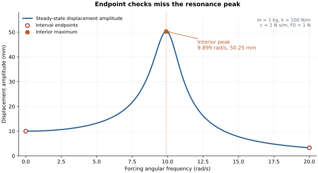
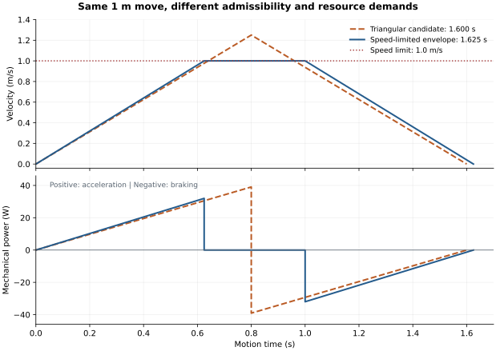

# 第3章 数量级、量纲与极限：先判断是否可能

**所属主题：问题与模型｜版本：V0.1 研究正文初稿｜日期：2026-11-16**

## 3.1 从一条漂亮曲线，回到一个物理系统

仿真中的平台可以在很短时间内到位，前提可能是执行器能够瞬间建立任意大的力；热分析中的器件平均温度可能不高，局部热点却已经超过允许值；能源账本可能显示一次往返的净机械功为零，驱动器却仍需承受加速功率、制动能量和持续损耗。

问题通常出在计算对象、约束或机制不完整。求解器正确求解了所输入的方程，并不自动说明方程描述的能力能够由现有设备实现。

第一章把任务转成有条件的要求，第二章明确数据的单位、参考与表达。本章进一步检查：**在规定对象、工况、资源和物理模型下，要求是否可能实现；简单计算能为这一判断提供多强的证据。**

早期分析不必立即复现所有细节，但应尽早回答：

- 主要性能由哪些尺度和机制控制？
- 至少需要多少时间、力、能量、功率或空间？
- 即使采用有利条件，方案是否仍不能满足要求？
- 简化所得是典型预测、指定方案结果，还是能够证明方向的界？
- 复杂计算是否通过量纲、平衡关系、极限和独立方法的校核？

本章采用经典力学、常规热学和连续介质工程模型；涉及其他物理尺度、强非线性材料或特殊工作机制时，应更换相应模型。所有数值为明确假设下的教学计算。

## 3.2 基本术语与结论的强度

### 3.2.1 先分清在做什么判断

| 术语 | 本章采用的专业含义或工作定义 | 结论的限制 |
| --- | --- | --- |
| 量纲校核 dimensional consistency check | 检查关系式在量纲、运算和对应物理类型上的相容性 | 量纲相容不能确定数值系数，也不能证明机制完整 |
| 数量级估算 order-of-magnitude estimate | 用主导尺度和少量参数识别结果的十进尺度及其主要依赖关系 | 不自动具有给定相对误差或覆盖概率 |
| 近似模型 approximate model | 在明确条件下省略、等效或近似部分关系，以支持特定用途的模型 | 近似值与原问题之差需要另行评估 |
| 可行解 feasible solution | 满足所研究问题全部约束的设计、状态或轨迹 | 必须说明“全部约束”属于哪一个模型和场景 |
| 松弛 relaxation | 通过扩大可行集合等方式，构造不比原问题更受限的问题 | 最优值的界向取决于最小化或最大化及目标函数关系 |
| 下界 lower bound、上界 upper bound | 在指定集合内，分别不大于、不小于目标量所有对应取值的量 | 一个取样点或一次仿真一般不构成全域界 |
| 保守估计 conservative estimate | 针对特定判定方向，采用使相关要求更难通过的估计 | 必须说明对象、方向、工况和依据 |
| 独立校核 independent check | 利用不同表达、推导、实现或证据来源复核同一结论 | 不同图表若共享同一错误模型，独立性仍很有限 |

量、量值、量纲及单位沿用第二章及VIM的含义。[R1] 表中的工程工作定义用于组织分析；不将其都宣称为某个统一行业标准的规范术语。

令不确定参数、工况、输入和扰动的组合为 $\xi$，研究集合为 $\mathcal D$，输出为 $Y(\xi)$。方向可靠的包络应满足：

$$
\ell(\xi)\le Y(\xi)\le u(\xi),
\qquad \forall \xi\in\mathcal D.
\tag{3-1}
$$

若采用常数界L、U，则应对整个集合有 $L\le Y(\xi)\le U$。区间端点不一定能被某个实际工况达到；因此，不能把“一个上界”自动称为“实际最大值”。

这里的原问题首先是当前作为依据的物理模型与约束。要将式（3-1）延伸到实物，还需证明参数范围和遗漏机制得到适当覆盖。模型用途、验证、确认和不确定性，应与决策所需的证据强度相匹配。[R15]

### 3.2.2 数量级与渐近符号的约定

对非零标量量Q，选同种量的正参考尺度 $Q_0$，构造无量纲正数 $q=|Q|/Q_0$。本章采用十进区间约定：

$$
q=c\,10^n,\qquad 1\le c<10,\qquad
n=\lfloor\log_{10}q\rfloor.
\tag{3-2}
$$

例如0.003 m以1 m为参考时，q为0.003，n为-3。换成毫米后，数值的十进指数会改变，物理长度并未改变。报告“差一个数量级”应统一单位和参考；不同资料也可能采用最接近的十次幂，应说明约定。零没有式（3-2）意义下的有限十进指数。

数学中的大O符号是渐近界。对同量纲函数f、g和无量纲参数 $\lambda$，一种常用定义为：

$$
f(\lambda)=\mathcal O(g(\lambda)),\quad \lambda\to0,
\quad\Longleftrightarrow\quad
\exists C>0,\delta>0:\ 
|f(\lambda)|\le C|g(\lambda)|,\ 
0<|\lambda|<\delta.
\tag{3-3}
$$

它不是“数值大约相等”的通用符号，也不提供常数C的数值。工程中的“约为”“按某尺度变化”和数学中的渐近结论应分别使用，不以符号替代误差说明。

### 3.2.3 典型值、指定方案结果与物理边界

同一个计算结果可以承担不同角色。例如“三角形速度轨迹所需的峰值功率”描述指定轨迹；“所有允许轨迹所需的最小峰值功率”则是另一个优化问题。

本章将结论分为四类：

| 结论类别 | 应随结果保留的说明 |
| --- | --- |
| 尺度估算 | 主导参数、遗漏系数、可能改变主导机制的因素 |
| 模型预测 | 方程、参数、初始条件和输入，以及预测误差依据 |
| 条件性上下界 | 研究集合、界的方向、证明依据和计算误差 |
| 可行方案证据 | 满足哪些约束、怎样构造、哪些实物条件仍待确认 |

数值十分接近实测，不自动使它成为全域界；界可以较松，但其不等号必须有依据。

## 3.3 量纲校核：先检查关系的结构

### 3.3.1 方程中的每一项都要接受检查

量纲校核至少包括：等式两侧相容；相加减的量属于可相加减的类型；导数和积分引入正确的时间或空间量纲；幂、指数、对数和三角函数的自变量按定义处理。

例如：

$$
\dim v=\mathsf L\mathsf T^{-1},\qquad
\dim a=\mathsf L\mathsf T^{-2},\qquad
\dim F=\mathsf M\mathsf L\mathsf T^{-2},\qquad
\dim P=\mathsf M\mathsf L^2\mathsf T^{-3}.
\tag{3-4}
$$

位置更新若写成“位移等于加速度乘时间”，量纲已经不相容；改成加速度乘时间平方后，形式上可以表示长度，但仍不能据此确定系数、初始速度和适用加速度条件。

对恒加速度且初始速度为零的运动，位移为加速度乘时间平方的一半。若讨论起终速度均为零的对称加减速运动，距离与总运动时间之间又会出现不同系数。这些差异来自运动条件，不能由量纲决定。

对数作用于相对于参考的无量纲比值；角度进入三角函数时应采用约定的弧度数值。频率、角频率、转速和周期必须按各自定义建立关系，不能仅因量纲接近就直接替换，相关区别见第二章。

### 3.3.2 单位一致还不够

力矩和能量具有相同量纲，表达的物理关系不同；位置向量与位移向量都可以采用米，但参考起点不同；标准差与最大允许误差都可以采用毫米，统计含义不同。

因此，量纲校核应与物理量类型、参考、时刻和统计口径一起进行。数据换成SI单位后，仍需检查其含义。

### 3.3.3 量纲检查应覆盖接口和中间变量

只检查最终输出容易漏掉相互抵消的错误。例如某个中间量多乘了1000，另一个中间量又少乘了1000，最后数值可能碰巧接近，但内部饱和、阈值和保护判断已经改变。

工程记录应在方程、参数表、接口和图轴上保留单位。程序中的比例、查表横轴、采样时间和协方差，也应纳入检查；第二章的数据字典是这一工作的基础。

## 3.4 数量级与尺度：识别主要资源需求

### 3.4.1 从少量参数建立主导尺度

设移动质量m在距离L上完成起终速度为零的运动，运动时间为 $T_m$。若考察一族形状相同、仅按时间和长度缩放的轨迹，忽略摩擦及其他驱动机制，则速度、惯性力和机械功率具有以下尺度：

$$
\begin{aligned}
v_{\mathrm{scale}}&=\frac{L}{T_m},&
a_{\mathrm{scale}}&=\frac{L}{T_m^2},\\
F_{\mathrm{scale}}&=\frac{mL}{T_m^2},&
P_{\mathrm{scale}}&=\frac{mL^2}{T_m^3}.
\end{aligned}
\tag{3-5}
$$

这些是尺度，不是所有轨迹的精确峰值。精确系数由轨迹形状、边界条件及额外约束决定。

在这一轨迹族和惯性主导条件下，距离、质量不变而运动时间减半，惯性力尺度变为4倍，功率尺度变为8倍。因此，“响应时间缩短一半”可能带来远大于一倍的执行器、电源和制动需求变化。

若存在持续摩擦力、重力、空气阻力、弹性储能或显著辅助负载，应比较其贡献，而不能继续只用式（3-5）。短行程中摩擦与驱动建立过程可能占主导；高速段中速度相关阻力可能改变功率尺度。

### 3.4.2 估算范围需要输入范围和作用方向

参数只知道一个区间时，应记录区间来源，并检查输出对各参数的单调性。质量、距离、可用时间和效率的组合可能相关，不能自动将它们视为独立随机变量。

对式（3-5），当m、L为正且固定时，惯性力和功率随 $T_m$减小而增加。若可用运动时间为1.6—1.8 s，可以据此计算相应轨迹族的需求范围；第3.10节给出完整数值。

这个范围来自参数集合与模型关系。除非另有概率模型和推断依据，不称为置信区间，也不赋予未经证明的95%覆盖含义。

### 3.4.3 几何放大不等于性能等比例放大

对几何相似、材料密度不变的一族物体，线性尺度放大 $\lambda>0$倍，有：

$$
L_2=\lambda L_1,\qquad
A_2=\lambda^2A_1,\qquad
V_2=\lambda^3V_1,\qquad
m_2=\lambda^3m_1.
\tag{3-6}
$$

如果进一步假设单位体积发热率相同、对流换热系数h不变，发热功率按体积变化，而给定温差下的对流散热能力按面积变化。由此得到的温升趋势与“尺寸增加多少，温升就增加多少”的任意经验类推不同。

这些结论具有附加条件：实际h可能随流动、几何和温度变化，材料、内部结构和边界也未必保持相似。尺度规律应连同相似条件记录；无量纲分析可以进一步识别哪些条件需要同时满足。[R2][R3]

一次有效的数量级估算，应指出主导项及可能使它失效的比值，而不只给出一个保留很多小数位的数。

## 3.5 守恒与平衡：把系统边界画出来

### 3.5.1 物质系统与控制体不同

物质系统跟踪同一组物质；控制体选择一个空间区域，允许物质穿过边界。工程中的机箱、储罐、泵、冷却通道与整机，可以选择不同控制边界。

质量、动量和能量关系应随边界选择改变表达。控制体内的量不一定恒定，边界通量和外部作用必须计入。Reynolds运输定理用于连接物质系统与控制体描述。[R4][R5]

本节采用固定在惯性参考系中的控制体。若边界运动，通量应使用物质相对于边界的速度；若参考系加速或转动，还需相应参考系处理，不能直接照搬下式。

### 3.5.2 质量平衡：有进出就可能有积累

在常规工程质量守恒模型下，控制体总质量 $M_{\mathrm{CV}}$满足：

$$
\frac{\mathrm dM_{\mathrm{CV}}}{\mathrm dt}
=\sum_{\mathrm{in}}\dot m_i-\sum_{\mathrm{out}}\dot m_j.
\tag{3-7}
$$

各端口的 $\dot m$表示取为非负的流入或流出质量流率。只有在积累项为零时，才可令总流入等于总流出。[R4]

体积流率相等还需要相应密度条件；气体压缩、液体储存或不同密度流体混合时，不能直接用体积代替质量。设备正在充装或排空时，稳态关系也不能替代瞬态关系。

### 3.5.3 动量平衡：外力和通量不能漏掉

在惯性系中，对同一物质系统：

$$
\frac{\mathrm d\mathbf P_{\mathrm{sys}}}{\mathrm dt}
=\sum\mathbf F_{\mathrm{ext}},\qquad
\Delta\mathbf P_{\mathrm{sys}}
=\int_{t_0}^{t_1}\sum\mathbf F_{\mathrm{ext}}\,\mathrm dt.
\tag{3-8}
$$

$\mathbf P_{\mathrm{sys}}$是总线动量。总外力为零时，总线动量保持不变；外力不为零时，应使用动量平衡或冲量关系。[R6]

对固定控制体，速度均在同一惯性系中定义和表达，有：

$$
\frac{\mathrm d}{\mathrm dt}\int_{\mathrm{CV}}\rho\mathbf v\,\mathrm dV
+\int_{\mathrm{CS}}\rho\mathbf v(\mathbf v\cdot\mathbf n)\,\mathrm dA
=\sum\mathbf F_{\mathrm{ext}}.
\tag{3-9}
$$

$\rho$为密度，$\mathbf n$为控制面外法向。第二项是净流出动量通量。喷流、泵、风道和液压系统的受力分析，不能只计算控制体内动量变化而漏掉它。[R5]

对固定质量质点，或以整个物体质心建立的平动模型，$\sum\mathbf F_{\mathrm{ext}}=m\mathbf a$是相应条件下的特例。质量变化、流体进出或多个物体相互作用时，应从完整平衡关系出发。

### 3.5.4 能量平衡：损耗是转移或转换

对封闭物质系统，以传入热量为正、系统对外做功为正，热力学第一定律可写为：

$$
\frac{\mathrm dE_{\mathrm{sys}}}{\mathrm dt}
=\dot Q_{\mathrm{in}}-\dot W_{\mathrm{out}}.
\tag{3-10}
$$

$E_{\mathrm{sys}}$包含所计入的内能、宏观动能和势能；若某保守力已用势能变化表示，不再将同一作用重复计为外功。电功、轴功及其他跨界能量应按一致约定计入。[R5]

对固定控制体、均匀端口状态及常见的单一流动方向近似，常用表达为：

$$
\begin{aligned}
\frac{\mathrm dE_{\mathrm{CV}}}{\mathrm dt}
={}&\dot Q_{\mathrm{in}}-\dot W_{\mathrm{out}}\\
&+\sum_{\mathrm{in}}\dot m
\left(h+\frac{\|\mathbf v\|^2}{2}+gz\right)
-\sum_{\mathrm{out}}\dot m
\left(h+\frac{\|\mathbf v\|^2}{2}+gz\right).
\end{aligned}
\tag{3-11}
$$

h为单位质量焓，含对应流动功；此时 $\dot W_{\mathrm{out}}$不再重复计入该流动功。g为所采用重力场的加速度大小，z为一致参考下的高度。端口显著不均匀时，应使用相应分布积分或有依据的修正，而非直接以平均量代替全部能流。[R16]

所谓摩擦损耗、铜耗和制动损耗，表示有用机械能或电能向热等形式转换。它们不意味着总能量凭空消失；选择整机、电源或环境作为边界时，记录位置也会改变。

### 3.5.5 能量充足与峰值功率足够是不同条件

对固定质量质点：

$$
K=\frac12m\|\mathbf v\|^2,\qquad
\frac{\mathrm dK}{\mathrm dt}
=\mathbf F_{\mathrm{net}}\cdot\mathbf v
=:P_{\mathrm{net}}.
\tag{3-12}
$$

合力所做的净功等于动能变化。[R7] 在一个时间区间内，可分别定义正、负机械功的大小：

$$
E_+=\int\max(P_{\mathrm{net}},0)\,\mathrm dt,\qquad
E_-=-\int\min(P_{\mathrm{net}},0)\,\mathrm dt,\qquad
E_+-E_-=\Delta K.
\tag{3-13}
$$

若起终均静止，$\Delta K=0$，但 $E_+$、$E_-$和峰值功率仍可很大。驱动器需要处理加速和制动过程，电源净耗能还取决于摩擦、效率、辅助负载和能量回收路径。不能以 $\Delta K/T$代替驱动器所需的峰值功率，也不能将其自动作为电池平均耗电功率。

另一个有用边界来自能量供给。若任务必须获得至少 $E_{\mathrm{need}}$的有用输出能量，初始可释放储能至多为 $\bar E_0$，唯一其他能量输入的功率不超过 $P_{\max}>0$，且已计入全部能源路径，则：

$$
E_{\mathrm{need}}\le \bar E_0+P_{\max}T
\quad\Longrightarrow\quad
T\ge\frac{\max(0,E_{\mathrm{need}}-\bar E_0)}{P_{\max}}.
\tag{3-14}
$$

这个下界忽略转换损耗，是在所述能源模型下的有利边界。若漏记预充电容、储压器或其他初始储能，可能错误地认为负载短时峰值违反电源能力；负载峰值可以高于某个外部电源的连续输出，但必须由完整能量账本解释。

## 3.6 约束包含：怎样从简化问题得到界

### 3.6.1 先说明界定的是哪一个最优值

设z代表设计或完整轨迹，原问题可行集合为 $\mathcal F$，以最小化指标J为目标：

$$
J^*=\inf_{z\in\mathcal F}J(z).
\tag{3-15}
$$

使用下确界是为了不预先假定最优值必能由某个解达到；具体模型若已证明存在最优解，可以使用最小值。

若放宽后的集合满足 $\mathcal F\subseteq\mathcal F_{\mathrm r}$，目标函数保持一致，则：

$$
\inf_{z\in\mathcal F_{\mathrm r}}J(z)\le J^*.
\tag{3-16}
$$

若同时将目标换成 $\tilde J$，还需在原可行解上满足 $\tilde J(z)\le J(z)$，才可按相应方向构造下界。这个集合与目标关系不要求原问题本身必须是凸问题；凸松弛是其中一种常用方法。[R8]

若找到满足原问题全部约束的候选解 $z_c$，则：

$$
J^*\le J(z_c).
\tag{3-17}
$$

因此，放宽最小化问题可以给最优值下界，实际可行候选解给最优值上界。最大化问题的集合放宽方向相反。某个候选解对最优值提供的上界，不是所有实际运行结果的上界。[R8][R9]

### 3.6.2 删除机制不自动等于放宽约束

删除一条限制可以直接检查集合包含；修改动力学方程却可能改变系统轨迹的对应关系。若新旧模型的变量不同，应说明原可行解怎样映射到简化问题，并证明其仍满足简化约束。

例如，真实平台满足一组力、摩擦和驱动方程。若能够证明所有真实可行运动都满足某个加速度上限，就可以只保留这一必要运动学条件，构成轨迹集合的外包。直接把摩擦项删掉并沿用原控制输入，则不能仅凭“更理想”三个字宣布集合包含。

此外，放宽问题的一次局部优化或一条仿真轨迹，并不等于放宽问题的最优值。对于最小化问题，局部候选目标值通常是该放宽问题最优值的上界，不能直接拿来充当原问题下界。用于严格判断时，应采用解析最优值、经过保证的全局下界、对偶证书或其他有依据的方法。

### 3.6.3 用速度可达包络证明运动时间下界

考虑一维运动，距离L为正，起终速度为零。假设所有待研究轨迹均满足 $|\dot v|\le a_{\max}$、$|v|\le v_{\max}$，其中两个上限为正。对给定运动时间T，从起点和终点分别积分可得：

$$
v(t)\le \min\left(a_{\max}t,\ v_{\max},\
a_{\max}(T-t)\right),\qquad 0\le t\le T.
\tag{3-18}
$$

对位移积分，得到：

$$
L\le L_{\max}(T)=
\begin{cases}
a_{\max}T^2/4,&T\le 2v_{\max}/a_{\max},\\
v_{\max}T-v_{\max}^2/a_{\max},
&T\ge 2v_{\max}/a_{\max}.
\end{cases}
\tag{3-19}
$$

该式对具有反向运动的轨迹仍给出正向位移上界，因为速度始终不超过所列包络。对只含这些运动学限制、允许瞬时切换加速度且无其他限制的模型，最大加速、必要时匀速、最大减速的轨迹可以达到包络。

反解得到该理想模型的最短运动时间：

$$
T_{\min}=
\begin{cases}
2\sqrt{L/a_{\max}},&0\le L\le v_{\max}^2/a_{\max},\\
L/v_{\max}+v_{\max}/a_{\max},
&L\ge v_{\max}^2/a_{\max}.
\end{cases}
\tag{3-20}
$$

两段在分界处相同。受限输入双积分器的最短时间问题具有相应最大加减速结构；速度上限下的包络和分段式由上述积分给出。[R12]

若真实系统的全部可行轨迹都包含在这个理想集合中，式（3-20）就是其最优运动时间的下界。若上限只是某个候选控制器当前采用的设置，而真实系统允许更大能力，则不能据此否决所有其他控制方案。

起终状态也属于证明条件。任务若允许终点区间、非零末端速度或其他完成判据，应按该允许集合重建边界，不能把精确位移、零末速模型的结论直接套上去。

## 3.7 单调性、比较关系与误差包络

### 3.7.1 参数取极值何时可以给界

对标量关系 $y=f(p)$，若p属于闭区间 $[p_-,p_+]$，f在该区间连续且内部可微，并且导数处处非负，则：

$$
\frac{\mathrm df}{\mathrm dp}\ge0
\quad\Longrightarrow\quad
f(p_-)\le f(p)\le f(p_+).
\tag{3-21}
$$

若导数处处非正，界的端点方向相反。仅在名义工作点计算一个偏导数，不能证明整个参数范围内的单调性。

多参数问题也应逐项确认方向及其成立域。将相关参数集合外包成矩形区间，可能获得较松但仍有效的包络；若某个角点实际无法出现，不应把它称为已确认的真实最坏工况。参数相关性还可能使“各项分别取最差值”远比实际联合极值更保守。

遇到分母变号、模式切换、饱和、接触、相变或共振时，应重新检查单调性及分段关系，不能把局部结论延伸到全部工况。

### 3.7.2 动态系统需要保序条件

对两个实标量系统，考虑：

$$
\begin{aligned}
\dot z&=f(t,z),&\quad \dot z_+&=g(t,z_+),\\
f(t,s)&\le g(t,s),& z(t_0)&\le z_+(t_0)
\quad\Longrightarrow\quad z(t)\le z_+(t).
\end{aligned}
\tag{3-22}
$$

一个常用的充分条件是：右端函数在共同适用域内连续，并对状态局部Lipschitz；对全部相关t、s满足所列函数大小关系；解在研究区间存在且留在该域内。比较时，f和g应在同一个状态取值s处比较，而非比较各自某次轨迹上恰好出现的导数。[R10]

该结论不能直接按分量推广到任意多维系统。多维状态之间存在耦合时，需要相应的保序、比较系统或其他证明条件。对于输出 $y=h(z)$，还应检查输出映射如何保持或改变不等号方向。

### 3.7.3 忽略散热何时给温升上界

设环境温度 $T_a$恒定，物体可用单温度节点表示，温升为 $\theta=T_b-T_a$，热容 $C_h>0$为常数。模型为：

$$
C_h\dot\theta=P_h(t)-\dot Q_{\mathrm{loss}}(t,\theta),
\qquad
\dot Q_{\mathrm{loss}}\ge0
\quad\Longrightarrow\quad
\theta(t)\le\theta(t_0)+
\frac1{C_h}\int_{t_0}^{t}P_h(s)\,\mathrm ds.
\tag{3-23}
$$

这里 $P_h$是已经计入全部来源的发热功率，$\dot Q_{\mathrm{loss}}$为向外净散热功率。只要在研究区间确实满足非负净散热，积分不等式便给出该节点温升的上界。若采用初始温度或发热功率上界，应继续核对其方向。

该结论的适用条件包括：没有漏计外界热输入；环境变化已被正确处理；热容近似和节点定义有效。实际环境升温时，温升导数还涉及环境温度变化，不能直接沿用恒定环境式。

单节点温度与局部最高温度尤其应区分。内部温度梯度显著时，平均温度的上界不能自动当作热点上界。集总热容模型通常需要内部温差足够小；Biot数可帮助检查内部导热与表面对流的相对作用，常用经验判据及其条件见热模型资料。[R13]

### 3.7.4 同一摩擦项，对不同指标可以产生相反方向

取一维水平运动，质量为m，执行器力幅值为F，滑动期间恒定库仑摩擦力幅值为 $F_f$，且 $F>F_f\ge0$。忽略静摩擦建立过程，研究正向运动从零加速至V，以及从V制动至零的阶段，则：

$$
t_{\mathrm{acc}}=\frac{mV}{F-F_f},\qquad
t_{\mathrm{stop}}=\frac{mV}{F+F_f},
\qquad V>0.
\tag{3-24}
$$

在此特定模型下，忽略摩擦会低估加速时间，却高估相同制动力下的停止时间。摩擦在前一阶段消耗可用加速能力，在后一阶段帮助减速。

这不等于已经证明完整往返、定位完成时间或闭环误差随摩擦单调变化。全过程还可能包含静摩擦、速度换向、控制切换与其他约束，应对所关心的完整输出重新分析。

### 3.7.5 误差包络能够把近似值转换为界

若原问题输出Y与简化输出 $\tilde Y$在整个研究集合内满足：

$$
|Y(\xi)-\tilde Y(\xi)|\le\varepsilon(\xi)
\quad\Longrightarrow\quad
\tilde Y(\xi)-\varepsilon(\xi)
\le Y(\xi)\le
\tilde Y(\xi)+\varepsilon(\xi).
\tag{3-25}
$$

简化结果本身可以时而偏大、时而偏小，只要包络得到证明，仍可建立上下界。

例如，对二阶连续可微的标量函数f，采用工作点 $p_0$的一阶近似。若在 $|p-p_0|\le\Delta p$内有 $|f''(p)|\le M$，则Taylor余项给出：

$$
f_{\mathrm{lin}}(p)=f(p_0)+f'(p_0)(p-p_0),
\qquad
|f(p)-f_{\mathrm{lin}}(p)|
\le\frac12M(\Delta p)^2.
\tag{3-26}
$$

M必须覆盖整个区间，且函数和导数在该区间内有效。这个例子说明：可利用简化关系，同时保留对近似误差方向和大小的控制。

实际工作还要分别处理参数范围、模型遗漏和数值误差。若已对同一比较链建立相应误差界，可以按三角不等式组合；不能重复加入已被包络覆盖的同一来源。区间算术等验证计算方法能够为运算结果提供包含保证，但不会自动补齐缺失的物理机制。[R11]

一次拟合残差、若干试验的最大偏差、标准差或任意百分比，都不能自动替代式（3-25）的全域误差界。证据只覆盖部分工况时，应如实标明范围和概率含义。

## 3.8 无量纲比值：把数值转成机制之间的比较

### 3.8.1 同一问题中，哪些关系真正控制结果

对移动平台，可构造：

$$
\begin{aligned}
\Pi_a&=\frac{a_{\max}T_m^2}{L},&
\Pi_v&=\frac{v_{\max}T_m}{L},\\
\Pi_P&=\frac{P_{\mathrm{mech,cap}}T_m^3}{mL^2},&
\Pi_f&=\frac{F_fT_m^2}{mL}.
\end{aligned}
\tag{3-27}
$$

各量的物理含义必须保持明确：$P_{\mathrm{mech,cap}}$是所选机械输出边界的功率能力，不能直接替换为电源输入功率；$T_m$是运动时间，不能混成包含其他开销的总作业时间。

$\Pi_a$比较加速度能力与任务运动尺度，$\Pi_v$比较速度能力与平均位移速率，$\Pi_P$比较机械功率与惯性功率尺度，$\Pi_f$比较摩擦与所选惯性力尺度。它们用于识别需要检查的机制，不意味着所有指标都已独立满足。

例如，起终零速度、精确移动L的模型至少需要 $\Pi_a\ge4$；单独由位移与速度上限还可得 $\Pi_v\ge1$。这两个条件各自必要，但不能替代式（3-19）的联合约束。加速度有限、L为正时，达到平均速度等于速度上限还会受到起停过程限制。

另一个有用比值为 $\chi=a_{\max}L/v_{\max}^2$。在式（3-20）的模型中，$\chi\le1$对应不必到达速度上限的分支，$\chi>1$对应含匀速段的分支。无量纲比值在这里直接区分模型的工作区域。

### 3.8.2 Buckingham Π定理能提供什么

设一个量纲齐次关系涉及n个选定物理变量，将各变量基本量纲的指数作为列，组成量纲矩阵D，其秩为r。对适当的正值域，可寻找指数向量a：

$$
D\mathbf a=0,\qquad
\Pi=\prod_{i=1}^{n}q_i^{a_i},\qquad
\dim\ker D=n-r.
\tag{3-28}
$$

由此可构造n-r个独立无量纲群，将原关系改写为这些群之间的关系。r是所选变量实际涉及的独立量纲秩，不应机械地总取3。[R2][R3]

该方法有三项重要限制：

1. 变量集合必须足以描述所研究关系，遗漏温度、粗糙度、初始状态或其他机制后，得到的相似性可能不适用于实际对象。
2. 定理不确定无量纲函数的具体形式，也不确定比例常数；这些仍需物理推导、试验或其他证据。
3. 几何、边界条件、材料本构和相关无量纲参数应满足相应相似要求，才能从一个尺度可靠推向另一个尺度。

因此，“两个系统的某一个比值相同”不等于全部行为相似。无量纲化应围绕当前决策选择必要群，并保留其物理解释。

### 3.8.3 一个热问题中的无量纲检查

对具有导热系数k、对流换热系数h和特征长度 $L_c$的物体，Biot数为 $\mathrm{Bi}=hL_c/k$。常用集总热容检查采用 $L_c=V/A_s$，其具体选择应与模型和边界定义一致。

Biot数比较内部导热与表面对流的相对阻力。相关模型资料常以Bi小于约0.1作为可采用集总近似的经验检查之一，但它不是任意几何、热源和局部热点条件下的统一误差保证。[R13]

这个例子说明，无量纲数的用途是帮助选择模型并识别近似条件。阈值应连同定义和适用范围使用，不能仅按名称套用。

## 3.9 极限、最不利工况与模型有效域

### 3.9.1 参数极限检查什么

极限检查利用参数趋向某个值时的行为，核对模型是否与物理预期和已知特例一致。检查前应说明该极限是否仍处在原模型适用域中。

| 检查 | 当前模型的趋势 | 不能据此推出的结论 |
| --- | --- | --- |
| 固定距离，运动时间趋近零 | 式（3-5）的惯性力和功率尺度增大 | 任意增大控制增益就能实现该响应 |
| 速度上限趋于无穷 | 式（3-20）退化为仅受加速度限制的分支 | 真实设备没有速度、功率和结构限制 |
| 加速度上限趋于无穷、速度上限固定 | 理想最短时间趋近L除以速度上限 | 有限加速度设备可以无起停代价地达到该值 |
| 固定运动时间，距离趋近零 | 当前轨迹族的惯性资源需求趋近零 | 接口开销、摩擦、待机功率及定位时间也趋近零 |
| 单节点恒定发热，散热系数趋近零 | 有限时间温升趋近绝热积累结果 | 节点温度自动等于局部最高温度 |

例如，运动时间缩短到驱动建立时间、采样周期或柔性振动时间尺度附近时，原先忽略的机制可能成为主导。不能先将公式推到失效区域，再把数学发散或趋零直接当作设备预测。

### 3.9.2 区间端点不一定是最不利工况

极限检查与寻找给定范围内的最不利工况是两项工作。最不利点可能出现在区间内部，共振是典型例子。

考虑线性单自由度系统，位移相对静平衡位置定义：

$$
m\ddot x+c\dot x+kx=F_0\cos(\omega t),
\qquad m,k,c>0.
\tag{3-29}
$$

在稳态谐波响应中，位移幅值为：

$$
X(\omega)=
\frac{F_0}{\sqrt{(k-m\omega^2)^2+(c\omega)^2}}.
\tag{3-30}
$$

令 $\omega_n=\sqrt{k/m}$、$\zeta=c/(2\sqrt{km})$。当 $0<\zeta<1/\sqrt2$时，位移幅频曲线的内部峰值频率为：

$$
\omega_r=\omega_n\sqrt{1-2\zeta^2}.
\tag{3-31}
$$

该频率与无阻尼固有频率一般不同。[R14] 稳态幅值也不是任意初始条件下瞬态位移的全程上界。

取教学参数m=1 kg、k=100 N/m、c=2 N·s/m、$F_0=1$ N，在0—20 rad/s范围内：

| 角频率 | 稳态位移幅值 |
| --- | --- |
| 趋近0的准静态极限 | 0.01000 m |
| $\sqrt{98}\approx9.8995$ rad/s | 约0.05025 m |
| 20 rad/s | 约0.003304 m |

若只检查最低和最高频率，会漏掉内部约五倍于静态位移的峰值。温度、负载、速度和控制参数组合也可能通过模式切换、饱和或耦合产生内部最不利点。

**图3-1** 按式（3-30）及上表参数直接计算。空心点为区间端点，实心点为内部幅值峰值；图中以毫米显示位移，正文公式采用米。

### 3.9.3 物理极限、额定值和当前设置要分开

额定持续能力、允许短时能力、软件限制和理论极限描述不同条件。电机标称功率不自动等于所有速度下的可用机械功率；力、速度、温度和持续时间也可能相互约束。

用于否决方案的能力上界，应真正覆盖该方案允许采用的全部工作方式。用于保证满足要求的能力下界，则应在规定负载和环境下可用。将供应商承诺的最低能力误作不可超过的最高能力，会把界的方向用反。

因此，参数表不仅需要数值和单位，还需要“上限、下限、典型值、当前设置或待确认假设”等属性，并说明这些条件是否可以同时成立。

## 3.10 贯穿算例：时间要求怎样传到力、能量和功率

### 3.10.1 任务、输入及当前依据

延续第一章的直线移动平台。任务为移动1 m，起终速度为零，总作业时间不超过2 s。串行非运动开销 $\tau$取0.2—0.4 s，当前定义明确要求覆盖 $\tau=0.4$ s这一工况。

为研究资源关系，本章新增移动质量20 kg的教学假设。它不是实测设备参数。先采用水平、刚体、固定质量、无摩擦的模型，暂不计电机和传动损耗、辅助负载、柔性、有限跃度及定位稳定过程。跃度指加速度对时间的导数。

| 输入 | 数值或定义 | 依据及属性 |
| --- | --- | --- |
| 距离L | 1 m | 教学任务规定的精确位移 |
| 总时间上限 | 2 s | 教学任务给定 |
| 非运动开销 $\tau$ | 0.2—0.4 s | 教学允许区间，且不与运动重叠 |
| 运动时间 $T_m$ | 不超过 $2-\tau$ s | 由当前串行任务模型得到 |
| 质量m | 20 kg | 本章新增教学假设 |
| 初始、末端速度 | 均为0 | 当前模型的边界条件 |
| 初步轨迹族 | 对称匀加速、匀减速 | 候选方案，不代表全部可行轨迹 |

若真实任务采用位置容许带和末端速度阈值，应首先将它们替换进边界条件，重新论证时间下界。第一章尚未确定的定位阈值，不在这里任意补成某个毫米值。

### 3.10.2 先计算指定轨迹族的需求

对对称三角形速度轨迹，前半段恒加速a，后半段恒减速-a。采用全部可用运动时间时：

$$
\begin{aligned}
a&=\frac{4L}{T_m^2},&
v_{\mathrm{pk}}&=\frac{2L}{T_m},\\
F_{\mathrm{pk}}&=\frac{4mL}{T_m^2},&
P_{\mathrm{mech,pk}}&=\frac{8mL^2}{T_m^3},\\
K_{\mathrm{pk}}&=\frac{2mL^2}{T_m^2}.
\end{aligned}
\tag{3-32}
$$

力为合惯性力，功率为该理想驱动的峰值机械功率大小。实际驱动力还应按完整受力模型加入摩擦、重力、传动等贡献，电源输入也应另算。

| 串行开销 | 运动时间 | 加速度幅值 | 峰值速度 | 峰值惯性力 | 峰值机械功率 | 峰值动能 |
| --- | --- | --- | --- | --- | --- | --- |
| 0.2 s | 1.8 s | 1.2346 m/s² | 1.1111 m/s | 24.691 N | 27.435 W | 12.346 J |
| 0.4 s | 1.6 s | 1.5625 m/s² | 1.2500 m/s | 31.250 N | 39.063 W | 15.625 J |

这些结果描述当前三角形轨迹族。其中，加速度幅值至少为 $4L/T_m^2$可由式（3-19）的加速度包络证明；对固定质量、无其他合力贡献的本例，相应惯性力也有下界。但不能将所列峰值速度与峰值功率的系数一并泛化为全部轨迹的最小峰值。改变轨迹形状、允许更大加速度或引入其他约束，可能改变资源组合。

表中小数位用于复核计算关系，不代表任务输入或设备能力已有相同精度的证据。

### 3.10.3 用冲量、功和功率独立重算

取 $T_m=1.6$ s，前半段0.8 s，位移0.5 m。根据不同表达：

$$
\begin{aligned}
F_{\mathrm{pk}}\frac{T_m}{2}
&=(31.25\ \mathrm N)(0.8\ \mathrm s)=25\ \mathrm{N\,s}
=mv_{\mathrm{pk}},\\
F_{\mathrm{pk}}\frac L2
&=(31.25\ \mathrm N)(0.5\ \mathrm m)=15.625\ \mathrm J
=\frac12mv_{\mathrm{pk}}^2,\\
\frac12P_{\mathrm{mech,pk}}\frac{T_m}{2}
&=\frac12(39.0625\ \mathrm W)(0.8\ \mathrm s)
=15.625\ \mathrm J.
\end{aligned}
\tag{3-33}
$$

最后一行利用前半程功率随速度线性增加，其时间图为三角形。运动学面积、冲量、机械功与功率积分给出相容结果。

加速阶段需要15.625 J机械能，制动阶段需处理同样大小的机械能。完整运动的净动能变化为零，但不能据此将峰值机械功率写为零。实际制动能量可以被回收、耗散或暂存，取决于系统路径。

这些校核在物理上共享牛顿力学，因此主要用于检查推导、单位和实现；它们不能代替对质量、摩擦、驱动能力和测量结果的实物确认。

### 3.10.4 加上速度上限，联合检查会改变结论

现假设该候选方案存在不可超过的硬限制：

- 加速度幅值不超过1.6 m/s²；
- 速度幅值不超过1.0 m/s；
- 在当前理想模型中，对应的最大加减速能力能够在所需速度区间内建立。

第三项是理想包络可达到的假设。若用于给真实系统时间下界，只需真实可行轨迹全部受到前两项上限约束；若要把包络轨迹当作可行候选，则还需其确能实现。

虽然1.6 m/s²大于三角形方案计算出的1.5625 m/s²，速度上限却低于所需的1.25 m/s。代入式（3-20），得到：

$$
\begin{aligned}
T_{m,\min}
&=\frac{1\ \mathrm m}{1\ \mathrm{m\,s^{-1}}}
+\frac{1\ \mathrm{m\,s^{-1}}}{1.6\ \mathrm{m\,s^{-2}}}
=1.625\ \mathrm s,\\
T_{\mathrm{total}}&\ge\tau+1.625\ \mathrm s.
\end{aligned}
\tag{3-34}
$$

对应理想轨迹为：加速0.625 s，匀速0.375 s，减速0.625 s。其峰值惯性力为32 N，峰值机械功率为32 W，峰值动能为10 J。

对 $\tau=0.2$ s，理想总时间为1.825 s；对需要覆盖的 $\tau=0.4$ s，理想总时间为2.025 s，已经超过2 s。若上述限制确实覆盖原问题允许的全部轨迹，那么在本例精确起终状态和串行开销下，后一工况不能靠改变控制算法满足要求。

25 ms是本教学精确参数下的模型差额。真实项目需要确认上限、开销、终点条件及其证据精度，不能把计算显示的小数位当作已经完成这些确认。

尤其需要检查：如果1.6 m/s²只是供应商保证“至少能够达到”的能力下限，而实际允许更大加速度，就不能将其当作所有轨迹都不可超过的上限来否决方案。

**图3-2** 同一1 m、20 kg教学任务。橙色虚线三角形方案超过1 m/s速度上限；蓝色实线为同时受速度与加速度限制的理想包络轨迹。机械功率正值对应加速，负值对应制动；两条曲线按各自运动时间绘制，瞬时切换加速度的假设尚未包含有限跃度。

### 3.10.5 这组计算支持什么决策

| 当前结果 | 结论类别 | 能支持的动作 |
| --- | --- | --- |
| 三角形轨迹的力、能量、功率 | 指定方案资源需求 | 初步检查驱动、电源、制动和热路径 |
| 仅受加速度限制的最短时间 | 放宽后的时间下界 | 排除连该必要条件都不满足的方案 |
| 同时考虑速度与加速度的最短时间 | 更紧的理想模型结果 | 识别速度限制及联合约束造成的不可行工况 |
| 2.025 s与2 s的比较 | 本例条件下的越界判断 | 调整允许开销、资源、任务或结构约束 |
| 实际定位完成时间 | 尚未获得的实物结论 | 引入驱动动态、柔性、有限跃度及完成判据验证 |

增加有限跃度等原模型外的限制，在其他条件不变且可行集合确实缩小时，不会让最优完成时间更短。若更改了终点容许带、允许末速或开销重叠关系，则是在更换任务模型，应重新推导。

## 3.11 用简单关系校核复杂结果

### 3.11.1 校核应尽量拥有不同的出错路径

一个完整仿真可以按以下关系复核：

| 校核对象 | 简单关系 | 主要能发现的问题 |
| --- | --- | --- |
| 位移与时间 | 速度曲线面积、可达包络 | 时间定义错误、速度限制遗漏、积分或单位错误 |
| 速度变化 | 合外力的时间积分与动量变化 | 漏力、方向错误、质量或步长使用错误 |
| 能量变化 | 功、热、流动能量与储能变化 | 漏损耗、重复计入、能量凭空增加 |
| 峰值与平均 | 峰值、正负功、窗口积分分别检查 | 将净值或平均值当作峰值能力 |
| 尺度与特例 | 参数缩放、极限、解析特例 | 公式系数、模式切换与模型适用性错误 |
| 数值结果 | 不同步长、容差或独立实现对照 | 离散化、积分、插值和求解误差 |

将同一数组画成两种图，不构成独立校核；两个程序复制同一错误方程，也可能高度一致。应说明独立的是推导、实现、参数来源还是测量链。

### 3.11.2 建立平衡残差，但不让残差替代物理判断

对具有相应能量边界的封闭系统，可定义：

$$
r_E(t)=E(t)-E(t_0)
-\int_{t_0}^{t}
\left(\dot Q_{\mathrm{in}}-\dot W_{\mathrm{out}}\right)\,\mathrm ds.
\tag{3-35}
$$

完整且一致的连续模型应满足 $r_E=0$。实际计算可因积分、采样、截断和数据不同步出现非零残差，应检查其来源和随数值设置变化的趋势。

若需归一化，可采用预先定义的正能量尺度 $E_{\mathrm{ref}}>0$：

$$
\rho_E(t)=\frac{|r_E(t)|}{E_{\mathrm{ref}}}.
\tag{3-36}
$$

参考尺度可来自当前任务的代表性储能或能量通量，应记录选择依据；不要用可能为零的全周期净功作分母。阈值应结合数值误差、测量能力和决策需要确定，不任意把某个百分比宣称为普遍标准。

残差接近零，说明所列账本之间相容。若热损耗、外部做功或流动能量根本没有进入账本，它仍可能对一个不完整模型给出接近零的结果。因此，还需独立审查系统边界和机制。

### 3.11.3 数值收敛与原问题正确性分别取证

缩小步长、收紧容差或加密网格，可以检查离散结果是否稳定。结果稳定并不自动证明已接近正确物理解，也不自动给出严格误差界。

用于上下界判定时，还应处理舍入、积分截断和优化求解误差。若只有近似数值而没有误差证书，应保留相应未确定范围；区间方法需要正确端点舍入和完整包含关系才能提供其保证。[R11]

源代码、求解配置、输入参数、数据处理和校核记录应保持版本一致。模型确认则继续需要与预期用途相适应的实测或其他独立证据。[R15]

## 3.12 保守程度与通过判定

### 3.12.1 针对哪一侧保守

对要求 $Y\le Y_{\mathrm{lim}}$，若L、U为研究集合内的全域常数下界和上界，则：

$$
\begin{aligned}
U\le Y_{\mathrm{lim}}
&\ \Longrightarrow\
\forall\xi\in\mathcal D,\ Y(\xi)\le Y_{\mathrm{lim}},\\
L>Y_{\mathrm{lim}}
&\ \Longrightarrow\
\forall\xi\in\mathcal D,\ Y(\xi)>Y_{\mathrm{lim}}.
\end{aligned}
\tag{3-37}
$$

若界区间跨过阈值，当前信息不能完成相应判定。要否定“覆盖全部允许工况”的保证，找到一个确实允许的工况，并证明该工况下的输出下界超过阈值，就已足够；不必证明所有工况都失败。

对最小时间等优化问题，下界超过要求可以排除方案；一个满足全部约束且时间不超过要求的候选解，可以证明当前模型内存在可行方案。候选方案的存在性与全工况运行保证仍是不同结论。

资源选型常需将需求上界与可用能力下界比较：

$$
\overline R_{\mathrm{need}}\le
\underline R_{\mathrm{available}}.
\tag{3-38}
$$

两侧必须对应同一种资源、同一工况、同一持续时间和同一作用边界。力、速度、功率、温度等能力若相互耦合，还需证明所需组合可以同时实现；逐项比较通过不一定构成整机可行性证明。

### 3.12.2 设计余量与不确定性不能混在一起

可靠界的松紧可以通过上下界差距衡量，但“更松”不总等于更有用。下界较低，可能无法排除明显困难的方案；需求上界过高，则可能导致设备过度选型。

设计余量是为明确目的保留的能力或资源空间；模型误差包络用于覆盖已分析的不确定影响；行业规定的安全系数则应按其适用对象和依据采用。三者可能有关，但不能用任意乘数相互替代，也不应重复计入同一影响。

工程记录应分别保存：名义预测、参数范围、已证明的界、未覆盖机制及设计余量。若决策仍取决于一个未知参数，应优先补证该参数，而非继续增加与决策无关的仿真细节。

### 3.12.3 概率覆盖与确定性包络

如果参数集合本身仅具有概率覆盖，则输出结论也应保留这一层条件。若能够证明：

$$
\begin{gathered}
\Pr(\xi\in\mathcal D)\ge1-\alpha,\qquad
\forall\xi\in\mathcal D:\ L\le Y(\xi)\le U,\\
\Longrightarrow\quad
\Pr(L\le Y\le U)\ge1-\alpha.
\end{gathered}
\tag{3-39}
$$

这里要求的是联合参数集合的覆盖，不能把各参数分别的覆盖率直接当成联合覆盖率。用于建立该集合的统计证据置信度，又与集合所覆盖的总体比例不同，详见第一章。

因此，一个有限样本范围、一个标准差区间和一个全工况物理界，不能只因都写成上下限就视为同一类证据。

## 3.13 本章的最小产物：一页可行性估算与独立校核表

### 3.13.1 一页记录应保留哪些信息

一页估算用于使另一位工程师快速重现判断。它可以链接到详细推导、图纸和试验，但关键假设、结果类别及未决事项应留在这一页。

至少包含以下内容：

- **问题与判据：** 对象、任务、起终条件、工况及通过阈值。
- **主要输入：** 数值、单位、范围、来源，以及上限/下限/典型值等属性。
- **简化关系：** 方程、遗漏机制、适用域和界向依据。
- **结果与校核：** 需求范围、物理界、独立关系及差额。
- **当前结论：** 排除、尚未排除、模型内可行或待补证；下一步应取得什么信息。

对大系统，按子任务或主导机制分别形成一页记录，并通过共同的单位、基准和版本关联。不要为压缩篇幅删掉会改变不等号方向的条件。

### 3.13.2 移动平台的填写示例

**对象与判据：** 水平20 kg平台精确移动1 m，起终速度为零；总时间不超过2 s；需覆盖串行开销0.4 s。以下仍为教学模型。

| 检查项 | 关系与结果 | 条件及当前判断 |
| --- | --- | --- |
| 可用运动时间 | $(2-0.4)$ s = 1.6 s | 开销与运动不重叠 |
| 三角形轨迹需求 | a=1.5625 m/s²，峰速1.25 m/s | 指定轨迹族；速度上限1 m/s不允许此轨迹 |
| 惯性资源 | 峰力31.25 N，峰功率39.0625 W，峰动能15.625 J | 无摩擦、无损耗，属于上述三角形方案 |
| 仅加速度约束 | 时间下界约1.5811 s | 小于1.6 s，单凭这一界不能否决或证明可行 |
| 联合速度与加速度约束 | 最短运动时间1.625 s | 硬上限1.6 m/s²、1 m/s；包络推导成立 |
| 总时间比较 | 下界2.025 s，大于2 s | 在本例任务和上限条件下排除该工况 |
| 独立校核 | 位移面积、加速冲量25 N·s、正机械功15.625 J | 量纲与所选轨迹相容 |
| 关键未决事项 | 上限证据、终点容许集合、开销、驱动与结构机制 | 真实项目应确认后再迁移结论 |
| 后续动作 | 复核任务剖面和上限；评估资源或任务调整 | 不以任意安全系数代替重新建模 |

配套[一页可行性估算与独立校核模板](https://github.com/voilalz/the-art-of-engineering/blob/main/templates/feasibility-estimate-and-cross-check.md)提供空白工作件，可与第一章任务记录和第二章物理量字典共同使用。

## 3.14 常见混淆与完成标准

| 常见做法或说法 | 应改为怎样检查 |
| --- | --- |
| 量纲一致，所以公式正确 | 继续核对系数、边界条件、对象和遗漏机制 |
| 数值合理，所以物理可行 | 逐项检查资源、作用路径和联合约束 |
| 忽略某个阻力，所以全部结果偏乐观 | 对指定过程和输出证明单调性或集合包含 |
| 松弛模型仿真得到某个值，所以它是下界 | 检查是否为已证明最优值或具有下界证书 |
| 得到一个可行方案，所以所有工况都通过 | 分开存在性证明与全工况保证 |
| 保证能力至少为某值，所以它不能超过该值 | 区分能力下界与不可超过的上界 |
| 只测参数区间两端即可覆盖最坏工况 | 检查内部极值、模式切换和耦合 |
| 全周期净功为零，所以不需要驱动能量与功率 | 分开正负功、峰值、损耗和回收路径 |
| 平均温度有界，所以热点温度也有界 | 核对空间分布和被界定的具体温度 |
| 所有参数各自取最差值就是实际最坏状态 | 核对联合可达集合和该组合是否可能 |
| 乘一个安全系数就得到严格上界 | 明确系数来源、作用对象和未覆盖影响 |
| 两次计算一致，所以模型已被确认 | 检查独立性及与实物证据的关系 |

本章的过关标准是：工程师能够用少量参数给出主要性能尺度、至少一项有依据的边界和一项不同路径的校核；能够解释详细结果为什么没有越过这些边界，以及哪些条件尚未被覆盖。

如果简单边界已经否决方案，应优先改变任务、架构或资源；如果上下界仍跨越决策阈值，应识别最值得补证的参数或机制。详细计算的作用，是缩小这些未决范围，并形成可追溯的设计依据。

## 参考文献与定义来源

通用术语、定理和物理关系参照下列一手资料作中文释义；本章的分析组织、参数属性表、一页工作件及数值算例为项目工作约定或独立教学推导。模型和界的适用条件在正文逐项说明。来源核对日期：2026-11-16。

- **[R1]** JCGM. *International Vocabulary of Metrology*, 1.7 Quantity dimension. 量及单位相关定义见第二章。 [官方词条](https://jcgm.bipm.org/vim/en/1.7.html)
- **[R2]** MIT OpenCourseWare. *Unified Engineering: Fluids—Lecture 4, Dimensional Analysis—Buckingham Pi Theorem*, 2005–2006. 用于无量纲化、参数缩减和动力相似。 [官方讲义](https://ocw.mit.edu/courses/16-01-unified-engineering-i-ii-iii-iv-fall-2005-spring-2006/b0d2168f3fc45735017ff56c05bd9a0c_f04_fall.pdf)
- **[R3]** MIT OpenCourseWare. *18.354J Nonlinear Dynamics II: Continuum Systems, Lecture 3—Dimensionless Groups*, 2015. 用于Π定理及其不能确定无量纲函数的限制。 [官方讲义](https://ocw.mit.edu/courses/18-354j-nonlinear-dynamics-ii-continuum-systems-spring-2015/f76b4aaa19153628ae7e7f91b12595ee_MIT18_354JS15_Ch3.pdf)
- **[R4]** Cimbala, J. M., Penn State. *Conservation of Mass using Control Volumes*. 用于积累、质量通量和稳态条件。 [作者课程](https://www.me.psu.edu/cimbala/Learning/Fluid/CV_Mass/home.htm)
- **[R5]** Cimbala, J. M., Penn State. *Control Volume (Integral) Technique*. 用于物质系统、控制体和Reynolds运输关系。 [作者课程](https://www.me.psu.edu/cimbala/Learning/Fluid/Control_Volume/home.htm)
- **[R6]** OpenStax. *University Physics Volume 1*, 9.3 Conservation of Linear Momentum. 用于外力与总动量的条件关系。 [作者教材](https://openstax.org/books/university-physics-volume-1/pages/9-3-conservation-of-linear-momentum)
- **[R7]** OpenStax. *University Physics Volume 1*, 7.3 Work-Energy Theorem. 用于净功、动能变化及其适用对象。 [作者教材](https://openstax.org/books/university-physics-volume-1/pages/7-3-work-energy-theorem)
- **[R8]** Boyd, S.; Vandenberghe, L. *Convex Optimization*, lecture slides, section 4.40 Convex Relaxation. 用于可行集合外包与目标函数下界。 [作者讲义](https://web.stanford.edu/~boyd/cvxbook/bv_cvxslides.pdf)
- **[R9]** Boyd, S., Stanford EE364b. *Branch and Bound*. 用于可行点、松弛及上下界证书的分工。 [作者讲义](https://see.stanford.edu/materials/lsocoee364b/17-bb_slides.pdf)
- **[R10]** Burke, J. V., University of Washington. *Linear Analysis*, lecture notes on differential inequalities and real scalar comparison. 用于比较定理的条件及适用范围。 [作者讲义](https://sites.math.washington.edu/~burke/crs/554/lectures/b-lecture22.pdf)
- **[R11]** NIST. *Digital Library of Mathematical Functions*, §3.1(ii) Interval Arithmetic. 用于带适当舍入的计算包含区间。 [官方正文](https://dlmf.nist.gov/3.1)
- **[R12]** Tedrake, R., MIT. *Underactuated Robotics*, Dynamic Programming: Optimal Control Formulations for the Double Integrator. 用于受限输入与最短时间的基本结构。 [作者教材](https://underactuated.csail.mit.edu/dp.html)
- **[R13]** COMSOL. *Theory for the Thermal Capacitor and Thermal Mass Components*, version 6.3. 用于集总热容、Biot数及常用近似条件；不将其经验阈值作为所有热问题的统一误差保证。 [官方模型文档](https://doc.comsol.com/6.3/doc/com.comsol.help.heat/heat_ug_theory.07.039.html)
- **[R14]** University of Alberta, Engineering Open Educational Resources. *Forced Vibrations of Damped Single Degree of Freedom Systems: Damped Spring Mass System*. 用于受迫振动幅频关系及内部峰值。 [作者课程](https://engcourses-uofa.ca/books/vibrations-and-sound/forced-vibrations-of-damped-single-degree-of-freedom-systems/damped-spring-mass-system/)
- **[R15]** NASA. *NASA-STD-7009B: Standard for Models and Simulations*, 2024；配套 *NASA-HDBK-7009B*, 2026. 用于模型用途、可信度和证据的组织思想；具体项目的适用要求另行确定。 [标准](https://standards.nasa.gov/sites/default/files/standards/NASA/B/1/NASA-STD-7009B-Final-3-5-2024.pdf)；[配套手册入口](https://standards.nasa.gov/standard/nasa/nasa-hdbk-7009)
- **[R16]** MIT Unified Engineering. *Control Volume Form of the System Laws*, section 2.5. 用于开放系统能量、流动功及焓的关系。 [作者课程](https://web.mit.edu/16.unified/www/SPRING/thermodynamics/notes/node18.html)

前置定义见[第一章](https://github.com/voilalz/the-art-of-engineering/blob/main/docs/problem-and-model/ch01-from-request-to-engineering-problem.md)和[第二章](https://github.com/voilalz/the-art-of-engineering/blob/main/docs/problem-and-model/ch02-units-datums-and-coordinates.md)。

