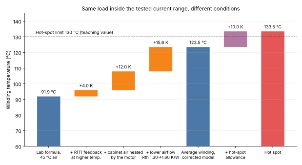

# 第4章 模型、假设与适用范围：模型支持什么结论

**所属主题：问题与模型｜版本：V0.1 研究正文初稿｜日期：2026-11-17**

## 4.1 同一个公式，为什么换了工况就失效

一个在恒温实验室里拟合得很好的温升公式，装进密闭机柜后明显低估温度；一组在空载台架上辨识出的摩擦参数，换了负载和润滑状态后不再适用；一条在常温下标定的传感器曲线，到了低温环境出现系统偏差。公式本身往往没有算错，问题在于：**公式在实验室成立，依赖的是实验室提供的一组条件，而这些条件没有被写进公式。**

实验室里被固定下来的环境温度、气流、负载、安装方式、初始状态和操作节奏，在拟合时变成了常数，进而被吸收进参数。换到新工况时，这些“常数”变了，公式却仍然沿用原来的参数和结构。

第一章建立了任务、场景与模型的关系，第二章统一了量的含义，第三章用简单关系判断方案是否可能。本章进一步回答：**一个模型由哪些部分组成；它的结论在哪些条件下成立；工况变化时，什么情况只需重新校准参数，什么情况必须重新建模。**

具体而言，本章关心：

- 模型的依据是物理规律、经验关联还是数据拟合，这会怎样影响外推？
- 静态与动态、集中与分布、线性与非线性，各自需要什么前提？
- 边界条件和初始条件是否与使用工况一致？
- 预测偏离实际时，偏离来自参数取值，还是来自模型结构？
- 当前决策需要多复杂的模型，增加细节能否改变决策？

本章以集总热模型、刚体运动和常规电阻温度关系为主要例子；所有数值均为明确假设下的教学计算，不代表具体产品。

## 4.2 模型由什么组成

### 4.2.1 基本术语

| 术语 | 本章采用的含义 | 使用时需要说明 |
| --- | --- | --- |
| 模型 model | 为特定用途对对象、过程或关系作出的表达，见第一章1.2.3节 | 用途、输入输出和支持的结论 |
| 模型结构 model structure | 变量之间关系的形式，例如方程类型、所含机制和状态 | 包含与省略了哪些机制 |
| 参数 parameter | 在给定结构中取值待定、在一次使用中视为已知的量 | 来源、估计方法、适用条件与不确定性 |
| 假设 assumption | 为建立或使用模型而接受、但未在本模型内证明的条件 | 怎样检查，失效时有什么后果 |
| 边界条件 boundary condition | 所研究对象与外界在边界上的作用关系 | 边界位置、类型和随时间的变化 |
| 初始条件 initial condition | 动态模型在起始时刻的状态 | 与试验或运行起点是否一致 |
| 模型校准 model calibration | 调整参数，使模型输出与参考数据在规定条件下相符 | 所用数据的工况范围；与计量校准不同 |
| 验证域 validation domain | 已用独立数据检查过模型预测误差的工况集合 | 覆盖了哪些变量及其组合 |
| 使用域 application domain | 模型被用来支持决策的工况集合 | 是否落在验证域内 |
| 外推 extrapolation | 在验证域以外使用模型 | 外推方向、所依赖的机制与证据 |

计量中的“校准”（VIM 2.39）是在规定条件下建立测量标准所提供的量值与示值之间的关系，对象是测量仪器或测量系统。[R1] 本章的“模型校准”沿用建模与仿真领域的用法，对象是模型参数。两者都依赖参考数据，但不能互相替代：传感器已校准，并不说明用它数据拟合出来的模型参数适用于其他工况。

“校验”在工程口语中可能指校准、核对或验证。本章写作“重新校准”时，指用新工况数据重新估计参数并复核预测误差；写作“重新建模”时，指改变模型结构。验证与确认的区分沿用[术语约定](../terminology.md)。

### 4.2.2 实验室结论隐含了哪些条件

沿用第一章式（1-2）的组织方式，把模型写为：

$$
\hat y=f(\mathbf x,\mathbf c;\boldsymbol\theta).
\tag{4-1}
$$

| 符号 | 含义 |
| --- | --- |
| $\hat y$ | 模型预测的输出，例如绕组温度、定位误差或响应时间 |
| $\mathbf x$ | 模型显式处理、并在使用中会改变的输入，例如电流、速度 |
| $\mathbf c$ | 工况条件，例如环境温度、气流、安装、负载与运行节奏 |
| $\boldsymbol\theta$ | 参数，例如热阻、摩擦系数、刚度 |

实验室中，部分条件被固定在 $\mathbf c_{\mathrm{lab}}$。如果模型没有把这些条件写成显式变量，拟合所得的实际上是：

$$
\hat y=f_{\mathrm{lab}}(\mathbf x;\hat{\boldsymbol\theta}_{\mathrm{lab}}),
\qquad
\hat{\boldsymbol\theta}_{\mathrm{lab}}=\hat{\boldsymbol\theta}(\mathbf c_{\mathrm{lab}}).
\tag{4-2}
$$

参数估计值依赖产生数据的条件。只要 $\mathbf c$ 不变，式（4-2）可以与实测高度一致；一旦 $\mathbf c$ 改变，公式中并没有可以反映这种变化的项。于是，“实验室有效、换工况失效”通常可以归入以下几类原因：

1. **被固定的条件改变了。** 环境、安装、负载或运行节奏不同，参数取值随之改变。
2. **新工况激活了实验室中不显著的机制。** 例如电阻随温度的变化、静摩擦、饱和或结构共振开始主导。
3. **边界或初始条件不同。** 恒温室近似为不受加热影响的外界，机柜空气却会被设备自身加热；台架从冷态开始，现场从热态开始。
4. **输出含义改变。** 实验室验证的是平均温度，现场决策需要的却是局部热点或寿命。

因此，模型说明不应只有方程和参数值，还需要保留这些参数**在什么条件下得到**，以及模型**被检查过的范围**。

## 4.3 物理模型、经验模型与数据模型

### 4.3.1 三类模型的依据不同

| 类型 | 主要依据 | 参数的含义 | 外推时依靠什么 | 典型限制 |
| --- | --- | --- | --- | --- |
| 物理模型 physics-based model | 守恒、本构、运动学等已建立的关系 | 通常对应可解释的物理量 | 所依赖机制在新工况中仍成立 | 简化假设本身可能失效；参数仍需测定 |
| 经验模型 empirical model | 对试验现象的关联式或规律总结，常有特定函数形式 | 部分参数有物理含义，部分只是拟合系数 | 资料给出的适用范围，以及相似条件 | 超出相关量范围后没有保证 |
| 数据模型 data-driven model | 由数据确定输入输出关系，结构较少依赖机理 | 多数参数没有单独的物理含义 | 训练数据对使用工况的覆盖 | 训练数据未覆盖的条件和组合无法推断 |

系统辨识中常把这三类分别称为白箱、灰箱和黑箱模型。[R2] 实际工程模型常是混合的：例如采用物理方程结构，再用试验数据确定若干等效参数；或者在物理模型上叠加一个数据驱动的修正项。

三类模型并没有固定的优劣顺序。物理模型的优势在于参数含义清楚，能够判断哪些条件变化会影响哪个参数；但若遗漏了主导机制，物理形式不会自动提醒使用者。数据模型能直接描述复杂关系，但对训练数据中没有变化过的条件不提供信息。经验关联式的适用范围通常已在资料中写明，使用时需要核对相应无量纲数或参数是否落在范围内。

### 4.3.2 拟合参数可能吸收结构误差

当模型结构遗漏了某个机制，拟合会把该机制在训练条件下的平均影响分配给现有参数。拟合所得参数此时不再是它名称所指的物理量，而是一个**等效参数**，它只在拟合时的条件下与数据相符。

例如，若温升模型假设绕组电阻恒定，而实际电阻随温度升高，那么拟合出的“热阻”会比真实热阻偏大，以补偿未建模的额外发热。在实验室温度范围内，这个等效热阻给出的预测可能很准；到了更热的环境，额外发热增加，等效热阻便不足以补偿。第4.9节给出这一过程的数值。

判断参数是否吸收了结构误差，可以检查：

- 不同工况下估计的同一参数是否系统性地变化；
- 拟合残差是否随输入或时间呈现规律，而非围绕零随机分布；
- 参数估计值是否与独立测量或资料中的物理量相符。

### 4.3.3 混合模型应分别标注依据

一份模型说明中，应逐项标注每个关系和参数属于哪一类依据。例如“导热关系为物理模型，对流换热系数取自某关联式，其适用雷诺数范围为……，摩擦参数由某次台架试验拟合”。这样，在条件变化时可以逐项判断哪一部分仍然可用。

## 4.4 模型形式的三组选择

### 4.4.1 静态与动态：比较时间尺度

静态模型忽略状态随时间的变化，只描述平衡或稳态关系；动态模型保留状态的变化过程，见第一章式（1-4）。选择的依据是：**所关心的输入变化和决策时间，相对于系统自身的响应时间有多快。**

以一阶系统为例：

$$
\tau\,\dot z(t)+z(t)=K\,u(t),
\qquad z(t_0)=z_0.
\tag{4-3}
$$

$\tau$为时间常数，$K$为静态增益。若输入在远长于 $\tau$ 的时间里保持不变，状态趋近 $Ku$，可以使用静态关系；若关心的时间与 $\tau$ 相当，或输入在 $\tau$ 量级内变化，就必须保留动态。

两个常见情况容易混淆：

- **周期输入远快于系统响应。** 若输入周期 $T_{\mathrm{cyc}}\ll\tau$，状态主要响应输入在周期上的平均值，周期内的波动被衰减。这时可以用“周期平均输入”的准静态模型，但要先说明平均的是什么量。例如电阻发热与电流平方成正比，应取电流的RMS值而不是平均值；RMS的定义见[误差统计口径](../concepts/error-statistics.md)和第二章有效值的讨论。
- **输入缓慢但决策时间短。** 若系统从冷态开始运行，即使输入恒定，在 $3\tau$ 左右的时间内状态仍在明显变化。一次短时试验看到的是过渡过程，不是稳态。

时间尺度分离也可以发生在同一系统的不同部分：电流环、速度环与热过程的时间常数可能相差几个数量级。分析热问题时可以把电流环当成静态，分析电流环时也可以把温度当成常数，但应说明这样处理的前提。

### 4.4.2 集中与分布：被关注的是哪个点

集中参数模型 lumped-parameter model 把空间上连续的对象表示为有限个节点，每个节点用一个状态代表，例如“绕组温度”“机柜空气温度”。分布参数模型 distributed-parameter model 保留状态在空间上的变化，通常对应偏微分方程或其离散化。

集中参数模型能否使用，取决于两个问题：

1. **节点内部的差异是否足够小。** 第三章第3.8.3节的Biot数就是热问题中的一种检查：内部导热阻力远小于表面换热阻力时，物体内部温度接近均匀。[R3]
2. **决策需要的量是否就是节点代表的量。** 即使内部差异不可忽略，若决策只需要平均温度（例如估算总散热量），集中模型仍可能足够；若决策取决于局部最高温度（例如绝缘寿命），节点平均值就不能直接使用。

同样的问题出现在其他专业中：刚体模型忽略结构变形，适用于激励频率远低于第一阶模态的情况；集总电路模型假设导线上的电磁波传播时间可以忽略，适用于信号波长远大于电路尺寸的情况。判断依据都是：被忽略的空间变化相对于所关心的量是否足够小。

测量位置也属于这一问题。传感器读到的是它所在位置的值，不一定等于模型节点代表的平均值，也不一定是最高值。模型卡片中应写清“模型输出的量”和“验证所用测量值”分别对应哪个空间位置或哪种平均。

### 4.4.3 线性与非线性：线性化只在工作点附近成立

对式（4-1）在工作点 $(\mathbf x_0,\mathbf c_0)$ 附近作一阶展开：

$$
\hat y\approx f(\mathbf x_0,\mathbf c_0;\boldsymbol\theta)
+\left.\frac{\partial f}{\partial\mathbf x}\right|_0(\mathbf x-\mathbf x_0)
+\left.\frac{\partial f}{\partial\mathbf c}\right|_0(\mathbf c-\mathbf c_0).
\tag{4-4}
$$

线性化模型的误差取决于二阶项在研究范围内的大小，第三章式（3-26）给出了标量情况下的余项界。[R4] 因此，“线性模型”应连同工作点和有效变化范围一起说明。

工程中常见的非线性来源包括：

| 来源 | 例子 | 对模型的影响 |
| --- | --- | --- |
| 参数随状态变化 | 电阻随温度、刚度随载荷、摩擦随速度变化 | 线性模型中的常数实际上随工作点移动 |
| 饱和与限幅 | 驱动器电流限幅、磁饱和、执行器行程 | 小信号模型在大信号下失效 |
| 不连续与切换 | 静摩擦、间隙、接触、模式切换 | 输出不再随输入连续变化 |
| 正反馈与耦合 | 发热升温使电阻增大，又使发热增大 | 小扰动可能被放大，极端时失去平衡点 |

最后一类尤其需要注意。设输出 $y$ 通过某个关系反过来影响自身的驱动量，在工作点附近的回路增益为 $g$。若 $0\le g<1$，线性化后输出的变化相对于没有反馈时被放大约 $1/(1-g)$ 倍；$g$ 趋近1时，小的参数变化会引起很大的输出变化，模型对参数变得非常敏感。在实验室低负载下 $g$ 很小，这种耦合可以忽略；在高负载或高温下 $g$ 增大，原先的线性公式就会明显偏低。

线性与非线性的划分是相对于所关心的变化范围而言的。同一个系统，在小范围内用线性模型足够，在大范围内则需要保留非线性；判断依据是忽略的项能否改变当前决策。

## 4.5 边界条件与初始条件

### 4.5.1 边界条件规定系统与外界怎样相互作用

建模时需要先画出系统边界，第三章第3.5节已经讨论了物质系统与控制体的区别。确定边界后，还需要规定外界在边界上怎样作用于系统。以热问题为例，常见的三类边界条件是：[R3]

| 类型 | 规定的内容 | 工程含义 |
| --- | --- | --- |
| 第一类（给定温度） | 边界温度为已知值或已知函数 | 外界热容很大，温度不受系统影响 |
| 第二类（给定热流） | 边界热流密度为已知值；绝热是热流为零的特例 | 外界提供或带走的热流已知 |
| 第三类（对流） | 边界热流与边界和外界流体的温差成比例 | 换热系数和外界流体温度共同决定热流 |

力学中有给定位移与给定力的边界，电路中有给定电压与给定电流的端口，流体中有给定压力与给定流量的边界。它们都对应同一个问题：**边界上哪个量由外界决定，哪个量由系统响应决定。**

### 4.5.2 实验室边界常是“理想外界”

实验室为了得到可重复的数据，常把外界做成理想形式：恒温室提供不受被测设备影响的环境温度，刚性台面提供不动的安装基础，稳压电源提供不随负载变化的电压。这些安排使数据干净，但也使模型中的外界成为一个不受系统影响的常数。

使用工况中，外界往往与系统耦合：

- 密闭机柜内的空气被设备自身加热，“环境温度”成为一个随设备发热升高的状态；
- 安装基础具有有限刚度，设备振动会传给基础，基础又反过来影响设备；
- 电源具有内阻，大电流时母线电压下降，驱动能力随之变化。

此时需要把原先的边界条件改写为：边界外再增加一个节点（例如机柜空气温度），或改用相应的耦合边界条件。仅仅把常数换成新环境的数值，往往仍会低估影响，因为外界的变化本身取决于系统的行为。

### 4.5.3 初始条件决定过渡过程和试验时长

动态模型需要起始状态才能得到确定的解。对式（4-3）的一阶系统，输入恒定为 $u$ 时：

$$
z(t)=Ku+(z_0-Ku)\,e^{-(t-t_0)/\tau}.
\tag{4-5}
$$

经过 $3\tau$，状态完成稳态变化量的约95%；经过 $5\tau$，约99.3%。这一关系直接影响试验设计和结论：

- 一次从冷态开始、持续时间远短于 $3\tau$ 的试验，测得的只是过渡过程的一部分，不能据此判断稳态温度是否合格；
- 若现场运行从热态开始，或者在一次停机后很快重新启动，初始状态与台架试验不同，过渡过程和最高值也会不同；
- 多节点系统中各节点的时间常数可能相差很大，最慢的节点决定系统达到稳态所需的时间。

模型卡片应记录模型和验证试验分别假设了什么初始条件。验证试验的初始状态与使用工况不同时，需要说明这一差异是否影响结论。

## 4.6 模型误差与参数误差

### 4.6.1 把预测误差拆开

设实际输出为 $y$，数值计算得到的模型输出为 $\hat y$。令 $f(\cdot;\hat{\boldsymbol\theta})$ 为使用估计参数时模型方程的精确解，$f(\cdot;\boldsymbol\theta^*)$ 为在同一模型结构下、对所研究工况与实际最相符的参数所对应的解。预测误差可写为三项之和：

$$
\hat y-y
=\underbrace{\hat y-f(\cdot;\hat{\boldsymbol\theta})}_{\delta_{\mathrm{num}}}
+\underbrace{f(\cdot;\hat{\boldsymbol\theta})-f(\cdot;\boldsymbol\theta^*)}_{\delta_{\mathrm{par}}}
+\underbrace{f(\cdot;\boldsymbol\theta^*)-y}_{\delta_{\mathrm{mod}}}.
\tag{4-6}
$$

$\delta_{\mathrm{num}}$ 为数值误差，来自离散化、迭代收敛和舍入，第三章第3.11.3节已讨论其检查方法；$\delta_{\mathrm{par}}$ 为参数误差，来自参数估计所用数据和方法的局限；$\delta_{\mathrm{mod}}$ 为模型误差，也称模型偏差 model discrepancy，来自模型结构与实际过程的差别。[R5][R6]

与试验数据比较时，测得值本身也有误差。若测得值为 $D=y+\varepsilon_D$，则模型与试验的比较误差为：

$$
\hat y-D=\delta_{\mathrm{num}}+\delta_{\mathrm{par}}+\delta_{\mathrm{mod}}-\varepsilon_D.
\tag{4-7}
$$

ASME V&V 20 以类似方式组织比较误差，并据此估计模型误差的范围。[R6] 式（4-7）说明：一次“预测与实测相差2 K”的比较，同时包含了四种来源，不能直接全部归为模型误差，也不能在测量不确定度未知时声称模型误差小于2 K。

需要注意，$\boldsymbol\theta^*$ 本身依赖“所研究的工况”。当模型结构不完整时，在不同工况范围内最相符的参数可能不同，这正是第4.3.2节所说的等效参数。因此，模型误差与参数误差的划分也要相对于一个明确的工况集合。[R5]

### 4.6.2 两类误差的表现不同

| 特征 | 参数误差 | 模型误差 |
| --- | --- | --- |
| 增加同一工况的数据后 | 通常随数据增多而减小 | 不随数据增多而消失 |
| 残差的形态 | 在结构正确时，残差主要表现为噪声 | 残差随输入、时间或工况呈现规律 |
| 不同工况下参数估计 | 在不确定度范围内一致 | 系统性漂移 |
| 主要处理方式 | 补充数据、改进估计方法、重新校准 | 增加或修改机制、改变边界或输出定义 |
| 外推时 | 可以通过参数不确定度传播估计影响 | 没有可靠的外推方法，只能缩小使用域或补证 |

把模型误差当成参数误差处理，会导致反复校准却始终无法覆盖新工况；把参数误差当成模型误差处理，则可能在不必要时增加模型复杂度。区分两者的最直接方法是：**在多个不同条件下分别估计参数，看估计值是否一致，残差是否仍有规律。**

### 4.6.3 拟合残差应写明统计口径和数据来源

残差 residual 是观测值减去模型预测或拟合值，依赖所用模型，见[术语约定](../terminology.md)。报告残差统计时，应同时说明：

- **口径：** 残差的均值、标准差、RMSE、最大绝对值还是某个分位值。各口径之间的关系和换算前提见[误差统计口径](../concepts/error-statistics.md)；残差的均值不为零时，标准差会低估偏离程度，应同时给出均值或使用RMSE。
- **数据来源：** 拟合所用数据上的残差（训练残差），还是未参与拟合的数据上的残差（检验残差）。训练残差一般偏乐观，参数越多，偏乐观的程度越大。[R7] 用于说明模型预测能力时，应给出未参与拟合的数据上的误差。
- **覆盖的工况：** 残差统计只代表所用数据覆盖的工况。实验室中RMSE很小，不说明在实验室以外误差同样小。

残差的形态比单个统计量包含更多信息。如果残差随某个输入单调变化，或者在时间上明显相关，就表明模型结构遗漏了与该输入或时间有关的机制，见第4.9.3节的例子。系统辨识中常用残差的自相关和与输入的互相关作为结构检查。[R2]

## 4.7 有效范围：从验证过的工况到可用的工况

### 4.7.1 验证域与使用域

模型的验证域是已用独立数据检查过预测误差的工况集合；使用域是模型被用来支持决策的工况集合。[R8] 两者的关系决定了模型结论的强度：

- 使用工况落在验证域内，可以用验证中得到的误差估计来说明预测的可信程度；
- 使用工况在验证域外，误差估计不再直接适用，需要依靠模型所依据的机制在新工况下仍然成立的论证，或者补充新的验证数据。

NASA-STD-7009B把模型的预期用途、验证、确认、不确定性和使用范围纳入可信度评估。[R9] 本章不采用其具体分级，但采用同样的原则：**模型结论的强度应与使用域和验证域的关系相称。**

### 4.7.2 外推的四种形式

外推不只是“输入超出了试验范围”。以下四种情况都属于在验证域以外使用模型：

| 形式 | 说明 | 例子 |
| --- | --- | --- |
| 已变化变量超出范围 | 试验中变化过的变量取了更大或更小的值 | 试验电流1.5—3.0 A，使用时4 A |
| 固定条件发生变化 | 试验中保持不变的条件，在使用中变了 | 试验环境恒为23 °C，使用于40 °C以上机柜 |
| 新的变量组合 | 每个变量单独都在范围内，但组合没有被覆盖 | 试验过高速和高温，但没有同时试过高速加高温 |
| 工作区或机制改变 | 变量范围看似相近，但主导机制改变 | 低速时以库仑摩擦为主，高速时粘性阻力和发热主导 |

第二种最容易被忽视，因为它不会在任何一个输入的范围检查中出现。第三种与第三章第3.7.1节讨论的“各参数分别取最差值”相对应：把各变量的试验范围组成一个矩形，并不意味着矩形内每一点都被验证过。

### 4.7.3 哪类变化需要重新校准，哪类需要重新建模

工况变化时，可按以下顺序判断：

| 变化后的情况 | 判断依据 | 对模型的处理 |
| --- | --- | --- |
| 仍在验证域内 | 显式变量和固定条件都在已验证的范围和组合内 | 继续使用，沿用已有误差估计 |
| 机制和结构不变，参数取值改变 | 物理上能说明哪个参数受影响；其余关系不变 | 用新工况数据重新校准受影响的参数，并用独立数据复核 |
| 边界条件改变 | 外界从理想条件变为与系统耦合，或边界位置改变 | 修改边界模型（如增加外界节点），再校准相关参数 |
| 主导机制或工作区改变 | 原先忽略的机制变得显著，或出现饱和、切换、相变 | 重新建模，增加机制或改用其他模型形式 |
| 决策需要的输出改变 | 由平均值改为局部值，由稳态改为瞬态，由均值改为尾部概率 | 重新判断模型是否足够，必要时改变输出定义和模型 |

只重新校准而不检查结构，可能让一个结构不完整的模型在新工况下暂时吻合，到下一次工况变化时再次失效。判断是否需要重新建模的主要依据是：**重新校准后的参数是否仍有原来的物理含义，以及残差是否仍然没有规律。**

## 4.8 模型复杂度跟随决策

### 4.8.1 先写出模型要支持的判断

模型的复杂度不应由“越接近实际越好”决定，而应由它要支持的决策决定。对一项形如 $y\le y_{\mathrm{lim}}$ 的要求，若已知预测值 $\hat y$ 和在使用域内有依据的误差范围 $[\hat y-U_-,\ \hat y+U_+]$，考察两个条件：

$$
\hat y+U_+\le y_{\mathrm{lim}},
\qquad
\hat y-U_->y_{\mathrm{lim}}.
\tag{4-8}
$$

前一式成立时，在该误差范围的意义下可以判定满足要求；后一式成立时，可以判定不满足。

若误差范围跨过阈值，当前模型和证据不足以作出判断。这与第三章式（3-37）的上下界判定一致；区别在于这里的 $U_\pm$ 需要说明是确定性包络还是某个概率口径的区间，后者的结论也只具有相应概率意义。

由此可以得到增加模型细节的一个判断原则：**增加的机制或精度，只有在可能使判断结果改变时才有价值。** 若当前预测与阈值之间的距离远大于所有已知误差来源的影响，进一步细化模型不会改变决策；若距离很小，应优先找出对差额贡献最大的那项不确定性，并针对它补充模型或数据。

### 4.8.2 增加细节有代价

更复杂的模型并不总是给出更可靠的预测：

- **参数增加，辨识要求随之增加。** 每增加一个参数，都需要能独立确定它的数据。数据不足时，多个参数可能相互补偿，单独的估计值失去含义；预测误差反而可能变大。[R7]
- **需要验证的内容增加。** 新增机制本身需要证据。一个未经检查的细节，可能比一个明确说明被省略的细节更危险。
- **更难理解和审查。** 模型越复杂，越难判断结果为何如此，也越难发现输入或实现错误。

因此，选择模型时可以从能支持当前决策的最简单模型开始，记录被省略的机制及其可能影响；当省略的影响可能改变决策时，再加入相应机制。

### 4.8.3 不同决策需要的模型

以绕组温度为例，不同决策对模型的要求不同：

| 决策 | 足够的模型 | 不能支持的决策 |
| --- | --- | --- |
| 在实验室条件下初步比较两款电机 | 稳态单节点、恒定电阻、实验室拟合的热阻 | 其他环境、其他安装方式下的温度 |
| 判断能否装入密闭机柜 | 增加电阻温度关系和机柜空气节点，使用机柜条件下的热阻 | 局部热点、启停过程中的最高温度 |
| 判断绝缘是否在热点上留有余量 | 加上热点与平均温度之差的依据（供应商资料、内置传感器或分布模型） | 长期寿命分布 |
| 规定启动后多久达到稳态，或间歇运行的最高温度 | 动态多节点模型及初始条件 | — |

表中每一级都在上一级基础上增加了一项能改变对应决策的机制。

## 4.9 贯穿算例：驱动电机温升从实验室到密闭机柜

### 4.9.1 任务、对象与当前依据

延续第三章的直线移动平台：移动质量20 kg，单程1 m，采用第3.10.4节的梯形速度轨迹（加速度1.6 m/s²，速度上限1.0 m/s，单程运动时间1.625 s）。本章新增以下教学假设：

| 项目 | 数值或定义 | 依据及属性 |
| --- | --- | --- |
| 工作循环 | 4 s：正向移动1.625 s，停留0.375 s，返回移动1.625 s，停留0.375 s | 教学假设，连续重复 |
| 摩擦 | 库仑摩擦 $F_c=8$ N，粘性系数 $b=6$ N·s/m | 台架辨识值，20 °C，新导轨 |
| 电机推力常数 | $K_F=10$ N/A | 教学假设，视为常数 |
| 等效绕组电阻 | $R_{20}=4.0\ \Omega$（20 °C） | 教学假设；铜耗按 $I^2R$ 计，相电流定义另行统一 |
| 电阻温度系数 | $\alpha=0.00393\ \mathrm K^{-1}$（以20 °C为参考） | 退火铜的常用值[R10] |
| 绕组热点上限 | 130 °C | 教学取值；实际允许值按电机标准与供应商资料确定[R11] |

停留期间不施加推力。忽略铁损、驱动器损耗对电机的影响，以及推力常数随温度的变化。电机推力是否足够、驱动器能否提供峰值电流，另行检查。

问题是：**在实验室中拟合的温升公式，能否用来判断这台电机装入密闭机柜后是否满足热点温度上限？**

### 4.9.2 由运动剖面得到等效发热功率

推力为惯性力与摩擦力之和。正向移动时，加速段推力 $F=ma+F_c+bv$，由40 N增至46 N；匀速段为14 N；减速段由-18 N变至-24 N。返回移动的推力方向相反、大小对称。

铜耗与电流平方成正比，热时间常数远长于4 s的循环（第4.9.6节核对），所以热模型的输入应取循环内的平均铜耗，即用电流的RMS值：

$$
F_{\mathrm{rms}}=\sqrt{\frac1{T_{\mathrm{cyc}}}\int_0^{T_{\mathrm{cyc}}}F^2\,\mathrm dt}
\approx27.46\ \mathrm N,
\qquad
I_{\mathrm{rms}}=\frac{F_{\mathrm{rms}}}{K_F}\approx2.746\ \mathrm A,
\qquad
P_{20}=I_{\mathrm{rms}}^2R_{20}\approx30.17\ \mathrm W.
\tag{4-9}
$$

$P_{20}$表示以20 °C电阻计算的铜耗。若只计惯性力，$F_{\mathrm{rms}}\approx25.30$ N，$P_{20}=25.6$ W；摩擦贡献约4.6 W，约占15%。瞬时铜耗峰值约84.6 W，平均值与峰值不能互换。

### 4.9.3 实验室公式及其拟合

实验室在恒温23 °C、自然对流的条件下，对电机通恒定电流，测量稳态绕组温升 $\theta=T_w-T_a$（电阻法，得到绕组平均温度）。采用恒定电阻的单节点模型：

$$
T_w=T_a+k\,P_{20},\qquad P_{20}=I^2R_{20}.
\tag{4-10}
$$

教学数据由下文第4.9.5节的参考模型生成，不加测量噪声，以便单独显示结构误差：

| 电流 / A | $P_{20}$ / W | 实测温升 / K | 式（4-10）拟合值 / K | 残差 / K |
| --- | --- | --- | --- | --- |
| 1.5 | 9 | 12.41 | 13.99 | -1.58 |
| 2.0 | 16 | 22.92 | 24.87 | -1.95 |
| 2.5 | 25 | 37.70 | 38.86 | -1.16 |
| 3.0 | 36 | 58.02 | 55.96 | +2.07 |

过原点最小二乘得 $k\approx1.554$ K/W，残差RMSE约1.73 K，最大绝对残差约2.07 K。在实验室补测2.75 A，即本任务负载附近，公式预测69.89 °C，与参考值69.91 °C相差不到0.1 K。

就实验室用途而言，这个公式表现良好。但残差符号呈“负、负、负、正”的规律：低功率时拟合偏高，高功率时拟合偏低，说明温升随功率的增长快于线性。这是结构遗漏的信号。原因是绕组电阻随温度升高，实际发热大于 $P_{20}$；拟合所得的 $k$ 是吸收了这一效应的等效热阻，而不是绕组到空气的实际热阻。

若在模型中保留电阻温度关系，令 $R_{wa}$ 为绕组到空气的热阻，稳态关系为：

$$
\theta=R_{wa}P_{20}\bigl[1+\alpha(T_a+\theta-20\ ^\circ\mathrm C)\bigr]
\quad\Longrightarrow\quad
\theta=\frac{R_{wa}P_{20}\bigl[1+\alpha(T_a-20\ ^\circ\mathrm C)\bigr]}{1-\alpha R_{wa}P_{20}}.
\tag{4-11}
$$

用同一组数据、已知 $\alpha$ 拟合 $R_{wa}$，得 $R_{wa}=1.30$ K/W，残差在本教学数据上为零。此时参数具有明确含义：它是**实验室自然对流条件下**绕组到空气的热阻。它可以迁移到其他环境温度，但不能迁移到其他气流条件。

### 4.9.4 机柜工况改变了什么

现场将电机装入密闭机柜。机柜热设计资料给出：外部环境最高35 °C；柜内其他设备发热 $P_{\mathrm{aux}}=40$ W；柜内空气到外部的等效热阻 $R_{ca}=0.25$ K/W。不计电机时，柜内空气温度为 $35+0.25\times40=45$ °C。

逐项对照第4.7.2节，实验室公式面对的变化包括：

| 变化 | 外推形式 | 对模型的影响 |
| --- | --- | --- |
| 电流 2.746 A | 在试验范围1.5—3.0 A内 | 单看电流，属于内插 |
| 环境温度由23 °C升至45 °C以上 | 固定条件发生变化 | 等效热阻 $k$ 只补偿了23 °C附近的电阻增加 |
| 柜内空气被电机自身加热 | 边界条件改变 | 环境不再是不受影响的恒温外界 |
| 柜内气流弱于实验室 | 参数取值改变 | $R_{wa}$ 需在机柜条件下重新确定 |
| 决策关心热点而非平均温度 | 输出含义改变 | 需要热点与平均温度之差的依据 |

电流在试验范围内，这一点很容易让人认为“工况已覆盖”。实际上，五项中有四项落在验证域以外。

### 4.9.5 修正后的模型与差额分解

增加机柜空气节点，并保留电阻温度关系：

$$
\begin{aligned}
P&=P_{20}\bigl[1+\alpha(T_w-20\ ^\circ\mathrm C)\bigr],\\
T_{\mathrm{cab}}&=T_{\mathrm{ext}}+R_{ca}(P+P_{\mathrm{aux}}),\\
T_w&=T_{\mathrm{cab}}+R_{wa}P.
\end{aligned}
\tag{4-12}
$$

记 $T_b=T_{\mathrm{ext}}+R_{ca}P_{\mathrm{aux}}$ 为不计电机发热时的柜内空气温度，$R_\Sigma=R_{wa}+R_{ca}$，回路增益 $g=\alpha R_\Sigma P_{20}$。当 $g<1$ 时，解为：

$$
T_w=T_b+\frac{R_\Sigma P_{20}\bigl[1+\alpha(T_b-20\ ^\circ\mathrm C)\bigr]}{1-g}.
\tag{4-13}
$$

机柜内气流较弱，按初步估算取 $R_{wa}=1.60$ K/W，待实测确认。代入 $T_b=45$ °C、$R_\Sigma=1.85$ K/W、$P_{20}=30.17$ W，得 $g\approx0.219$，$T_w\approx123.5$ °C，柜内空气升至约55.6 °C，实际铜耗约42.4 W。

把实验室公式（直接代入45 °C）与修正模型之间的差额逐项分解：

| 步骤 | 绕组平均温度 / °C | 增量 / K | 差额性质 |
| --- | --- | --- | --- |
| 实验室公式，环境取45 °C | 91.9 | — | 等效参数 $k$ 外推 |
| 改用式（4-11）的电阻温度关系，$R_{wa}=1.30$ K/W，空气45 °C | 95.9 | +4.0 | 结构误差：等效参数只补偿了实验室温度下的电阻增加 |
| 加入机柜空气节点 | 107.9 | +12.0 | 边界条件：外界被设备自身加热 |
| 机柜气流下 $R_{wa}$ 取1.60 K/W | 123.5 | +15.6 | 参数改变：需在新条件下重新校准 |
| 加热点与平均温度之差10 K（教学假设） | 133.5 | +10.0 | 输出含义：从平均值改为局部最高值 |

**图4-1** 按式（4-10）至式（4-13）及上表参数计算。橙色为结构、边界和参数变化带来的增量，紫色为热点与平均温度之差的教学假设；纵轴从60 °C开始。

实验室公式给出的热点估计为101.9 °C，离130 °C上限还有约28 K；修正模型给出133.5 °C，超出约3.5 K。两者使用的负载完全相同，差别全部来自条件、边界和输出定义。

在修正模型中，结论对 $R_{wa}$ 很敏感：$R_{wa}$ 每增加0.1 K/W，绕组平均温度约升高5.2 K；$R_{wa}$ 约为1.53 K/W时，热点恰好达到130 °C。若导轨摩擦在现场工况下比台架值高50%（$F_c=12$ N），平均温度还会再升约12 K。回路增益 $g\approx0.22$ 意味着发热的任何增加都被电阻温度反馈放大约1.28倍。

### 4.9.6 动态与初始条件检查

实验室阶跃试验得到绕组节点热容约400 J/K，与 $R_{wa}=1.30$ K/W对应的时间常数约520 s。

- **循环平均是否成立：** 4 s循环远短于520 s。按瞬时铜耗与平均铜耗之差在一个循环内的积分估算，温度波动约0.07 K，可以用式（4-9）的平均铜耗代替瞬时铜耗。若运行方式改为连续运动若干分钟后长时间停机，这一前提需要重新检查。
- **试验时长：** 从冷态开始的10 min试验只完成稳态温升的约68%，30 min约97%。机柜空气节点的热容更大，系统达到稳态所需的时间还会更长，应在机柜条件下实测确定。用一次10 min的冷态试验判断“温升合格”，会系统性低估稳态温度。
- **初始状态：** 现场若在停机后短时间内重新启动，绕组从较高温度开始，与冷态试验的过渡过程不同。本例只判断稳态，不对启停过程作结论。

### 4.9.7 这组计算支持什么决策

| 结论 | 依据的模型 | 能支持的动作 |
| --- | --- | --- |
| 实验室恒温、自然对流下，2.75 A时绕组约70 °C | 式（4-10），验证域内 | 在相同条件下比较电机或循环方案 |
| 实验室公式不能用于机柜工况 | 第4.9.4节的变化分析 | 停止用该公式作机柜选型依据 |
| 机柜中热点可能接近或超过上限 | 式（4-13），$R_{wa}$ 与热点差为估计值 | 把机柜热阻和热点差列为最高优先级验证项 |
| 机柜中 $R_{wa}$、$R_{ca}$ 和热点差的实际值 | 尚无证据 | 在机柜条件下做带热态初始条件、足够时长的试验 |
| 启停过程和间歇运行中的最高温度 | 尚未建模 | 需要动态多节点模型 |

最值得补证的是 $R_{wa}$（机柜气流条件）和热点差：它们对结论影响最大，且都无法从实验室数据推出。在得到这些证据之前，可以考虑的设计动作包括增加柜内通风、降低循环RMS推力或更换热容量更大的电机，但应在新的证据基础上比较，而不是对实验室公式乘一个任意系数。

## 4.10 本章的最小产物：模型卡片

### 4.10.1 卡片记录什么

模型卡片是一页随模型一起保存的说明，使另一位工程师不必重读推导，就能判断这个模型能不能用于自己的问题。它至少包含：

- **用途与结论：** 模型要支持什么决策，已经支持了哪些结论，明确不支持哪些。
- **方程与输出：** 方程或关系、输入输出及单位、模型输出对应的物理位置或平均方式。
- **参数来源：** 每个参数的数值、来源类型（物理测量、资料、拟合、暂定假设）、获得时的条件，以及是否为等效参数。
- **假设：** 结构上的简化、边界条件、初始条件，以及每项假设怎样检查。
- **有效范围：** 验证域（变量范围、固定条件、组合），验证数据的残差统计及口径。
- **待验证项：** 尚无证据的参数和假设，按对结论的影响排序。
- **变化触发：** 哪些变化只需重新校准，哪些需要重新建模。

一个模型用于多个决策时，可以共用方程和参数部分，但“用途与结论”和“有效范围”应针对各决策分别填写。模型改动后，卡片版本随之更新，并与代码、数据和参数文件的版本对应。

### 4.10.2 电机温升模型的填写示例

**模型：** 驱动电机绕组稳态温度，机柜工况，V0.1。**用途：** 判断电机装入密闭机柜后，连续循环运行时绕组热点是否低于130 °C。

| 项目 | 内容 |
| --- | --- |
| 方程 | 式（4-12）、（4-13）；输入为循环RMS电流，由式（4-9）计算 |
| 输出 | 绕组平均温度（电阻法含义），热点 = 平均 + 热点差 |
| 参数及来源 | $R_{20}$、$\alpha$：资料，物理参数；$R_{wa}=1.30$ K/W：实验室拟合，仅对自然对流有效；机柜取1.60 K/W为估计值；$R_{ca}$、$P_{\mathrm{aux}}$：机柜热设计资料；$F_c$、$b$：20 °C新导轨台架拟合；热点差10 K：暂定假设 |
| 主要假设 | 单节点绕组、单节点柜内空气；循环周期远短于热时间常数；外部环境为恒定35 °C；忽略铁损和推力常数的温度变化 |
| 边界与初始条件 | 柜体对外为对流边界，以 $R_{ca}$ 表示；只研究稳态，不涉及初始条件 |
| 有效范围 | 已验证：23 °C自然对流，1.5—3.0 A。机柜条件尚未验证，当前全部机柜预测均为外推 |
| 误差信息 | 实验室数据上，式（4-11）残差在教学数据中为零；实测数据须报告残差RMSE、最大值，并区分训练与检验数据 |
| 支持的结论 | 实验室公式不适用于机柜；机柜中热点有接近或超过上限的可能 |
| 不支持的结论 | 机柜中热点的具体数值；启停与间歇工况的最高温度；绝缘寿命 |
| 待验证项（按影响排序） | ① 机柜气流下 $R_{wa}$；② 热点差；③ 现场工况下的摩擦；④ $R_{ca}$ 与柜内其他发热 |
| 需重新校准 | 更换风扇或调整风道（$R_{wa}$）；导轨润滑或负载变化（$F_c$、$b$）；柜内其他设备发热改变（$P_{\mathrm{aux}}$） |
| 需重新建模 | 运行方式变为长时间连续运动加长时间停机；需要寿命或热点分布；电流接近使 $g$ 显著增大的范围；增加主动冷却或改变安装方式 |

配套[模型卡片模板](../../templates/model-card.md)提供空白工作件，可与第一章任务记录、第二章物理量字典和第三章一页可行性估算一起使用。

## 4.11 常见混淆与完成标准

| 常见做法或说法 | 应改为怎样检查 |
| --- | --- |
| 实验室里吻合得很好，所以模型是对的 | 说明吻合的工况范围；检查固定条件在使用中是否改变 |
| 输入在试验范围内，所以属于内插 | 同时检查试验中被固定的条件和变量组合 |
| 拟合参数就是它名称所指的物理量 | 检查结构是否完整；在不同工况下比较参数估计值 |
| 残差RMSE很小，所以预测误差很小 | 区分训练与检验数据；说明残差口径和覆盖工况；检查残差形态 |
| 换了环境，把环境温度改成新值即可 | 检查外界是否被系统自身影响，是否需要增加外界节点 |
| 平均功率不超，所以发热没有问题 | 发热由电流平方决定时使用RMS；检查循环周期与时间常数之比 |
| 试验运行了10分钟温度稳定，所以合格 | 与热时间常数比较试验时长；说明初始条件 |
| 集中模型给出的温度就是最高温度 | 说明节点代表的空间平均，以及最高值的依据 |
| 线性公式在小负载下准，大负载下也准 | 检查非线性项和反馈回路增益随工作点的变化 |
| 模型越复杂越可靠 | 判断新增机制能否改变决策；检查新增参数能否被独立确定 |
| 换了工况就重新拟合一次参数 | 先判断机制和边界是否改变；重新校准后检查参数含义和残差形态 |
| 预测与实测差2 K，所以模型误差是2 K | 拆分数值误差、参数误差、模型误差和测量误差 |

本章的过关标准是：工程师能够为一个模型写出模型卡片，说明该模型**支持什么结论、不支持什么结论**；并能对一项具体的工况变化，指出它属于验证域内、只需重新校准参数，还是需要重新建模，以及据此应补充什么证据。

模型的价值在于支持一个明确的决策。说清它在什么条件下成立、哪些条件还没有证据，比追求一个在所有工况下都“准确”的模型更有工程意义。

## 参考文献与定义来源

通用术语、方法和物理关系参照下列资料作中文释义；本章的变化分类、模型卡片字段及数值算例为项目工作约定或独立教学推导。来源信息整理日期：2026-11-17。

- **[R1]** JCGM. *International Vocabulary of Metrology*, 2.39 Calibration. 用于区分计量校准与模型校准。 [官方词条](https://jcgm.bipm.org/vim/en/2.39.html)
- **[R2]** Ljung, L. *System Identification: Theory for the User*, 2nd ed. Prentice Hall, 1999. 用于白箱、灰箱、黑箱模型的划分，以及残差分析和模型检验。
- **[R3]** Bergman, T. L.; Lavine, A. S.; Incropera, F. P.; DeWitt, D. P. *Fundamentals of Heat and Mass Transfer*, 7th ed. Wiley, 2011, §2.4 边界与初始条件，§5.1–5.2 集总热容法与Biot数。
- **[R4]** Åström, K. J.; Murray, R. M. *Feedback Systems: An Introduction for Scientists and Engineers*, 2nd ed. Princeton University Press, 2021, 线性化与工作点的相关章节。 [作者网站](https://fbswiki.org/)
- **[R5]** Kennedy, M. C.; O'Hagan, A. Bayesian calibration of computer models. *Journal of the Royal Statistical Society: Series B*, 63(3): 425–464, 2001. 用于模型偏差与参数校准的区分，以及参数与模型偏差的混淆问题。 [DOI](https://doi.org/10.1111/1467-9868.00294)
- **[R6]** ASME. *V&V 20-2009 (R2021): Standard for Verification and Validation in Computational Fluid Dynamics and Heat Transfer*. 用于比较误差中模型误差、数值误差、输入误差和试验数据误差的组织方式。
- **[R7]** Hastie, T.; Tibshirani, R.; Friedman, J. *The Elements of Statistical Learning*, 2nd ed. Springer, 2009, §7.2–7.4 训练误差与检验误差。 [作者网站](https://hastie.su.domains/ElemStatLearn/)
- **[R8]** Oberkampf, W. L.; Roy, C. J. *Verification and Validation in Scientific Computing*. Cambridge University Press, 2010. 用于验证域与使用域的关系及外推。 [DOI](https://doi.org/10.1017/CBO9780511760396)
- **[R9]** NASA. *NASA-STD-7009B: Standard for Models and Simulations*, 2024. 用于模型用途、可信度和使用范围的组织思想；具体项目的适用要求另行确定。 [标准](https://standards.nasa.gov/sites/default/files/standards/NASA/B/1/NASA-STD-7009B-Final-3-5-2024.pdf)
- **[R10]** IEC 60028:1925. *International standard of resistance for copper*. 用于退火铜20 °C时电阻温度系数0.00393 K⁻¹。
- **[R11]** IEC 60085:2007. *Electrical insulation — Thermal evaluation and designation*. 用于绝缘热等级的含义；电机绕组的允许温度另按电机产品标准和供应商资料确定。

前置定义见[第一章](./ch01-from-request-to-engineering-problem.md)、[第二章](./ch02-units-datums-and-coordinates.md)和[第三章](./ch03-orders-dimensions-and-limits.md)。
